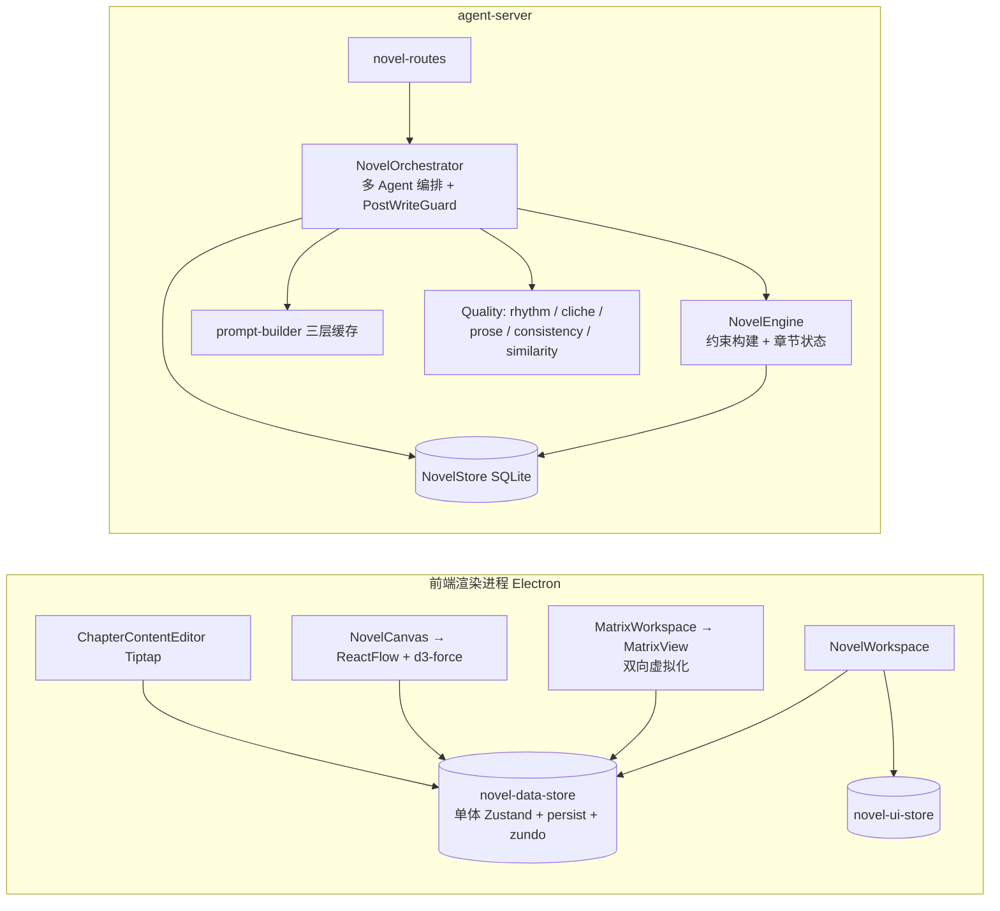

# 小说创作工作台 · 全维度优化方案（代码核查 + 建议）

- 日期：2026-07-22
- 作者：架构师（Bob）· 软件评审团队
- 范围：前端体验/性能 · AI 生成质量 · 架构与技术债 · 新方向探索
- 交付性质：**仅分析建议，不含实现代码**

---

## 0. 范围界定与方法

### 0.1 本次刻意避开的内容（已确认有独立规划，不重复）

根据 `docs/novel/2026-07-22-三方向修改方案-要素追踪-上下文组装-工具校验.md`，以下三项引擎层能力**已经在做**，本方案不再覆盖：

| 已规划方向 | 核心内容 |
| --- | --- |
| 要素变化追踪与按章回退重生 | snapshot 补全、restoreStateFromSnapshot、regenerate 端点、getStoryState 条件修正 |
| 创作时上下文组装 | 查询工具 asOfChapter 时点语义、上下文预览抽屉 |
| Tool 调用行为校验 | 工具插桩、tool-call SSE 事件、三剧本行为测试 |

本方案聚焦上述三项**未充分覆盖**的四个维度，全部基于实代码核查，每个优化点均给出文件/行号级别的证据。

### 0.2 核查方式

- 通读前端 `apps/desktop/src/renderer/src/components/novel/**` 与两个核心 store；
- 通读后端 `novel-plugin/core/**` 的 AI 质量与编排核心模块；
- 用 Grep 统计 `React.memo/useMemo`、`localStorage`、虚拟化、测试覆盖；
- 对比 `ARCHITECTURE.md` / `NOVEL_ARCHITECTURE.md` 设计与实现落差。

### 0.3 当前架构（上下文）



---

## 1. 维度一：前端体验与性能

### 1.1 现状综述

前端渲染性能整体**基础不错**：矩阵做了行列双向虚拟化（`matrix-view.tsx:228-253` 行窗口 + `:176-193` 列窗口），画布用 `ReactFlow` 的 `onlyRenderVisibleElements`（`novel-canvas.tsx:704`）。但存在几处与**实体量级**强相关的成本点：单体 store 的持久化与历史栈、矩阵数据重建的算法复杂度、未 memo 的渲染单元、画布力导向的同步阻塞。

### 1.2 优化点清单表（维度一）

| # | 优化点 | 代码依据 | 优先级 |
| --- | --- | --- | --- |
| F1 | 缩减 localStorage 持久化范围（正文不入 localStorage） | `novel-data-store.ts:415-437` partialize 含 `chapters`（含 content） | **P0** |
| F2 | temporal 历史栈等值比较改为浅比较/分片 | `novel-data-store.ts:468-470` 每次变更对全量 partialize 做 `JSON.stringify` | **P0** |
| F3 | `buildGroups` 历史过滤降为 O(n) 单遍 Map | `matrix-logic.ts:424-427` 内层 `characterHistory.filter` | **P1** |
| F4 | 矩阵单元格/编码组件包 `React.memo` | `matrix-view.tsx:1039-1066` HitCell / EntityMainEncoding 无 memo | **P1** |
| F5 | 画布 force 布局防抖/离主线程 | `novel-canvas.tsx:149-190` 每次实体变更同步跑 800 次 d3-force tick | **P2** |
| F6 | 章节编辑器按章节订阅而非整 `chapters` | `chapter-content-editor.tsx:46,165` 订阅全量数组 | **P2** |
| F7 | 大项目内存预警从"节点数"扩展到"实体总量" | `novel-canvas.tsx:194-200` 仅看 nodeCount | **P2** |

### 1.3 优化点详述

#### F1 · localStorage 持久化包含完整章节正文

- **问题现象**：切项目/刷新后，整本小说的全部章节正文被写进 `localStorage`（key `wenlang-agent-novel-data`）。
- **代码依据**：`novel-data-store.ts:415-437` 的 `partialize` 把 `chapters`、`characters`、`conflicts`… 全部纳入持久化；`chapters` 元素含 `content`（长篇可达数千字/章）。
- **风险/成本**：
  1. localStorage 同步写入且容量上限约 5MB，200 角色 + 50 章正文的体量极易触发 `QuotaExceededError`，导致 persist 抛错并可能中断 store 更新；
  2. 每次 `upsertChapter`（保存/创作回流）都触发一次全量序列化 + 同步写盘，**主线程卡顿**；
  3. 章节正文本质可从后端按需拉取，本地冗余存储收益低、风险高。
- **建议方案**：
  - `partialize` 剔除 `chapters`（正文改由 React Query 缓存/内存持有）；
  - 或仅持久化轻量字段（`id/chapterNumber/title/status/wordCount`），`content` 不落 localStorage；
  - 若需离线可用，改用 `idb-keyval`（IndexedDB）异步存储正文，与 UI 状态 store 解耦。
- **预期收益**：消除配额爆炸风险，保存/回流时主线程不再被大字符串序列化阻塞。
- **优先级**：**P0**（体量一旦上来即功能性故障，非单纯慢）。

#### F2 · zundo temporal 全量 JSON 等值比较

- **问题现象**：任意实体 update/delete/upsert 后，撤销栈的"是否去重"判定要对整个 partialize 状态做 `JSON.stringify` 比较。
- **代码依据**：`novel-data-store.ts:468-470` `equality: (a,b) => JSON.stringify(a) === JSON.stringify(b)`，partialize 含全部实体列表（行 445-466）。
- **风险/成本**：实体量大时每次 state 变更都序列化整个对象图（含所有角色字段、章节正文若未剔除则更糟），成本随实体数线性放大；高频 upsert（如创作回流批量更新）会密集触发。
- **建议方案**：
  - 将 equality 改为**按切片浅比较**（仅比较发生变化的实体列表引用是否已变更，或只比较 `characters/chapters` 等少数大数组的引用相等 + 长度）；
  - 或把 temporal 的 partialize 收窄为真正需要撤销的"画布编排/矩阵编辑"相关字段，排除章节正文等大块数据；
  - 也可引入 `zundo` 的 `handleSet` 节流，避免一帧内多次写入历史。
- **预期收益**：高频实体变更场景下撤销栈维护成本从 O(全量) 降为 O(变更切片)。
- **优先级**：**P0**。

#### F3 · `buildGroups` 历史过滤为 O(n²)

- **问题现象**：角色越多、历史记录越多，矩阵数据重建越慢。
- **代码依据**：`matrix-logic.ts:424-427` 在遍历 `characters` 的循环内对每个角色执行 `characterHistory.filter(h => h.characterId === character.id)`；`buildPool` 同样模式（行 674-682）。整体复杂度 = 角色数 × 历史条数。
- **风险/成本**：`MatrixWorkspace` 虽用 `useMemo` 缓存（`matrix-workspace.tsx` 大量 memo），但**每次相关数据变更都会重算**；200 角色 × 数千条历史即百万级比较，阻塞渲染提交。
- **建议方案**：
  - 先用一次 `Map<characterId, HistoryEntry[]>` 归并（`O(n)`），再在角色循环内 O(1) 查表；
  - 把 `buildGroups`/`buildPool` 的"历史→跨度"计算下沉或缓存到 Web Worker，避免占用主线程。
- **预期收益**：历史重建从 O(n²) 降为 O(n)，大项目矩阵切换/回流后的首屏重建明显变快。
- **优先级**：**P1**。

#### F4 · 矩阵单元格/编码组件未 memo

- **问题现象**：播放头移动、选中态变化、拖拽预览时，可见窗口内所有实体行整体重渲染。
- **代码依据**：`matrix-view.tsx:1039` `HitCell` 对每个可见列渲染；`EntityMainEncoding`（`matrix-view.tsx:1285-1412`）是纯函数式组件但**未用 `React.memo`**；`EntityRow` 内 `arcMarkers` 已用 useMemo，但子组件本身未 memo。
- **风险/成本**：矩阵滚动/选择/高亮频繁触发 `MatrixView` 重渲染，连带所有可见 `HitCell`/`SpanBand`/`ForeshadowEncoding` 重渲染（可见区可达数百节点），在低端机或超大窗口下掉帧。
- **建议方案**：
  - 对 `HitCell`、`EntityMainEncoding`、`SpanBand`、`ForeshadowEncoding`、`GroupRow` 包 `React.memo`；
  - 传给单元格的 `onContextMenu` 等回调统一用 `useCallback` 稳定引用（部分已是，但跨组件传递需整体核对）。
- **预期收益**：选择/高亮/拖拽时仅受影响单元格重渲染，滚动更顺滑。
- **优先级**：**P1**。

#### F5 · 画布 force 布局同步阻塞主线程

- **问题现象**：画布（图谱模式）下，任意实体增删改都会同步重跑 d3-force 模拟，界面短暂卡顿。
- **代码依据**：`novel-canvas.tsx:149-190` `layout` useMemo 依赖全部实体数组；force 模式调 `applyForceLayout`（`force-layout.ts:163-176`）同步跑 `iterations=800` 次 `simulation.tick()`，注释自称"<200 节点 <50ms"，但**在主线程**且对每次实体变更都跑。
- **风险/成本**：大图谱（节点数逼近 `WARNING_THRESHOLD`）时 800 次迭代明显阻塞；若用户边编辑边看画布，拖拽/输入会顿。
- **建议方案**：
  - 对 `layout` 的 force 分支做**防抖**（实体变更后 150-300ms 才重算）；
  - 或将 d3-force 放入 Web Worker，主线程只接收最终坐标；
  - grouped 模式（非 force）不受影响，无需改。
- **预期收益**：画布交互在大数据量下不再因力导向重算卡顿。
- **优先级**：**P2**。

#### F6 · 章节编辑器订阅整个 `chapters` 数组

- **问题现象**：编辑器组件在无关章节变更时也会重算/重渲染。
- **代码依据**：`chapter-content-editor.tsx:46` 订阅 `s.chapters`，并在 `useEffect`（行 165）与 `flushSave`（行 68）里 `chapters.find(...)`；任一章节 `upsertChapter` 都让 `chapters` 引用变更 → 该 effect 重跑（虽有 `loadedChapterIdRef` 守卫不重载，但仍执行 find）。
- **风险/成本**：编辑器内正在输入时，后端回流/自动保存导致 `chapters` 变更，引发多余重渲染与 effect 执行。
- **建议方案**：
  - 用选择器只订阅"当前播放头章节对象"（如 `useNovelDataStore(s => s.chapters.find(c => c.chapterNumber === playhead))`，配合 `useShallow`/稳定引用）；
  - 或将 `flushSave` 改为直接持有所需 chapterId，不再依赖 `chapters` 数组。
- **预期收益**：编辑体验更稳，输入不受章节列表变更干扰。
- **优先级**：**P2**。

#### F7 · 内存预警维度单一

- **问题现象**：仅当画布节点数超阈值才提示"节点过多"，但矩阵/详情/编辑器侧的实体总量压力无提示。
- **代码依据**：`novel-canvas.tsx:194-200` 仅基于 `layout.nodes.length`；而真正的内存大头是单体 store 中的全部实体 + 章节正文（见 F1）。
- **建议方案**：把 Electron 渲染进程内存占用（`performance.memory` / Electron `webFrame` 资源统计）纳入预警；当实体总量或 `chapters` 总字符数超阈值时，在 Workspace 顶部给出"建议精简当前项目缓存/关闭无关面板"提示。
- **预期收益**：大项目下更早暴露内存风险，配合 F1 形成闭环。
- **优先级**：**P2**。

---

## 2. 维度二：AI 生成质量

### 2.1 现状综述

后端已建立一套**程序化 + LLM** 混合的质量防线：确定性形态扫描（`prose-quality-evaluator`）、AI 腔正则（`cliche-scanner`）、节奏控制（`rhythm-controller`）、跨章一致性审计（`consistency-auditor`）、相似实体扫描（`novel-similarity-scanner`）、文风档案（`writing-style-prompt-factory`）。整体方向正确，但存在"**提示词约束强、程序化校验弱**""**节奏是位置函数而非内容函数**""**单点 LLM 调用成本与召回有限**"三类系统性短板。

### 2.2 优化点清单表（维度二）

| # | 优化点 | 代码依据 | 优先级 |
| --- | --- | --- | --- |
| Q1 | 节奏建议由"章节号取模"改为"叙事内容驱动" | `rhythm-controller.ts:171,178` | **P1** |
| Q2 | 文风档案增加程序化合规校验（非仅提示词） | `writing-style-prompt-factory.ts` 仅编译注入；auditor 不查风格 | **P1** |
| Q3 | 修正 `genericSimile` 过宽正则 | `prose-quality-evaluator.ts:83` | **P1** |
| Q4 | 一致性审计接入创作流（非仅按需） | `consistency-auditor.ts` 仅 `audit()` 手动触发 | **P2** |
| Q5 | 相似度扫描改分批/embedding + 传递闭包 | `novel-similarity-scanner.ts:135-296` | **P2** |
| Q6 | ClicheScanner 阈值与误报治理 | `cliche-scanner.ts:112` opening_scenery 等 | **P2** |
| Q7 | 质量门阈值配置化（prompt 可配） | `prose-quality-evaluator.ts` / `cliche-scanner.ts` 阈值硬编码 | **P2** |

### 2.3 优化点详述

#### Q1 · 节奏建议是"章节号取模"而非内容驱动

- **问题现象**：第 15 章与第 1 章节奏相同，长篇小说节奏在 14 章后陷入循环；`arcPosition` 在超过第 14 章后恒为 1（"故事已结束"误判）。
- **代码依据**：
  - `rhythm-controller.ts:171` `const modelIndex = (currentChapter - 1) % model.sequence.length` —— 纯位置；
  - `rhythm-controller.ts:178` `const arcPosition = Math.min(currentChapter / model.sequence.length, 1)` —— 除以固定 14，第 15 章起恒为 1；
  - 仅"故事状态感知修正"（行 189-231）能覆盖少量情形，但主路径仍是取模。
- **风险/成本**：长篇（200+ 章）节奏单调循环，高潮/舒缓分布失真；`arcPosition` 失真影响 `generateReason` 文案（行 300-306 永远走"接近尾声"分支）。
- **建议方案**：
  - 节奏模型改为**按故事阶段（StoryStage）+ 活跃冲突/伏笔紧迫度**主导，章节号仅作微调；
  - `arcPosition` 改为相对"全书计划总章数/当前卷进度"滚动计算（如 `currentChapter / max(plannedTotal, currentVolumeChapters)`），避免提前封顶；
  - 支持每卷独立节奏模型（每卷重置弧线位置）。
- **预期收益**：长篇节奏曲线更自然，与叙事强度匹配。
- **优先级**：**P1**（影响长篇整体可读性，且是结构性缺陷）。

#### Q2 · 文风档案仅提示词约束，无程序化合规校验

- **问题现象**：文风档案（人称/距离/句式/语域/情感温度/意象密度）全靠 Writer/Reviser/Reviewer "自觉遵守"，没有自动检测"是否真的用第三人称/是否切换视角/情感温度是否越界"。
- **代码依据**：`writing-style-prompt-factory.ts` 仅把 profile 编译成提示词段注入 Agent 身份层；`consistency-auditor.ts` 的 4 项检查（伏笔/钩子/孤儿实体/时间线）**完全不涉及文风维度**；`prose-quality-evaluator.ts` 只测形态（段落/对话比/模板句式），不测人称/距离/语域。
- **风险/成本**：文风漂移（如意外切第一人称、滥用全知旁白）无法被自动捕获，只能靠人工审稿发现；与"文风一致性"这一核心卖点直接冲突。
- **建议方案**：
  - 在 `prose-quality-evaluator` 增加**轻量确定性指标**：视角一致性（同场景 POV 切换检测）、人称占比（统计"我/俺"等第一人称标记密度，对照 profile.narrativePerson）、对话占比对照 `dialogueRatio` 阈值告警；
  - 或新增 `StyleComplianceAuditor`，与 `ConsistencyAuditor` 并列，输出风格偏离报告，可作为 Reviewer 的硬输入。
- **预期收益**：文风档案从"软约束"升级为"可验证"，提升一致性口碑。
- **优先级**：**P1**。

#### Q3 · `genericSimile` 正则过宽导致大量误报

- **问题现象**：任意含"像"的句子都被计入"泛化比喻"，正文稍长即触发 `generic_simile` 告警，污染形态评分。
- **代码依据**：`prose-quality-evaluator.ts:83` `genericSimile: /像(?:是|有|一|某|什么|被|在)?[^，。！？\n]{1,24}/g` —— "他像往常一样坐下""像所有年轻人那样"等正常表达全部命中；阈值 `>= 2.5 per thousand`（行 123）仍易触发。
- **风险/成本**：ProseQuality 评分被拉低 → 进入 Reviewer 时被误判"比喻密度偏高"，干扰真实 morphology 判断；长期可能诱导模型规避所有"像"字，损失表达。
- **建议方案**：
  - 收窄为"比喻词 + 比喻标记词"组合（如 `/(如同|犹如|仿佛|宛若|恰似|好似)[^，。！？\n]{2,20}(一般|似的|一样|般)/`），排除"像+名词/代词"的普通比较；
  - 或改用"比喻词密度"相对阈值 + 抽样人工校准，避免绝对计数。
- **预期收益**：形态评分更可信，Reviewer 收到的信号更干净。
- **优先级**：**P1**。

#### Q4 · 一致性审计未接入创作流

- **问题现象**：伏笔过期、钩子悬挂、孤儿实体等只能在 `consistency-audit-panel` 手动触发查看，创作过程中不会自动预警。
- **代码依据**：`consistency-auditor.ts` 仅暴露 `audit(projectId)`（行 80），由面板调用；编排流 `novel-orchestrator.ts` 的 Reviewer 阶段只做单章 10 维评分，不调用全书审计（文档亦明确"Reviewer 只做单章审稿"）。
- **风险/成本**：长篇小说写到中段才人工审计，发现"伏笔过期 50 章"时已难回收，返工成本高。
- **建议方案**：
  - 在创作流**完成/发布钩子**上轻量调用 `audit()`（可仅跑增量：只检查本章及最近 N 章相关实体），把 urgent/expired 项作为 Reviewer 的附加输入或作者 toast；
  - 控制成本：审计本身是确定性无 LLM，单次开销可控（见 Q-性能注：当前 `auditOrphanCharacters` 对每个角色 `listCharacterHistory` 是 N 次 DB 查询，需先优化为单查询 + 内存分组）。
- **预期收益**：一致性问题"早发现、早回收"，降低长线返工。
- **优先级**：**P2**。

#### Q5 · 相似度扫描单 LLM 调用 + 无传递闭包

- **问题现象**：全部 8 类实体一次性塞进一个 LLM 调用；只能发现直接相似对，无法识别 A≈B、B≈C 但 A≠C 的传递链。
- **代码依据**：`novel-similarity-scanner.ts:135-296` `buildUserPrompt` 枚举所有实体字段；单次 `session.promptStream`（行 86）；`sanitizeGroups` 仅做 ID 唯一性校验（行 392-436），无相似关系闭包。
- **风险/成本**：
  - 大项目（200 角色 + 全字段）单次 prompt 极大，token 成本高、易截断、质量下降；
  - 漏报传递相似，去重不彻底。
- **建议方案**：
  - 改用 **embedding 预聚类**：先对所有实体名/关键字段做向量化，按余弦相似度预筛候选对，再对候选小批送 LLM 判定，成本与召回双优；
  - 或在 LLM 结果上做**传递闭包合并**（A~B、B~C ⇒ 同组），再交用户确认。
- **预期收益**：扫描更省、更全，大项目可用。
- **优先级**：**P2**。

#### Q6 · ClicheScanner 阈值/误报治理

- **问题现象**：部分模式阈值偏严或正则偏宽，存在题材相关误报。
- **代码依据**：`cliche-scanner.ts:112` `opening_scenery: /^[^"「『]{0,5}(天|云|风|雨|月|日|...)/g` —— 开头第一句若写"云层里..."即触发"开头纯风景"，但合理开篇（"风卷着雪粒打在脸上"）也中；`deep_inside`（行 94）`/(内心深处|灵魂深处...)/g` threshold=1 偏严；`long_paragraph`（行 276）任意一段 >200 字即报。
- **建议方案**：
  - `opening_scenery` 增加"随后 N 字仍为环境描写"的二次确认（避免单字命中）；
  - 对文学性题材放宽容忍度，或把阈值/启用列表做成 **prompt 可配**（见 Q7）；
  - 与 Q3 同理，建立少量人工标注样本做回归。
- **预期收益**：减少误报对 Reviewer 的干扰，提升作者信任。
- **优先级**：**P2**。

#### Q7 · 质量门阈值配置化

- **问题现象**：形态/AI 腔的触发阈值散落硬编码在各 scanner，不同题材（悬疑/言情/玄幻）难差异化。
- **代码依据**：`prose-quality-evaluator.ts:103-131` 与 `cliche-scanner.ts:43-205` 的 threshold/severity 均为常量；无外部配置入口。
- **建议方案**：把阈值/启用项纳入 `novel_style_guides` 或项目级配置（与现有"风格指南"表同构），由 `prompt-builder` 注入 Reviewer；默认值保持现状，允许项目覆盖。
- **预期收益**：质量策略可按题材调优，且无需改代码即可迭代。
- **优先级**：**P2**。

---

## 3. 维度三：架构与技术债

### 3.1 现状综述

后端 `novel-plugin` 分层清晰（core / routes / stores），但存在**编排器单体过大、引擎与编排职责边界模糊、测试覆盖不均、巨型文件、重复逻辑、类型安全缺口**等典型技术债。前端则"组件多但组件测试极少"。

### 3.2 优化点清单表（维度三）

| # | 优化点 | 代码依据 | 优先级 |
| --- | --- | --- | --- |
| A1 | 清理 `NovelEngine.createChapter` 死计算 | `novel-engine.ts:449` | **P1** |
| A2 | 编排器拆分（Director/Writer/... 阶段 handler） | `novel-orchestrator.ts` 单体 ~900+ 行 | **P1** |
| A3 | 补齐核心模块单测（engine/auditor/scanner/prompt-builder） | `novel-plugin/__tests__` 仅 routes+cliche+aggregation | **P1** |
| A4 | 前端组件测试补强（Matrix/Canvas/Workspace/Forms） | 仅 logic/utils 有测试 | **P2** |
| A5 | `prompt-builder.ts` 巨型文件拆分 | 引用行号至 2027 | **P2** |
| A6 | 去重：cliche vs prose 重叠 + `computeMaxChapter` 栈风险 | `prose-quality-evaluator.ts:81-85` vs `cliche-scanner.ts` | **P2** |
| A7 | 类型安全：`any` cast 与接口收口 | `novel-canvas.tsx:496` `(e.data as any)` | **P2** |

### 3.3 优化点详述

#### A1 · `NovelEngine.createChapter` 调用约束构建但丢弃结果

- **问题现象**：创建章节时执行了昂贵的约束构建（多次 DB 查询），但结果从未使用。
- **代码依据**：`novel-engine.ts:449` `const constraints = this.buildChapterConstraints(projectId, chapterNumber)` —— 后续仅用 `chapterNumber` 建记录，`constraints` 变量再未被读取；行 470-471 注释已自承"prompt-builder 无副作用，历史遗留死代码已删"，但此处死计算未清。
- **风险/成本**：每次 `createChapter`（含 `create-flow`/`ai-arrange` 入口）都白白跑 `listConstraints/listForeshadowing/listCharacters/listConflicts/listInformationLayers` + 信息层 `listEdgesByEntity` 循环（行 180-203），浪费 DB 往返与 JSON 解析。
- **建议方案**：删除该行死计算；若 orchestrator 需要约束，由 orchestrator 显式调用并复用（见 A2 职责收口）。
- **预期收益**：建章路径少一轮重查询，编排延迟下降。
- **优先级**：**P1**（明显的免费优化 + 代码异味）。

#### A2 · 编排器单体过大、职责边界模糊

- **问题现象**：`NovelOrchestrator` 同时承担流程编排、四个 Agent 阶段、检查点、SSE、PostWriteGuard、候选评分、状态快照、回退——单文件过长，难以测试与演进。
- **代码依据**：`novel-orchestrator.ts` 行号延伸至 951+；`createChapterWithFlow` 内含 director→writer→reviewer→reviser→memory 全链路；`runPostWriteGuard`（行 959）、`scoreWriterCandidate`（行 1097）等内聚性差。
- **风险/成本**：改动任一阶段易引发回归；单测只能覆盖 `runPostWriteGuard` 等少数入口（`novel-orchestrator-run-context.test.ts`），无法独立验证各阶段。
- **建议方案**：
  - 将各阶段抽为 `phases/director-phase.ts` 等纯函数/类（输入上下文、输出结果），orchestrator 仅做串联与检查点；
  - 约束构建统一收口到 `NovelEngine`（A1 的去向），orchestrator 只消费。
- **预期收益**：可测试性、可维护性提升，为后续质量策略迭代打基础。
- **优先级**：**P1**。

#### A3 · 核心后端模块单测缺口

- **问题现象**：质量与编排核心逻辑缺乏单元测试，仅靠手动端到端验证。
- **代码依据**：`novel-plugin/__tests__` 仅有 `chapter-routes / volume-routes / cliche-scanner / matrix-aggregation-routes / chapter-renumber / arranged-entities`；**`NovelEngine`、`ConsistencyAuditor`、`NovelSimilarityScanner`、`prompt-builder`、`RhythmController`、`writing-style-prompt-factory` 均无单测**。
- **风险/成本**：A1/A2 与 Q 系列重构时无安全网；`prompt-builder` 作为成本核心一旦改坏影响所有 Agent。
- **建议方案**：优先补 `prompt-builder`（缓存分层/哈希）、`ConsistencyAuditor`（各检查边界）、`RhythmController`（阶段/arcPosition）、`NovelEngine.buildChapterConstraints`（约束正确性）的单测。
- **预期收益**：重构与阈值调优可放心进行。
- **优先级**：**P1**。

#### A4 · 前端组件测试补强

- **问题现象**：前端组件测试几乎空白，只有少量 logic/utils 测试。
- **代码依据**：`components/novel/__tests__` 仅有 `writing-style-profile-editor / chapter-task / outline-tree / chapter-content-editor / novel-undo / matrix-*（logic 级）`；**`MatrixView`、`EntityRow`、`NovelCanvas`、各 `nodes/*`、`detail-forms/*`、`novel-workspace` 均无组件测试**。这与任务书"前端组件测试偏薄"一致。
- **建议方案**：用 `@testing-library/react` 补关键交互组件测试——矩阵单元格点击/拖拽、画布节点增删、详情表单提交；以 `matrix-view` 已有虚拟化测试为样板。
- **预期收益**：前端重构（F 系列）有回归保护。
- **优先级**：**P2**。

#### A5 · `prompt-builder.ts` 巨型文件

- **问题现象**：提示词构建核心集中在单一文件（引用行号至 2027），阅读/修改成本高。
- **代码依据**：`ARCHITECTURE.md` 与 `novel-orchestrator.ts:254` 均引用 `prompt-builder` 内部方法；行号跨度 >2000。
- **建议方案**：按"系统提示词 / 章节上下文 / 各 Agent 格式化子段 / 缓存诊断"拆分为 `prompt-builder/` 子模块，保留现有公共导出。
- **预期收益**：降低认知负荷，减少改一处影响全局的风险。
- **优先级**：**P2**。

#### A6 · 重复代码与潜在栈溢出

- **问题现象**：质量扫描逻辑重复；`computeMaxChapter` 对超大数组用 `Math.max(...spread)` 有栈溢出风险。
- **代码依据**：
  - `prose-quality-evaluator.ts:81-85` 与 `cliche-scanner.ts` 都实现 `binaryContrast / explanatoryTone / genericSuspense / metaWriting` 类检测，逻辑重叠；
  - `matrix-logic.ts:643-648` `Math.max(...valid, 20)` —— 若章节数组极大（万级），spread 可能 RangeError。
- **建议方案**：
  - 把共享形态检测抽为 `scan-shared.ts`，两个 scanner 复用；
  - `computeMaxChapter` 改为 `reduce` 取最大值。
- **预期收益**：减少漂移、消除极端边界崩溃。
- **优先级**：**P2**。

#### A7 · 类型安全缺口

- **问题现象**：画布边高亮等逻辑使用 `any` 强转，绕过类型检查。
- **代码依据**：`novel-canvas.tsx:496` `const { highlightOverride, ...restData } = e.data as any`；多处 `e.data?.xxx` 依赖运行时字段约定。
- **建议方案**：为 `Edge['data']` 定义显式类型（`NovelEdgeData { auto: boolean; edgeId?: string; highlightOverride?: boolean; origStyle?: CSSProperties }`），消除 `as any`。
- **预期收益**：边高亮/过滤逻辑在编译期可校验，减少隐性 bug。
- **优先级**：**P2**。

---

## 4. 维度四：新方向探索（代码核查中发现的其他有价值优化）

### 4.1 现状综述

除前三维度外，核查还发现若干**跨分类、当前未规划但价值明确**的方向：可观测性缺失、创作流并发保护、质量自动回归、离线兜底等。

### 4.2 优化点清单表（维度四）

| # | 优化点 | 代码依据 | 优先级 |
| --- | --- | --- | --- |
| N1 | 创作成本/缓存命中仪表盘 | `cache-diagnostics` 仅返回 hash，无 token/成本 | **P1** |
| N2 | 创作流并发重入保护 | `novel-orchestrator.ts` create-flow 无锁（arrange 有锁） | **P1** |
| N3 | 质量自动回归基线（章节 diff） | 现有审计均为"即时"，无历史基线 | **P2** |
| N4 | 前端性能监控（long-task/内存） | 仅画布节点数预警（见 F7） | **P2** |
| N5 | 相似度/去重增量与 embedding 化 | 见 Q5 | **P2** |
| N6 | 离线/弱网兜底与创作流断点续传 | SSE 失败无本地草稿恢复 | **P2** |
| N7 | 配置化质量阈值统一入口 | 见 Q7 | **P2** |

### 4.3 优化点详述

#### N1 · 创作成本与缓存命中可观测性

- **问题现象**：知道缓存"哈希"，但不知道每次创作花了多少 token、三层缓存各自命中率、哪类 Agent 最贵。
- **代码依据**：`novel-routes.ts` 的 `cache-diagnostics` 仅返回 4 个 Agent 的 system/chapter 上下文 hash（`ARCHITECTURE.md:10.11`），无 token 估算与成本汇总；`novel_agent_logs` 存三层 prompt 但无聚合视图。
- **建议方案**：在 `cache-diagnostics`/agent-logs 上增加 token 估算（已有 `formatChapterContext` 分段，补 token 计数即可）与"本章总成本/缓存节省"汇总，前端加一个轻量"成本面板"。
- **预期收益**：让作者感知成本，指导精简实体编排、验证三层缓存收益。
- **优先级**：**P1**（低成本高信息量，契合"可观测性"方向）。

#### N2 · 创作流并发重入保护

- **问题现象**：`ai-arrange` 有 `aiArrangeLocks` 防并发（`ARCHITECTURE.md:7.1`），但 `create-flow` 未见同等锁；同一章同时发起两次 create-flow 会双写、状态污染。
- **代码依据**：`novel-orchestrator.ts` `createChapterWithFlow` 入口无 `projectId:chapterNumber` 维度的进行中标记；`finally` 仅清 `currentArrangedEntities`。
- **建议方案**：为 create-flow 增加与 arrange 同构的 `createFlowLocks`（内存 Map 或基于 `novel_agent_logs` 的"进行中"标记），重复触发直接拒绝并提示"本章正在创作"。
- **预期收益**：避免并发双写导致的数据不一致与 token 浪费。
- **优先级**：**P1**（功能性正确性）。

#### N3 · 质量自动回归基线

- **问题现象**：质量扫描都是"当前章即时判断"，没有跨章节的质量趋势基线，无法回答"这一章比上一章差在哪"。
- **代码依据**：`prose-quality-evaluator` / `cliche-scanner` 只输出当章报告；`consistency-auditor` 输出全书快照但无历史对比。
- **建议方案**：把每章的质量评分/问题存为轻量时间序列（`novel_chapter_reviews` 已含 10 维评分，可扩展），提供"质量趋势"曲线与"相邻章 diff"，让作者看到退化点。
- **预期收益**：质量可控性从"单点"升级为"趋势"，契合"生成结果可控性"诉求。
- **优先级**：**P2**。

#### N4 · 前端性能监控

- **问题现象**：无生产环境渲染性能/内存监控，问题靠用户体感上报。
- **代码依据**：前端无 `performance.monitor` / `PerformanceObserver(longtask)` 埋点；仅画布节点数预警（F7）。
- **建议方案**：在 Workspace 挂载 `PerformanceObserver` 监控 long-task 与内存，超阈时上报到现有通知/日志通道（非阻塞、可关闭）。
- **预期收益**：为 F 系列优化提供量化依据，提前发现大项目卡顿。
- **优先级**：**P2**。

#### N5 · 相似度/去重增量与 embedding 化

- 并入 Q5（见维度二），此处不重复展开。

#### N6 · 离线/弱网兜底与断点续传

- **问题现象**：创作流依赖 SSE，网络中断后无本地草稿恢复，作者可能丢失"已生成但未落库"的正文。
- **代码依据**：`use-novel-creation-flow.ts` 监听 SSE；`ChapterContentEditor` 的只读模式显示流式内容（行 232-240），但中断后无回写。
- **建议方案**：SSE 异常时把已接收的 `creationChapterContent` 暂存为"未保存草稿"（localStorage 小字段即可，呼应 F1 的"正文不入大 store"），恢复后提示用户继续/丢弃。
- **预期收益**：弱网体验更稳，降低创作中断焦虑。
- **优先级**：**P2**。

#### N7 · 配置化质量阈值统一入口

- 并入 Q7（见维度二）。

---

## 5. 跨维度总体优先级排序与实施节奏

### 5.1 优先级总览（按 P 聚合）

| 优先级 | 编号 | 优化点 | 维度 |
| --- | --- | --- | --- |
| **P0** | F1 | localStorage 持久化剔除正文 | 前端性能 |
| **P0** | F2 | temporal 等值比较改浅比较/分片 | 前端性能 |
| **P1** | F3 | buildGroups O(n²)→O(n) | 前端性能 |
| **P1** | F4 | 矩阵单元格组件 memo | 前端性能 |
| **P1** | Q1 | 节奏改为内容驱动 | AI 质量 |
| **P1** | Q2 | 文风档案程序化合规 | AI 质量 |
| **P1** | Q3 | genericSimile 正则修正 | AI 质量 |
| **P1** | A1 | 清理 createChapter 死计算 | 架构债 |
| **P1** | A2 | 编排器阶段拆分 | 架构债 |
| **P1** | A3 | 核心模块单测补齐 | 架构债 |
| **P1** | N1 | 成本/缓存命中仪表盘 | 新方向 |
| **P1** | N2 | 创作流并发重入保护 | 新方向 |
| **P2** | F5 | 画布 force 防抖/Worker | 前端性能 |
| **P2** | F6 | 编辑器按章节订阅 | 前端性能 |
| **P2** | F7 | 内存预警扩展 | 前端性能 |
| **P2** | Q4 | 一致性审计接入创作流 | AI 质量 |
| **P2** | Q5 | 相似度 embedding/闭包 | AI 质量 |
| **P2** | Q6 | ClicheScanner 误报治理 | AI 质量 |
| **P2** | Q7 | 质量阈值配置化 | AI 质量 |
| **P2** | A4 | 前端组件测试补强 | 架构债 |
| **P2** | A5 | prompt-builder 拆分 | 架构债 |
| **P2** | A6 | 去重 + 栈溢出修复 | 架构债 |
| **P2** | A7 | 类型安全收口 | 架构债 |
| **P2** | N3 | 质量回归基线 | 新方向 |
| **P2** | N4 | 前端性能监控 | 新方向 |
| **P2** | N6 | 离线/弱网兜底 | 新方向 |

> 注：N5、N7 已分别并入 Q5、Q7，不单列计数。

### 5.2 建议实施节奏（按 PR 拆分）

```mermaid
graph LR
    PR_A[PR-A 性能地基<br/>F1 F2 F3 F4] --> PR_B[PR-B 质量可信<br/>Q1 Q2 Q3 N1]
    PR_A --> PR_C[PR-C 架构加固<br/>A1 A2 A3 N2]
    PR_B --> PR_D[PR-D 质量深化<br/>Q4 Q5 Q6 Q7]
    PR_C --> PR_E[PR-E 前端测试+DX<br/>A4 A5 A6 A7 F5 F6 F7]
    PR_D --> PR_F[PR-F 可观测与韧性<br/>N3 N4 N6]
    PR_B -.可并行. PR_C
    PR_D -.可并行. PR_E
```

| PR | 内容 | 维度 | 依赖 | 验证点 |
| --- | --- | --- | --- | --- |
| **PR-A** | 持久化瘦身 + temporal 浅比较 + buildGroups 优化 + 矩阵 memo | 前端性能 | 无 | 200 角色项目切换不报错；矩阵滚动帧率≥50fps |
| **PR-B** | 节奏内容驱动 + 文风合规校验 + simile 正则修正 + 成本仪表盘 | AI 质量/新方向 | 无（与 A 并行） | 长篇小说节奏曲线多样；风格偏离可报告；成本面板可见 |
| **PR-C** | 编排器拆分 + 清理死计算 + 核心单测 + create-flow 锁 | 架构债/新方向 | 无（与 A/B 并行） | 单测绿；重复 create-flow 被拒 |
| **PR-D** | 一致性审计入流 + 相似度 embedding/闭包 + cliche 治理 + 阈值配置 | AI 质量 | PR-B | 审计在发布钩子触发；相似度召回提升 |
| **PR-E** | 前端组件测试 + prompt-builder 拆分 + 去重/栈溢出 + 类型收口 + 画布防抖/订阅优化 | 架构债/前端性能 | PR-A/C | 组件测试覆盖关键交互；无 any 强转 |
| **PR-F** | 质量回归基线 + 前端性能监控 + 离线兜底 | 新方向 | PR-B/D | 质量趋势曲线；弱网草稿可恢复 |

**排期原则**：
1. P0（F1/F2）先行且独立，属"不修即可能故障"项；
2. PR-A/B/C 三路可**并行**启动，分别由前端、质量、架构负责人认领；
3. PR-D/E 依赖前置的质量/架构地基；PR-F 为收口增强，可后置。
4. 所有 PR 保持"仅建议、可灰度"，每 PR 配对应单测/组件测试（呼应 A3/A4）。

---

## 附录：核查证据清单（关键文件/行号）

| 维度 | 文件 | 关键行号 | 用途 |
| --- | --- | --- | --- |
| 前端性能 | `stores/novel-data-store.ts` | 415-437, 468-470 | 持久化范围 / temporal 等值 |
| 前端性能 | `components/novel/matrix/matrix-logic.ts` | 424-427, 643-648 | O(n²) 过滤 / Math.max 栈风险 |
| 前端性能 | `components/novel/matrix/matrix-view.tsx` | 176-253, 1039-1412 | 双向虚拟化 / 未 memo 单元 |
| 前端性能 | `components/novel/novel-canvas.tsx` | 149-190, 194-200, 496, 704 | force 同步 / 节点预警 / any / onlyRenderVisible |
| 前端性能 | `components/novel/chapter-content-editor.tsx` | 46, 68, 165 | 整 chapters 订阅 |
| 前端性能 | `components/novel/novel-workspace.tsx` | 890 | 矩阵/画布三元挂载（无双挂） |
| AI 质量 | `core/rhythm-controller.ts` | 171, 178, 189-231 | 位置取模 / arcPosition 封顶 |
| AI 质量 | `core/writing-style-prompt-factory.ts` | 全文 | 仅编译注入，无校验 |
| AI 质量 | `core/prose-quality-evaluator.ts` | 81-85, 103-131 | 重叠检测 / genericSimile 过宽 |
| AI 质量 | `core/cliche-scanner.ts` | 43-205 | 阈值/误报 |
| AI 质量 | `core/consistency-auditor.ts` | 80, 216, 232 | 仅手动审计 / N 次 DB 查询 / includes |
| AI 质量 | `core/novel-similarity-scanner.ts` | 135-296 | 单 LLM 全量 / 无闭包 |
| 架构债 | `core/novel-engine.ts` | 449, 470-471 | 死计算 |
| 架构债 | `core/novel-orchestrator.ts` | 959, 1097, 全文 | 单体编排 |
| 架构债 | `plugins/novel-plugin/__tests__/` | 目录 | 测试覆盖缺口 |
| 架构债 | `components/novel/__tests__/` | 目录 | 前端组件测试缺口 |
| 新方向 | `novel-routes.ts` / `cache-diagnostics` | ARCHITECTURE 10.11 | 仅 hash 无成本 |
| 新方向 | `core/novel-orchestrator.ts` | createChapterWithFlow | create-flow 无锁 |

> 说明：本方案所有结论均来自对上述文件的实读与 Grep 统计，未覆盖已规划的三方向引擎层内容（要素回退/上下文组装/工具校验）。
