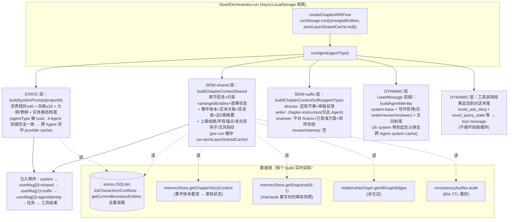
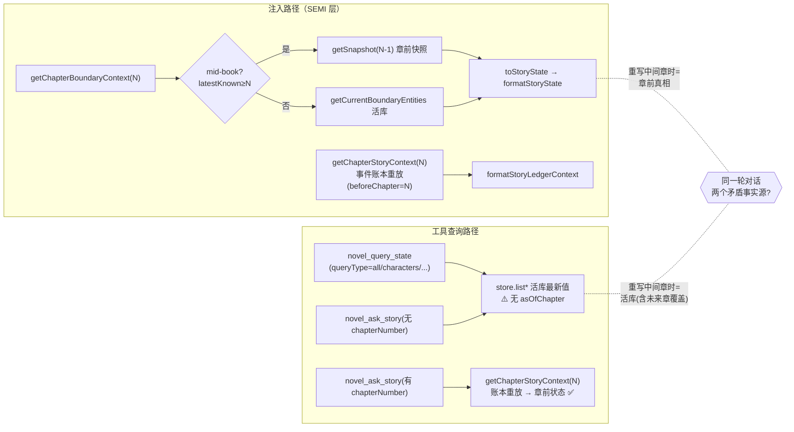

# 小说上下文构建（Context Building）机制架构评估

- **评估对象**：`apps/agent-server/src/plugins/novel-plugin/core/prompt-builder.ts` 及其协作模块（prompt-manager / agent-run-utils / novel-orchestrator / novel-tools / novel-memory-store）
- **评估人**：Bob（Architect）
- **日期**：2026-07-29
- **任务性质**：聚焦架构评估（仅分析，不改代码）
- **结论速览**：当前"三层缓存 + arrangedEntities 精准注入 + 按 Agent 差异注入"在**当前产品规模下基本合理、成本收益优秀**，但存在 **1 个 P0 正确性问题（注入 vs 工具查询双事实源）** 与若干 P1/P2 可观测性、长篇小说伸缩性、兜底健壮性风险。评级：**基本合理，但有重大改进空间**。

---

## 一、现状架构核查（基于真实代码）

### 1.1 三层缓存结构（已确认）

`prompt-builder.ts:1-66` 的头部注释与 `buildSystemPrompt`（`:519`）/`buildChapterContextShared`（`:678`）/`buildChapterContextSuffix`（`:844`）/`buildAgentIdentity`（`:617`）共同定义了三层：

关键代码事实：

- **STATIC 层只含静态数据**：`buildSystemPrompt`（`:519-603`）明确 `void agentType`（`:520`），且注释声明"只读取静态数据，不读取动态状态，也不读取角色定义"（`:499`）。世界规则 `.slice(0,40)`（`:574`）、风格 `.slice(0,20)`（`:585`）做了上限截断。
- **Agent 身份从 system 剥离**：原本放在 `system` 末尾的 `system-base.md` 因"cache_control 打在 system 末尾，agent_type 不同 → 整块 cache miss"而被移到 `buildAgentIdentity` 注入 userMessage 前缀（`:591-600`、`:606-639`）。这是一次有效的跨 Agent 缓存收益优化。
- **SEMI-shared 跨 Agent 完全一致**：`buildChapterContextShared` 的注释强调"输出必须对所有 Agent 完全一致（不依赖 agentType）"（`:665`），并在 orchestrator 中以 `run.semiLayerSharedCache` 做 per-run 单构建缓存（`:1245-1269`），Director 写入后其余 Agent 命中。
- **DYNAMIC 层尾插**：工具结果作为 tool message 追加到对话末尾，前缀（system + 早期消息）不变（`:2854-2864` 的写工具注释 + `:1289-1303`）。

### 1.2 arrangedEntities 精准注入（已确认）

编排实体（characterIds / conflictIds / foreshadowIds / clueIds / factionIds / locationIds / itemIds）由前端手动选择或 AI 章纲编排产出，经 `orchestrator.createChapterWithFlow` → `runStorage.run({arrangedEntities})`（`:139-145`）→ `run.arrangedEntities`（`:157`）→ 传入 `buildChapterContextShared`（`:1262`）。

- **有编排时**：`formatArrangedEntities`（`:1276-` ）注入本章实体的完整静态+动态定义；`formatStoryState` 改为**严格按 arrangedEntities 筛选**（`:1751-1842`），仅补充"编排角色之间的关系"与"编排角色拥有的物品状态"，非编排实体被隔离（`:1837-1839`）。
- **无编排时（兜底）**：`formatStoryStateFullFallback`（`:1850-`）注入**全量**精简状态（角色≤12、关系≤12、冲突≤10、伏笔≤12、线索≤8、势力≤8…），即「让 LLM 知道存在」的旧行为。
- **占位实体过滤**：`formatArrangedEntities`（`:1349-1354`）与 fallback（`:1766-1767`）都过滤名字含"（待定）/待补充/测试角色"的占位实体，避免污染上下文。

### 1.3 按 Agent 差异注入（已确认）

| Agent | SEMI-shared | SEMI-suffix | 写作铁律 | chapter-instruction |
|---|---|---|---|---|
| director | 共 | 宏观节奏 + 审稿反馈回流 | 否 | 否 |
| writer | 共 | **创作指令（仅此）** | 是 | **是（仅此）** |
| reviewer | 共 | 平台 Rubric + 已批准方案 + 矩阵验收 | 是 | 否 |
| reviser | 共 | 空 | 是 | 否 |
| memory | 共 | 空 | 否 | 否 |

差异注入的动机（注释佐证）：chapter-instruction 含"直接输出正文"，对 Director/Reviewer 注入会致越权（`:885-887`）；写作铁律给 Director/Memory 会污染其示范（`:622-625`）；矩阵验收段只对 Reviewer 有意义（`:872-874`）。逻辑集中在 `buildChapterContextSuffix`（`:844-915`）。

### 1.4 运行态隔离与缓存（已确认）

- **并发隔离**：`AsyncLocalStorage<CreationRunContext>`（`:91`、`:139`），并发章节不共享 `arrangedEntities` / `semiLayerSharedCache`（ARCHITECTURE.md:346）。
- **SEMI-shared per-run 缓存**：`run.semiLayerSharedCache`（`:250-269`、`:1250-1268`），key = `projectId|chapterNumber`，每次 `createChapterWithFlow`（含 rewrite 递归）清空（`:158-160`）。→ 每章仅构建 1 次 shared，4 个 Agent 复用。
- **审计缓存 60s TTL**：`getCachedAudit`（`:2920-2941`），覆盖单章 4 Agent 调用周期。
- **诊断 hash 仅为观测**：`getSystemPromptHash` / `getChapterContextHash`（`:3185-3210`）用 SHA-256 前 16 位，**仅用于诊断，不参与任何本地缓存失效决策**。

### 1.5 双事实源：注入 vs 工具查询（核心矛盾点）

**证据**：
- 注入路径对 mid-book 章节走 `getSnapshot(chapterNumber-1)`（`:2672-2687`）+ `getChapterStoryContext` 账本重放（`:711-720`、`novel-memory-store.ts:1189-1227`）→ 章前时点。
- `novel_query_state`（`:949-1011`）**永远读活库** `store.list*`（`:962-999`），**没有任何章节时点参数**。
- `novel_ask_story` 仅当调用方显式传 `chapterNumber` 才走账本（`:615-621`），否则读活库（`:623-648`）。
- 即：**重写第 N 章（N 在书中间，后续章已有内容）时，SEMI 注入的是"第 N-1 章末真相"，而 Agent 若调 `novel_query_state` 会拿到"被第 N+1… 章覆盖后的最新值"**——同一轮对话里存在两个互相矛盾的事实源。这比"不查"更危险（AI 会自信地引用错误时点状态）。

该问题在 `2026-07-22 三方向修改方案` 第 2.2 节已被识别，计划通过给工具加 `asOfChapter` 参数解决，但**截至本评估，代码中尚无 `asOfChapter` 落地**（全仓 grep 无 `asOfChapter` 引用）。

---

## 二、合理性评估

### 2.1 优点（设计动机与收益 — 真实且有效）

1. **成本经济性优秀（针对当前规模）**：STATIC 层内容有硬上限（世界规则≤40、风格≤20、大纲/卷纲固定），**与实体总数无关**；SEMI 层在有 arrangedEntities 时被编排边界约束，token 量≈ O(本章编排量 + 近 5 章摘要)，**不随全书实体量线性增长**。这是最重要的一条优点——长篇小说实体累积不会直接撑爆每章上下文。
2. **prompt cache 命中率优化到位**：① 把易变的 Agent 身份从 system 移到 userMessage（`:591-600`）；② SEMI-shared 跨 Agent 完全一致 + per-run 缓存（`:1245-1269`）；③ 工具结果尾插不破坏前缀（`:2854-2864`）；④ 列表排序用 `(category,id)` 双键保证确定性（`:569-573`）。这些是针对 Anthropic/OpenAI prompt-cache 前缀匹配语义的精准优化。
3. **编排控制（orchestration control）保留**：arrangedEntities 让"本章必须出场的实体"被显式约束，且 `formatStoryState` 严格隔离非编排实体（`:1751-1839`），避免 Writer 被未选实体干扰、绕过编排。这是产品差异化能力（矩阵/画布编排）在 prompt 层的落地。
4. **防"未来章倒灌"做得细**：近章摘要按 `chapterNumber` 倒序精确向前取（`:754-765`），而非 `listRecentChapters` 全局 DESC（注释详述了旧实现的剧情错乱 bug，`:740-753`）；mid-book 重写走快照（`:2672-2687`）。
5. **可降级**：编排缺失有全量兜底（`:1850-`）、auditor 缺失有本地计算降级（`:2868-2890`）、快照损坏有 try/catch 回退（`:2683-2685`）。
6. **已具备基础可观测性**：诊断 hash（`:3185-3210`）+ `novel_agent_logs` 存三层全文 + 耗时（ARCHITECTURE.md:100）。

### 2.2 问题与风险（均附代码/行号佐证）

**P0 — 双事实源不一致（mid-book 重写）**
- 如上 §1.5：注入走章前快照/账本（`:2672-2687`、`:711-720`），而 `novel_query_state` 走活库（`:949-1011`）。重写中间章节时两个事实源矛盾。最严重，因会静默产出"看似合理但时点错误"的正文。
- 影响面：`novel-multi-agent` 工作流中 Director/Writer/Reviewer 都持有 `novel_ask_story`（novel-agents.ts:67/93/126），很可能触发。

**P1 — 兜底路径（无 arrangedEntities）破坏成本模型与控制意图**
- `formatStoryStateFullFallback`（`:1850-`）对长篇小说注入全量（角色≤12、关系≤12、冲突≤10、伏笔≤12、线索≤8、势力≤8…），且 `getCurrentBoundaryEntities`（`:2689-2712`）每章全量装载所有实体到内存。当 AI 编排失败降级或旧项目无编排时，**token 量回到 O(总实体量)**，长篇小说直接撑大；同时"全量让 LLM 知道存在"会**泄露未编排实体给 Writer**，削弱编排控制（`:1753-1758` 注释本身就承认这是权衡）。
- 触发场景注释列了三类：旧项目无编排 / AI 编排失败降级 / 纯 Reviewer 评估无 arrangedEntities（`:1770`、`:1847`）。第三类（Reviewer 无 arrangedEntities）是常态——Reviewer 评估时往往没有本章编排，于是吃全量兜底。

**P1 — 上下文对作者/调试不透明**
- 仅 `cache-diagnostics` 返回 hash（`:3191-3210`），无分段 token 估算、无"为何注入此实体"的来源标记（arranged vs ledger vs fallback）、无与 `novel_agent_logs` 的易对照视图。作者无法在生成前确认"这次到底塞了什么、占多少 token、哪个 Agent 看到什么差异"。

**P1 — 长篇小说 SEMI 段随章数/实体累积的隐性膨胀**
- 尽管有编排约束，仍有若干段随规模增长：`formatUrgentForeshadows`（`:2838-2891`）对**全部** foreshadow 做 `gap = chapterNumber - plantedAt` 遍历（`:2877-2887`），200+ 伏笔每章 O(n) 扫描（输出截断到 20 条，但输入全扫）；`collectRelevantEdges` 调 `relationshipGraph.getAllGraphEdges(projectId)`（`:1690-1693`）对**全图**派生边计算后过滤；`formatConsistencyAudit` 孤儿实体按章过滤但仍可能多项（`:2978-3000`）。这些在有编排时是受控的，但缺乏"总量上限"护栏，长篇小说仍有渐进膨胀风险。

**P2 — 重复注入/风格信息三源并存**
- 文风信息同时在三处注入：agent identity 中的 `writingStyleProfile`（`:637-638`）、shared 中的 `formatSoundAnchor`（`:780-781`）、shared 中的 `formatStyleFingerprint`（`:823-826`）。三者互补（规则/前文示范/量化基准）但分散，存在口径不一致与冗余风险。
- `formatPreviousChapterEnding`+`formatSoundAnchor`+`formatNextChapterAnchor`+`formatUnfulfilledHooks`+`formatStyleFingerprint` 对 Director 是"浪费但 cache read 廉价"（`:767-782` 注释自承）——属可接受的缓存权衡，但意味着 Director 实际消耗的 SEMI 比它需要的大。

**P2 — 无本地缓存层，重建成本完全外溢到 provider cache**
- STATIC 层 `buildSystemPrompt` 每次调用都实时读库构建（无进程内缓存），SEMI-shared 仅 per-run 缓存（`:1245-1269`）。跨 run 的命中**完全依赖 provider 端前缀匹配**。世界规则/风格被编辑后，所有后续请求要重新 warm；且 `hash` 仅诊断、不参与失效（`:3185-3210`）。对长篇小说每次生成（多 Agent × 多章）的本地重建 CPU/IO 不可忽略。

**P2 — 上帝模块与死参数**
- `prompt-builder.ts` 单行 3211 行，集格式化/边界计算/账本/审计/文风/哈希于一身，可维护性风险高。
- `buildSystemPrompt(projectId, agentType)` 的 `agentType` 被 `void`（`:520`），`getSystemPromptHash(projectId, agentType)` 实际忽略 agentType——签名与行为不一致，易误导。

**P2 — 重写中间章的约束/节奏仍读未来章**
- `buildChapterConstraints`（`:1210-1216`）与 `rhythmSuggestion`（`:174-189`）基于 `listChapters`（含未来章）计算，重写第 N 章时可能受其后续章节奏偏置（轻微，但属时点一致性漏洞的一类）。

### 2.3 评估清单表

| # | 维度 | 现状（代码佐证） | 问题 | 严重度 |
|---|---|---|---|---|
| 1 | **双事实源一致性** | 注入走章前快照/账本（`:2672-2687`、`:711-720`）；`novel_query_state` 走活库（`:949-1011`）；`asOfChapter` 未落地 | mid-book 重写时注入与工具结果矛盾，静默产出错误时点正文 | **P0** |
| 2 | **兜底健壮性** | 无编排→全量兜底（`:1850-`）+ 全量装载（`:2689-2712`） | 长篇小说 token 回到 O(总实体量)、泄露未编排实体、削弱编排控制 | P1 |
| 3 | **作者可观测性** | 仅 hash 诊断（`:3185-3210`）+ agent_logs 存全文 | 无分段 token、无注入来源标记、生成前不可预览 | P1 |
| 4 | **长篇小说伸缩性护栏** | 伏笔全扫（`:2877-2887`）、全图派生边（`:1690-1693`）、孤儿实体（`:2978-3000`）仅输出截断、无总量上限 | SEMI 随实体/章数渐进膨胀 | P1 |
| 5 | **成本模型稳定性** | STATIC 与有编排 SEMI 与实体量解耦（优点） | 仅在有 arrangedEntities 时成立；兜底/Reviewer 常态无编排破功 | P1 |
| 6 | **冗余/口径一致** | 文风三源（`:637` `:780` `:823`）；Director 吃多余段（`:767-782`） | 风格口径分散、Director 上下文偏大 | P2 |
| 7 | **本地缓存层** | 仅 per-run shared 缓存（`:1245-1269`）；STATIC 无进程内缓存 | 跨 run 重建成本全外溢 provider；编辑后需 re-warm | P2 |
| 8 | **可维护性** | 单文件 3211 行；死参数 agentType（`:520`） | 改动风险高、签名误导 | P2 |
| 9 | **重写时点一致性（约束/节奏）** | constraints/rhythm 读含未来章的 listChapters（`:1210-1216`、`:174-189`） | 中间章重写受后续章偏置 | P2 |
| 10 | **prompt cache 命中优化** | 身份剥离（`:591-600`）、shared 一致性+缓存（`:1245-1269`）、尾插（`:2854-2864`）、确定性排序（`:569-573`） | （无） | —（优点） |

---

## 三、替代方案（结合本项目实际的范式对比）

> 以下方案均**不要求推翻"分层注入"这一根基**，多数可作为"替换/增强其中某一层的数据供给方式"落地。

### 3.1 RAG / embedding 向量检索式上下文选择
- **原理**：把全部实体档案、章节摘要、事件账本切片做 embedding，生成时以"（章纲 + Agent 任务 + 近期上下文）"为 query 召回 top-k 相关片段注入，替代人工 arrangedEntities 编排 + 静态全量注入。
- **改进点**：自然消除"全量兜底"问题（无编排也能按需召回，token 与总实体量解耦）；无需依赖 AI 章纲编排质量；对 200+ 实体长篇小说伸缩性最佳。
- **成本/风险**：新增向量库（pgvector 或本地索引）与每次生成的 embedding 调用（延迟+费用）；检索质量不可控，可能漏掉"必须出现"的编排实体（丧失编排控制）；需保证召回的确定性以满足可复现调试。
- **与现有架构契合度**：中。当前 `relationshipGraph`/`story-ledger` 已是结构化事实源，可先做"图+关键词"检索，再升级 embedding。
- **落地形态**：新增 `story-retrieval` 服务；`buildChapterContextShared` 改从检索结果组装；保留 arrangedEntities 作为"强制召回白名单"。

### 3.2 提示词压缩 / 分层自动摘要（LLMLingua 类）
- **原理**：对 STATIC/SEMI 中"非活跃工作集"的文本（如远章摘要、长大纲、低优先实体档案）先做压缩/摘要，只保留本章编排实体与近期事件原文。
- **改进点**：直接压低 token 成本（尤其 P1 兜底路径与长篇小说）；可作为现有管线的"前置压缩层"，不动分层结构。
- **成本/风险**：额外一次压缩 LLM 调用（延迟/费用）；有信息损失风险；需处理压缩后 Agent 仍要原文细节时的回查。
- **与现有架构契合度**：高（可作 `buildChapterContextShared` 输出后的包装步骤）。
- **落地形态**：在 `buildChapterContextShared` 返回后接 `compressContext()`；活跃集 = arrangedEntities + 近 3 章；远端摘要压缩。

### 3.3 故事图谱 + 统一 Story State Service（asOf 内建）★ 推荐重点
- **原理**：以 `novel_edges` + `novel_memory_events` 账本为基础，建立一个**带章节时点的统一故事状态服务**，prompt-builder 与所有查询工具**都向它查询**（带 `asOfChapter`），单一事实源。
- **改进点**：**直接根治 P0 双事实源**（注入与工具查询走同一服务、同章前语义）；关系注入更精准（图查询）；时点语义内建，重写中间章天然一致。
- **成本/风险**：需把现有 ledger 重放能力（已部分具备，`getChapterStoryContext`，`novel-memory-store.ts:1189-`）收敛成统一查询 API；写路径需保证"读暂存/时点"一致（三方向方案 1.4 已列出写隔离成本）。
- **与现有架构契合度**：**高**——`novel_edges`/`novel_memory_events`/`getSnapshot` 已是半套图谱+时点能力，本方案是"收口"而非"另起炉灶"。
- **落地形态**：新增 `StoryStateService.query(asOfChapter, scope)`；`novel_query_state`/`novel_ask_story` 改调它；`prompt-builder` 注入也改调它；工具加 `asOfChapter`（即三方向方案 2.2 的落地）。

### 3.4 增量 / 差异上下文（diff-based，复用 ledger）★ 高 ROI 试点
- **原理**：每章只注入"相对上一章的 diff"——新增实体、变化的状态、新推进的冲突/伏笔、新兑现的钩子；完整状态仍可通过工具按需取（asOf）。
- **改进点**：SEMI 增长与"本章变化量"绑定而非"全书累积量"；模型聚焦"发生了什么"，长篇小说最受益；**可直接复用现有 ledger 的 `stateBeforeChapter`/`plannedChanges`/`unresolvedDebts`**（`formatStoryLedgerContext` 已在做类似切片，`:2459-`）。
- **成本/风险**：需稳健的跨章状态 diff（ledger 已支持）；风险是模型丢失"什么没变但需要记得"的全局上下文，需配合"指针式工具回查"兜底。
- **与现有架构契合度**：**高**——ledger 基础已就绪，主要是组装策略调整。
- **落地形态**：`buildChapterContextShared` 增加 `mode: 'diff'|'full'`，默认 diff；完整状态经 `StoryStateService`（3.3）回查。

### 3.5 长上下文模型 + 检索辅助（对照基线，不推荐生产）
- **原理**：用 200k–1M context 模型近全量塞入项目状态 + 近 N 章，检索仅作远古事实回查。
- **改进点**：实现最简、无编排脆弱性、无双事实源（全塞同一份）。
- **成本/风险**：**每 Agent 调用 token 成本 explosion**（×4 Agent × 多章），provider 前缀缓存因 SEMI 过大而跨章命中率骤降；当前定价下长篇小说不可行。
- **与现有架构契合度**：低（与现有成本优化哲学相悖）。
- **落地形态**：仅建议在"成本不计"的研究场景或作为兜底全量模式的极端档位。

### 3.6 方案对比表（方案 × 维度）

| 维度 | 当前（基线） | 3.1 RAG 向量检索 | 3.2 提示词压缩 | 3.3 图谱+统一服务 ★ | 3.4 增量 diff ★ | 3.5 长上下文 |
|---|---|---|---|---|---|---|
| 上下文精准度 | 高（编排约束） | 中（召回不确定） | 高（保活跃集） | **高**（图查询+时点） | 高（聚焦变化） | 高 |
| 推理 token 成本 | 低（有编排时） | 低-中 | **最低** | 低 | **最低**（长篇小说） | **极高** |
| 构建/基础设施成本 | 低 | 高（向量库+embed） | 中（压缩调用） | 中（收口现有 ledger） | 低（复用 ledger） | 低 |
| 双事实源一致性 | **差（P0）** | 中（需统一检索源） | 差（不改查询） | **优（根治）** | 中（需配 3.3） | 优 |
| 长篇小说伸缩性 | 中（兜底破功） | **优** | 优 | 优 | **优** | 优 |
| 与现有架构契合度 | — | 中 | 高 | **高** | **高** | 低 |
| 编排控制保留 | **强** | 弱（需白名单保） | 强 | 强 | 强 | 弱 |
| 可观测性 | 差 | 中 | 中 | **优（单源可追）** | 中 | 中 |
| 实现复杂度 | — | 高 | 中 | 中 | 低 | 低 |

> ★ = 最推荐试点/重点落地。RAG（3.1）潜力最大但基建成本最高，建议**在 3.3/3.4 落地后**再评估。

---

## 四、结论与建议

### 4.1 合理性评级

**基本合理，但有重大改进空间。**

- 在"当前产品规模（中短篇为主、编排常态可用）"下，三层缓存 + arrangedEntities + 按 Agent 差异注入是一套**成本收益优秀、prompt-cache 命中优化到位、保留编排控制**的务实设计，不应推翻。
- 但它有 **1 个 P0 正确性缺陷（双事实源）** 与若干 P1（兜底破功、不透明、缺伸缩护栏）。这些不是在"小项目"里才暴露，而是**只要出现"mid-book 重写 + Agent 调工具查询"就会触发**——而 multi-agent 工作流默认就给 Director/Writer/Reviewer 开了 `novel_ask_story`（novel-agents.ts:67/93/126），因此 P0 实际可达概率不低。

### 4.2 演进路线（结合已规划三方向，不重复其细节）

1. **先修 P0（正确性，最高优先）**：把三方向方案 2.2 的 `asOfChapter` 落地——`novel_query_state`/`novel_ask_story` 改走**统一 Story State Service（即本评估 3.3）**，与 `prompt-builder` 注入共用同一章前语义。这是最小改动、最大收益的修复。
2. **修 P1 兜底（健壮性）**：无 arrangedEntities 时不再全量 dump，改为"分段上限 + 指向工具回查"；确保 Reviewer 评估等常态无编排场景也不破成本模型（呼应 3.4 diff 思路）。
3. **修 P1 可观测性**：落地三方向方案 2.3 的 `context-preview` 端点，并**额外加"注入来源标记"**（arranged / ledger / fallback / audit），让作者看到"为什么这段在这儿"。
4. **试点高 ROI 增强（3.4 增量 diff）**：在 ledger 基础上把 SEMI 默认改为 diff 模式，长篇小说直接受益，风险低。
5. **收口统一服务（3.3）**：将注入与工具查询统一到带 `asOfChapter` 的 `StoryStateService`，根治双事实源并作为未来 RAG（3.1）的检索后端。
6. **（远期）评估 RAG（3.1）**：待 3.3/3.4 稳定后，再决定是否上向量检索替代/增强 arrangedEntities。

### 4.3 一句话优先级

- **最该先修的现状问题**：P0 双事实源（注入走章前快照、工具走活库，mid-book 重写时矛盾）。
- **最值得先试点的替代方案**：**3.3 故事图谱+统一 Story State Service（asOf 内建）**——既根治 P0，又与现有 `novel_edges`/`novel_memory_events`/`getSnapshot` 资产契合；次之是 **3.4 增量 diff 上下文**（复用 ledger，低成本高收益，直接缓解长篇小说 SEMI 膨胀）。

---

## 附：关键证据索引（文件:行号）

| 证据 | 位置 |
|---|---|
| 三层设计头部注释 | `prompt-builder.ts:1-66` |
| STATIC 层构建 + agentType 被 void | `prompt-builder.ts:519-603`（`:520` `:588-600`） |
| Agent 身份移到 userMessage | `prompt-builder.ts:606-639`（`:591-600` `:622-633`） |
| SEMI-shared 构建（含快照/账本/边/信息差/摘要/钩子/指纹） | `prompt-builder.ts:678-829` |
| SEMI-suffix 按 Agent 差异 | `prompt-builder.ts:844-915`（`:858-883` `:888-911`） |
| arrangedEntities 注入 | `prompt-builder.ts:1276-`（`:1349-1354` 占位过滤） |
| 严格按编排筛选的故事状态 | `prompt-builder.ts:1751-1842` |
| 全量兜底（无编排） | `prompt-builder.ts:1850-`（`:1857-1909`） |
| 审计 60s TTL 缓存 | `prompt-builder.ts:2920-2941` |
| 孤儿实体按章过滤 | `prompt-builder.ts:2958-3000` |
| mid-book 走章前快照 | `prompt-builder.ts:2660-2696`（`:2672-2687`） |
| 全量装载所有实体 | `prompt-builder.ts:2689-2712` |
| 伏笔全扫描 | `prompt-builder.ts:2877-2887` |
| 诊断 hash 仅观测 | `prompt-builder.ts:3185-3210` |
| per-run SEMI shared 缓存 | `novel-orchestrator.ts:1245-1269`（`:139-160` 清空） |
| AsyncLocalStorage 隔离 | `novel-orchestrator.ts:91`、`:139-145` |
| 工具走活库（无 asOf） | `novel-tools.ts:949-1011` |
| 工具账本重放（仅传 chapterNumber） | `novel-tools.ts:595-650`（`:615-621`） |
| 账本重放实现 | `novel-memory-store.ts:1189-1227` |
| 三方向方案（已规划未落地） | `docs/novel/2026-07-22-三方向修改方案-要素追踪-上下文组装-工具校验.md:149-183`（asOfChapter `:171-172`、context-preview `:180-183`） |
