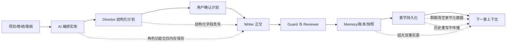

# 小说模块全面诊断与二次复核

> 日期：2026-08-03  
> 范围：`packages/shared/src/novel`、`apps/agent-server/src/plugins/novel-plugin`、`apps/agent-server/src/core/agent/chapter-finalizer.ts`、桌面端小说创作工作流  
> 性质：静态架构与数据流诊断，不包含业务代码修改

## 1. 结论摘要

当前小说模块已经具备较完整的章节生产基础：实体编排、Director/Writer/Reviewer/Memory 流程、事件账本、章节版本、前后章锚点、伏笔/冲突/信息差、风格约束和一致性审计都已存在。它能够支持中短篇或人工强介入的长篇创作。

但如果目标是“自动、稳定地持续创作长篇小说”，目前还不能判定为达到可靠生产要求。主要阻断点不是功能数量不足，而是几个关键契约没有闭环：

1. Director 提交的结构化章节计划没有完整传给 Writer/Reviewer，也没有完整持久化。
2. 角色弧光存在三套阶段词表和两个事实源，长期运行后会漂移。
3. 创作约束声明了卷级/章级作用域，但模型没有目标标识，读取也不执行作用域。
4. 群聊落库、历史章节重写、角色功能位和自动节奏建议存在跨流程状态丢失。
5. 章节级事件账本较强，但全书/卷级规划模型仍偏薄，缺少自动滚动的宏观总结和可执行阶段目标。

综合评级：**章节生产能力较强，长篇连续性基础较好，但结构化计划、弧光、作用域和重写传播仍存在阻断性缺陷。**

## 2. 审计方法与证据边界

本次以已经更新的 `codebase-memory-mcp` 索引为主要发现工具，并用精确源码检索进行反证复核。

- 全仓图谱：5,276 个节点、14,356 条边。
- 小说后端范围：1,342 个节点、3,763 条边。
- 前端入口已识别为 React `App.tsx`，不是 Vue。
- 图谱用于定位符号、调用关系、复杂度热点和疑似孤岛。
- 源码用于确认动态调用、字符串字段、缓存条件和图谱漏边。
- 单纯“入度为 0”不作为死代码结论；必须同时证明没有生产调用者或消费者。

图谱存在少量漏边。例如 `NovelMemoryStore.getChapterStoryContext` 和 `NovelEntityGenerator.generateAndArrange` 在图谱中没有生产 CALLS 入边，但源码分别在 PromptBuilder 和创建流程路由中被调用。因此本文只把源码复核通过的条目列为孤岛。

## 3. 用户操作路径与问题落点

受影响的主要用户路径：

| 用户操作 | 当前行为 | 风险 |
|---|---|---|
| AI 编排后立即创作 | 前端临时携带角色功能位 | 当前页面内通常有效；刷新、重试或分步操作后丢失 |
| Director 计划确认后创作 | Writer 收到任务描述、类型、定位指引和额外事实包 | POV、场景数、时间偏移等独立字段没有进入 Writer 约束 |
| 群聊共创并落库 | 复用 ChapterFinalizer | 既有时间偏移和章尾钩子会被写成 `null` |
| 重写中间章节 | 为避免污染未来状态而跳过 Memory 写入 | 正文改变，但后续状态没有自动重算，形成内容/账本分叉 |
| 连续生成多章 | RhythmController 每章计算建议 | 自动建议没有写回章节，后续历史难以看到真实已执行节奏 |

## 4. 已确认缺陷

### P0-1 Director 结构化计划没有完整进入 Writer/Reviewer

Director 工具强制提交 `secondaryTasks`、`requiredReferences`、章尾钩子、POV、场景数、定位、时间偏移、悬念持续章数和冲突强度变化：

- `apps/agent-server/src/plugins/novel-plugin/core/novel-tools.ts:2146`
- `apps/agent-server/src/plugins/novel-plugin/core/novel-tools.ts:2211`

Orchestrator 也确实保存了完整 `run.directorTask`：

- `apps/agent-server/src/plugins/novel-plugin/core/novel-orchestrator.ts:405`
- `apps/agent-server/src/plugins/novel-plugin/core/novel-orchestrator.ts:421`

但在每个 Agent 构建上下文时，shared 层重新创建的是数据库章纲对应的简化 `NarrativeTask`，随后 `buildChapterConstraints` 也没有把 Director 的 POV、场景数和时间偏移合并进去：

- `apps/agent-server/src/plugins/novel-plugin/core/novel-orchestrator.ts:1533`
- `apps/agent-server/src/plugins/novel-plugin/core/novel-orchestrator.ts:1542`
- `apps/agent-server/src/plugins/novel-plugin/core/novel-engine.ts:286`

`formatConstraints` 虽然已经实现 POV、场景数和时间偏移的渲染，但生产者没有给它这些值：

- `apps/agent-server/src/plugins/novel-plugin/core/prompt-builder.ts:1534`

Writer/Reviewer 的 suffix 会拿到完整 `directorTask`，但 Writer 模板只读取 `description` 和 `type`；Reviewer 只读取 `description`：

- `apps/agent-server/src/plugins/novel-plugin/core/novel-orchestrator.ts:1605`
- `apps/agent-server/src/plugins/novel-plugin/core/prompt-builder.ts:1218`
- `apps/agent-server/src/plugins/novel-plugin/core/prompt-builder.ts:1238`
- `apps/agent-server/src/plugins/novel-plugin/core/prompt-builder.ts:1255`

实际字段闭环如下：

| Director 字段 | Writer 是否稳定可见 | 其他用途 |
|---|---:|---|
| `description` | 是 | Writer/Reviewer suffix |
| `type` | 是 | Writer suffix |
| `positioning` | 是 | 约束、字数目标、最终持久化 |
| `requiredReferences` | 是 | 单独构建 Writer fact pack |
| `chapterEndingHook*` | 否，除非描述文本自行重复 | 创建 Hook 实体并持久化类型 |
| `povCharacters` | 否 | 仅进度气泡显示 |
| `sceneCount` | 否 | 仅进度气泡显示 |
| `timeOffset` | 否 | 正文生成后才持久化 |
| `secondaryTasks` | 否 | 仅进度气泡显示 |
| `priority` | 否 | 仅进度气泡显示 |
| `expectedIntensityDelta` | 否 | 仅进度气泡显示 |
| `suspenseDuration` | 否 | 仅进度气泡显示 |
| `climaxTarget` | 未直接传递 | RhythmConstraint 可提供部分重叠信息 |

影响：Director 的结构化规划看起来已经提交并经用户批准，但 Writer 不一定按 POV、场景和时间线执行，Reviewer 也无法逐项验收这些字段。

补充契约错误：`NarrativeTask.povCharacters` 注释和工具 schema 约定为“角色名”，`ChapterConstraints.povCharacters` 注释却写“角色 ID”，当前没有统一解析或存在性校验。

### P0-2 角色弧光有三套阶段词表和两个事实源

当前同时存在：

1. `NovelEngine` 的旧阶段：`introduction/development/struggle/transformation/resolution`。
2. Memory 普通角色更新的阶段：`setup/rising/climax/falling/resolution`。
3. `NovelCharacterArc` 按弧光类型定义的阶段，例如 growth 为 `denial/resistance/acceptance/transformation`。

证据：

- `apps/agent-server/src/plugins/novel-plugin/core/novel-engine.ts:567`
- `apps/agent-server/src/plugins/novel-plugin/core/prompts/role-memory-generator.md:28`
- `apps/agent-server/src/plugins/novel-plugin/core/prompts/role-memory-generator.md:226`
- `packages/shared/src/novel/index.ts:669`

事实源也重复：

- `NovelCharacter.arcStage/arcHistory`：`packages/shared/src/novel/index.ts:304`
- `NovelCharacterArc.currentStage/stageHistory`：`packages/shared/src/novel/index.ts:657`

同步逻辑不完整：

- 普通 `characterUpdates` 只更新 `character.arcStage`，不更新独立弧光：`novel-memory-generator.ts:1029`。
- 首次创建独立弧光时不更新角色镜像：`novel-memory-generator.ts:1581`。
- 已有独立弧光推进时只同步 `arcStage`，从不维护 `character.arcHistory`：`novel-memory-generator.ts:1598`。

直接后果：Engine 遇到 `resistance`、`setup` 等非旧词表阶段时无法计算下一阶段；PromptBuilder 只能退化为“下一步由本章剧情决定”。长期创作时同一角色会出现阶段漂移和历史不一致。

### P0-3 Constraint 的 volume/chapter 作用域无法执行

`NovelConstraint.scope` 声明为 `global | volume | chapter`，但实体没有 `scopeId`、`volumeId` 或 `chapterNumber`，只有语义不同的 `relatedEntityId`：

- `packages/shared/src/novel/index.ts:823`

数据库读取只按 `project_id` 和 `is_active` 过滤：

- `apps/agent-server/src/plugins/novel-plugin/core/stores/world-store.ts:35`
- `apps/agent-server/src/plugins/novel-plugin/core/stores/world-store.ts:190`

Engine 随后把项目全部活跃约束装入当前章：

- `apps/agent-server/src/plugins/novel-plugin/core/novel-engine.ts:71`

因此“仅本卷适用”或“仅某章适用”的规则会污染其他章节。这不是缺少一层过滤，而是当前实体模型没有表达目标作用域所需的字段。

### P1-1 群聊共创会清空既有时间线和章尾钩子元数据

群聊共创调用 ChapterFinalizer 时传入章节 ID，但没有 `directorTask`：

- `apps/agent-server/src/plugins/novel-plugin/core/novel-discussion-runner.ts:336`
- `apps/agent-server/src/plugins/novel-plugin/core/novel-discussion-runner.ts:385`

Finalizer 对 `positioning` 有旧值回退，但 `timeOffset` 和 `chapterEndingHook` 在缺少 Director 任务时直接写 `null`：

- `apps/agent-server/src/core/agent/chapter-finalizer.ts:296`

结果是同一章节走标准工作流时保留元数据，走群聊工作流时丢失元数据，属于跨入口逻辑冲突和确定性数据损失。

### P1-2 角色“本章功能位”只在前端内存中存在

`ArrangedEntity.characterFunctions` 用于告诉 Writer 每个角色在本章承担什么功能。后端明确承认它不落库，无法从矩阵事实源重建：

- `apps/agent-server/src/plugins/novel-plugin/core/matrix-projection.ts:372`

前端使用 `useRef` 临时保存最近一次 AI 编排结果，并在读取后清空：

- `apps/desktop/src/renderer/src/hooks/use-novel-creation-flow.ts:140`
- `apps/desktop/src/renderer/src/hooks/use-novel-creation-flow.ts:423`
- `apps/desktop/src/renderer/src/components/novel/novel-workspace.tsx:579`

因此只有“同一页面、AI 编排后立刻创作”这条路径能稳定携带功能位。刷新、重启、跨设备、稍后创作、反向编排或单独重试都会退化成只有角色短卡，容易出现多角色同场时仅点名、不承担剧情功能的问题。

### P1-3 自动节奏建议没有写回章节

标准工作流每章会读取既有 `chapter.rhythm` 构造 `rhythmHistory`，然后生成新的节奏建议：

- `apps/agent-server/src/plugins/novel-plugin/core/novel-orchestrator.ts:245`

但最终持久化只写正文、定位、时间偏移和钩子，没有写入 `rhythmSuggestion.rhythm`：

- `apps/agent-server/src/core/agent/chapter-finalizer.ts:296`

全仓生产代码中没有其他自动写回点；章节路由只支持手工修改。结果是 RhythmController 的历史输入主要反映人工设置，而不是系统自己已执行的建议。`NovelChapter.tension` 的注释也说可由 Director 建议，但 Director 工具并没有 tension 字段，当前同样只有手工路径。

### P1-4 历史章节重写不传播到后续状态

Finalizer 检测到后面已有完成章节时，会主动跳过 Memory、实体维度同步和快照写入：

- `apps/agent-server/src/core/agent/chapter-finalizer.ts:180`
- `apps/agent-server/src/core/agent/chapter-finalizer.ts:203`

这样做能避免把新变化直接叠加到“已经包含未来结果”的全局状态上，但仓库没有与该用户路径连通的“从本章起重放/重建后续账本”流程。`ledger-backfill.ts` 只有测试调用，且用途是补缺失维度，不是基于新正文重演后续章节。

结果：中间章正文可以改成功，但后续实体状态、变化记录、快照和摘要仍基于旧正文。系统避免了即时污染，却留下长期内容/记忆分叉。

### P1-5 信息层 sustaining 分支不可达

Engine 先筛选 `revealChapter <= chapterNumber`，随后再以同一个条件决定 `releasing`，否则才是 `sustaining`：

- `apps/agent-server/src/plugins/novel-plugin/core/novel-engine.ts:205`
- `apps/agent-server/src/plugins/novel-plugin/core/novel-engine.ts:231`
- `apps/agent-server/src/plugins/novel-plugin/core/novel-engine.ts:238`

因此从 information layer 生成的 `SuspenseHook` 永远不会是 `sustaining`。未来计划揭示的信息仍可能通过 PromptBuilder 的独立“信息差”段进入上下文，所以不能说信息层完全丢失；准确问题是悬念动作分类和持续章数跟踪失效。

## 5. 条件性风险与设计债务

### P2-1 Shared cache key 依赖隐含的不变性假设

shared 上下文缓存键只有 `projectId | chapterNumber | ask-story`：

- `apps/agent-server/src/plugins/novel-plugin/core/novel-orchestrator.ts:1577`

它不包含 constraints、arrangedEntities、数据库快照版本或 Director 计划。当前标准流程中，编排实体通常在 Director 首次调用前已经确定，Director 实时任务又被设计为放进 suffix，因此不是每次都会命中错误缓存。

风险在于：代码没有保护“shared 输入在一次 run 内不可变”这一前提。若检查点期间修改了矩阵/约束，或者重规划改变了会进入 shared 的定位/字数约束，缓存仍可能复用旧值。应将其定性为条件性陈旧风险，而不是必现故障。

### P2-2 Agent 身份和写作铁律位于 user 前缀

为提高跨 Agent system prompt 缓存命中率，Agent 身份和写作铁律从 system message 移到了 `prefixUserMessage`：

- `apps/agent-server/src/plugins/novel-plugin/core/prompt-builder.ts:814`
- `apps/agent-server/src/plugins/novel-plugin/core/prompt-builder.ts:840`
- `apps/agent-server/src/plugins/novel-plugin/core/novel-orchestrator.ts:1737`

缓存收益明确，但身份和铁律的指令优先级低于真正的 system message。只要用户指令、章节正文或工具返回中出现冲突内容，模型服从边界会比 system 级身份弱。当前没有证据表明它必然失效，因此属于提示词治理风险。

### P2-3 diff 上下文只用于预览，没有进入生产流程

PromptBuilder 已实现 `full | diff`：

- `apps/agent-server/src/plugins/novel-plugin/core/prompt-builder.ts:913`
- `apps/agent-server/src/plugins/novel-plugin/core/prompt-builder.ts:1120`

但 Orchestrator 和 discussion runner 调用时都没有传 `mode: 'diff'`；只有 context-preview 路由接受 diff：

- `apps/agent-server/src/plugins/novel-plugin/core/novel-orchestrator.ts:1590`
- `apps/agent-server/src/plugins/novel-plugin/core/novel-discussion-runner.ts:107`
- `apps/agent-server/src/plugins/novel-plugin/routes/context-preview-routes.ts:36`

这更像未完成的过渡或灰度能力，不是死代码。问题是生产侧没有选择策略、规模阈值和质量对比数据。

### P2-4 Reviewer 未知决策采用 fail-open

运行时遇到未知 review decision 时会告警并按“接受正文”继续：

- `apps/agent-server/src/plugins/novel-plugin/core/novel-orchestrator.ts:1102`

常规 HTTP 路径会校验该检查点允许的选项，类型也使用严格联合，因此标准前端路径通常不可达：

- `apps/agent-server/src/core/agent/chapter-finalizer.ts:97`
- `apps/agent-server/src/plugins/novel-plugin/routes/creation-flow-routes.ts:296`

应定性为非标准调用方或协议漂移时的防御性风险，不是常规路径高严重度缺陷。不过“未知即接受”仍不适合覆盖正文的操作，建议改成 fail-closed 或保留草稿并要求重新确认。

### P2-5 长篇宏观规划模型偏薄

项目级只有 synopsis 和一段全书 outline，卷级只有 title、outline、sortOrder：

- `packages/shared/src/novel/index.ts:12`
- `packages/shared/src/novel/index.ts:257`

系统会把前卷、当前卷、下卷的人工 outline 注入 system prompt：

- `apps/agent-server/src/plugins/novel-plugin/core/prompt-builder.ts:750`

因此不能说“没有卷级上下文”。准确缺口是没有结构化且可验收的全书命题、主题推进、卷目标、卷内转折、阶段出口条件和结局承诺，也没有自动生成的滚动卷总结/主线阶段总结/角色弧光总结。

`ChapterBlueprint` 已定义五段式细纲，但全仓生产代码没有消费者：

- `packages/shared/src/novel/index.ts:1120`

此外事件账本已经提供 `sceneId/sceneOrder`，Director 也提交 `sceneCount`，但仓库没有 `NovelScene` 实体或 `novel_scenes` 表。场景的 POV、地点、时间、目标、冲突、转折和结果无法作为一等对象持久化。

### P2-6 长程上下文并非只有最近 5 章，但宏观压缩仍不足

二次复核纠正了第一轮的过度表述：

- 最近章节叙事摘要确实只保留 5 章：`prompt-budget.ts:105`。
- 账本“最近承接”只回看 2 章、6 条：`prompt-budget.ts:80`。
- 但 `getChapterStoryContext` 会扫描全部历史变化，按维度重建章前最新状态，并注入本章计划、未解决债务和未来承诺：`novel-memory-store.ts:1242`。

所以系统不是只知道最近 5 章。真正问题是：长程事实状态有聚合，长程叙事因果和主题/弧光演进没有相应的层级摘要。另一个质量风险是 recap 缺失时仍会退化到正文开头 300 字，而正文开头通常不是剧情总结：

- `apps/agent-server/src/plugins/novel-plugin/core/prompt-builder.ts:2454`

## 6. 实体模型评估

| 实体/领域 | 评价 | 主要依据与问题 |
|---|---|---|
| Project | 部分满足 | 有简介、全书大纲、阶段、目标平台和节奏模型；缺结构化主题、终局、阶段目标 |
| Volume | 不足 | 只有标题、大纲、顺序；没有卷目标、阶段出口、关键转折、卷总结 |
| Chapter | 部分满足 | 正文、章纲、版本、节奏、定位、时间、钩子、recap 较完整；结构化 Director 计划未完整持久化 |
| NarrativeTask | 运行时结构丰富、闭环失败 | 字段足够，但 Writer/Reviewer 消费和章节持久化不完整 |
| Character | 基础字段较完整 | 长期欲望、功能层级、移除影响有价值；弧光镜像和历史存在双事实源 |
| CharacterArc | 模型方向正确、实现冲突 | 按弧光类型分阶段合理，但与旧角色字段/Memory 词表不统一 |
| Relationship | 可用但弱类型 | 当前阶段和历史以自由字符串/JSON 表达，创作自由度高，但难做自动合法迁移校验 |
| Conflict/Foreshadow/Clue/Hook | 较完整 | 有阶段、跨度、节点、回收、强度和实体关联；未发现阻断性字段缺失 |
| InformationLayer | 部分满足 | 作者/读者/角色认知和揭示计划齐全；`characterKnowledge` 为 JSON 字符串，悬念 sustaining 分类不可达 |
| Constraint | 不满足 | 作用域目标不可表达，执行时全项目生效 |
| StoryEvent/ChangeRecord | 较强 | 支持章节/场景顺序、实体角色、前后值、原因、影响链和未来承诺 |
| Scene | 缺失 | 只有裸 `sceneId/sceneOrder`，没有一等场景实体和可执行场景计划 |
| ArrangedEntity | 部分满足 | 实体 ID 可从矩阵重建；`characterFunctions` 不持久化 |
| AuthorIntent/Annotation | 迁移重叠 | 新 Annotation 的 `kind='intent'` 已进入 prompt；旧 NovelAuthorIntent 仍是仅写入契约 |
| Review | 基础较强、统一契约未落地 | 章节审查和多维评分可用；`ReviewFinding` 统一 schema 未被生产采用 |

## 7. 提示词与上下文评估

### 已做对的部分

1. system 层包含全书简介/大纲、相邻卷纲、世界规则和风格指南。
2. shared 层包含章节信息、实体编排、故事状态、事件账本、关系、信息差、最近摘要、上一章结尾、声音锚点、下一章开头和遗留钩子。
3. 中间章节生成使用章节边界快照，避免直接读取未来实体结果。
4. 事件账本能重建章前最新状态，并提供本章计划和未来承诺。
5. Writer 的 required references 会构建确定性 fact pack，而不是完全依赖模型自行查询。
6. 提示词预算已经集中管理，并有 golden prompt 测试和预算不变量。

### 仍需修正的部分

1. 把 Director 的完整结构化计划编译为 Writer/Reviewer 可逐项执行和验收的提示词，而不是只渲染描述和类型。
2. 将身份、写作铁律的缓存收益与指令优先级风险显式化；至少增加冲突注入测试。
3. 为 full/diff 建立生产选择策略，而不是只提供预览。
4. 让未来承诺、主题推进和弧光推进形成分层摘要，而不只提供状态快照。
5. recap 失败时应使用确定性抽取摘要或标记缺失，不应默认把正文开头冒充摘要。

## 8. 已确认的孤岛与过渡遗留

### 确认的生产孤岛/死状态

| 条目 | 证据 | 判断 |
|---|---|---|
| `NovelAuthorIntent` | 类型、migration 和 `createAuthorIntent` 存在；无 list/get/route/prompt 消费者 | 写入孤岛，很可能已被 Annotation intent 替代 |
| `ChapterBlueprint` | 仅类型定义 | 未落地的细纲契约 |
| `ReviewFinding` | 仅类型定义 | 未落地的统一审查契约 |
| `NovelPromptTemplate` | 仅类型定义 | 类型孤岛；不能据此认定 PromptManager 无效 |
| `run.directorOutput` | 初始化并多次赋值，但没有读取点 | 死状态；注释仍声称“完整方案”会注入 Writer，易误导维护者 |
| `applyLedgerBackfill` | 只有自身文件和测试调用 | 未接入生产的维护工具，不解决历史重写传播 |

### 明确不是孤岛

- `PromptManager.saveTemplate/listTemplateNames/clearCache` 有路由和生产调用；只有共享包中的 `NovelPromptTemplate` 类型未使用。
- `NovelEngine.createChapter/completeChapter/publishChapter/saveReview` 有路由或 Orchestrator 调用。
- `ChapterChatStore.addMany` 被 discussion history 使用。
- `generateAndArrange` 在图谱中入度为 0，但创建流程路由在 `creation-flow-routes.ts:764` 和 `:879` 直接调用。
- 多个前端 API 包装器虽然图谱无 CALLS 入边，但被 React Query 的 `queryFn` 等回调引用，不能批量判为死代码。

## 9. 复杂度与维护风险

codebase-memory 图谱确认以下热点：

| 符号 | 行数 | 圈复杂度 | 认知复杂度 | 风险 |
|---|---:|---:|---:|---|
| `NovelEntityGenerator.generateAndArrange` | 783 | 88 | 300 | 编排规则、持久化、进度和兼容逻辑集中，回归面大 |
| `NovelPromptBuilder.formatArrangedEntities` | 约 359 | 76 | 262 | 多实体格式、预算和兼容分支集中，容易出现字段漏传 |
| `createCreationFlowRoutes` | 1,167 | 96 | 157 | 多工作流入口、检查点和 SSE 状态耦合 |

这些复杂度不会直接证明有 bug，但本次发现的 `characterFunctions` 丢失、群聊元数据清空和提示词字段漏传，都发生在跨模块契约边界上。继续增加条件分支会显著提高同类回归概率。

## 10. 二次复核：修正与排除的误报

| 第一轮说法/疑点 | 二次复核结论 |
|---|---|
| Director 的 POV/场景数/时间偏移是否可能通过其他路径进入 Writer | 仍确认缺失。`formatConstraints` 虽支持，但 constraints 生产者未赋值；suffix 只渲染描述/类型。定位和 fact pack 是例外 |
| shared cache 是否必然返回错误内容 | 否，降级为条件性风险。标准流程的 shared 输入通常稳定，Director 实时任务刻意放在 suffix |
| 系统是否只保留最近 5 章上下文 | 否。5 章只指叙事摘要窗口；事件账本会聚合全部历史的最新维度状态 |
| Reviewer 未知决策是否是常规高危路径 | 否，HTTP 路由有 allowed options 校验；仅非标准调用或协议漂移时可达 |
| 图谱零入度是否等于孤岛 | 否。已用源码排除多组漏边，包括 `generateAndArrange`、`getChapterStoryContext` 和前端 queryFn 包装器 |
| `formatEntityArchive` 是否存在 | 源码不存在，属于陈旧图谱符号或旧结论，不写入缺陷清单 |
| Prompt 模板功能是否是孤岛 | 否。PromptManager 正常运行；只有 `NovelPromptTemplate` 共享类型未使用 |
| 是否完全没有卷级上下文 | 否。前卷、当前卷、下卷 outline 均注入；缺的是自动滚动总结和结构化卷目标 |

## 11. 测试缺口

现有测试覆盖了工具 schema、时间线审计、golden prompt、上下文 diff、store CRUD 和编排契约，但没有覆盖以下跨模块不变量：

1. 用户批准的完整 Director task 必须逐字段出现在 Writer 和 Reviewer 最终 payload 中。
2. chapter/volume constraint 只能进入目标章节。
3. 任一弧光写入路径都必须原子更新唯一事实源和历史。
4. 群聊共创不得清空已有章节元数据。
5. AI 编排后刷新/重试，角色功能位仍可恢复。
6. 自动节奏建议必须进入下一章的 rhythm history。
7. 中间章重写后，后续账本和快照必须被标记失效或完成重建。

## 12. 建议修复顺序

### 第一阶段：修复契约闭环

1. 引入可持久化的 `ChapterPlan`（或正式启用 `ChapterBlueprint`），保存完整 Director task。
2. 由同一编译函数生成 Writer 指令、Reviewer 验收清单、进度气泡和章节持久化字段。
3. 增加 end-to-end prompt payload 测试，逐字段验证 POV、场景、时间、钩子、次要任务、优先级和强度变化。
4. 修复群聊 Finalizer 的旧值回退，并自动持久化 rhythm suggestion。

### 第二阶段：统一事实源

1. 选定 `NovelCharacterArc` 为弧光唯一事实源，`character.arcStage` 要么移除，要么只做数据库生成镜像。
2. 使用 `ARC_STAGE_MODELS` 统一 Engine、Memory prompt、校验和 PromptBuilder。
3. 为 Constraint 增加明确的 `scopeId` 或 `{ volumeId, chapterNumber }`，在 store 层提供 `listApplicableConstraints`。
4. 持久化 `characterFunctions`，让矩阵和重试路径可恢复。

### 第三阶段：补齐长篇重写与宏观规划

1. 中间章节重写时，将后续 ledger/snapshot 标记为 stale，并提供从该章开始的可恢复重放任务。
2. 增加结构化全书目标、卷目标、阶段出口、关键转折和结局承诺。
3. 增加滚动卷总结、主线阶段总结、角色弧光总结和主题推进总结。
4. 将 Scene 建为一等实体，至少包含 POV、地点、时间、目标、冲突、转折、结果和顺序。
5. 以真实项目做 full/diff A/B 评估，再决定生产启用阈值。

### 第四阶段：清理过渡代码和降低复杂度

1. 删除或迁移 `NovelAuthorIntent`、`run.directorOutput` 等确认孤岛。
2. 决定 `ChapterBlueprint`、`ReviewFinding`、`NovelPromptTemplate` 是正式启用还是删除。
3. 按“解析/校验/持久化/提示词格式化/进度上报”拆分三个复杂度热点。

## 13. 需要产品/领域层确认的模糊点

1. Constraint 的 chapter scope 是按章节号、章节 ID，还是章节区间？volume scope 是按 volumeNumber 还是 volumeId？
2. POV 字段的权威值是角色 ID 还是角色名？是否允许无实体的临时叙述视角？
3. 一名角色是否只能有一条主弧光，还是长篇中允许主弧光和关系/救赎等副弧并存？
4. `ChapterBlueprint` 的五段结构是所有题材的硬模型，还是可替换模板？
5. 历史重写的期望语义是“冻结后文，只改文字”，还是“重新推演后文状态”？两者必须在 UI 上明确区分。
6. 节奏和 tension 是系统建议、用户决策，还是最终正文评估值？目前字段把这三种语义混在一起。

## 14. 最终判断

当前架构不是“不能写长篇”，而是“能生成长篇章节，但不能保证所有结构化规划和历史状态长期一致”。

最值得优先投入的不是继续增加 Agent 或实体数量，而是把现有四条主链做成单一事实源：

1. `Director plan -> Writer execution -> Reviewer acceptance`
2. `Character arc -> Memory update -> next chapter constraint`
3. `Scoped rule -> applicable chapter -> prompt`
4. `Chapter rewrite -> downstream state invalidation/rebuild`

这四条闭环后，现有事件账本、实体矩阵、上下文预算和审稿流程才能真正转化为可靠的长篇创作能力。
