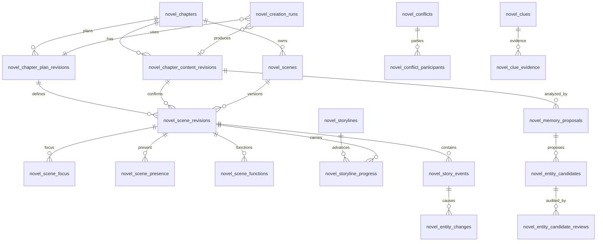
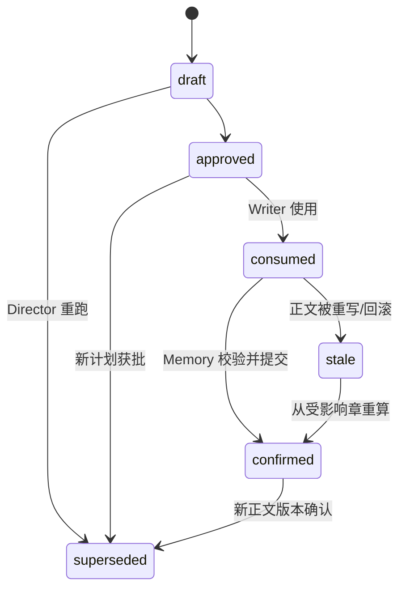
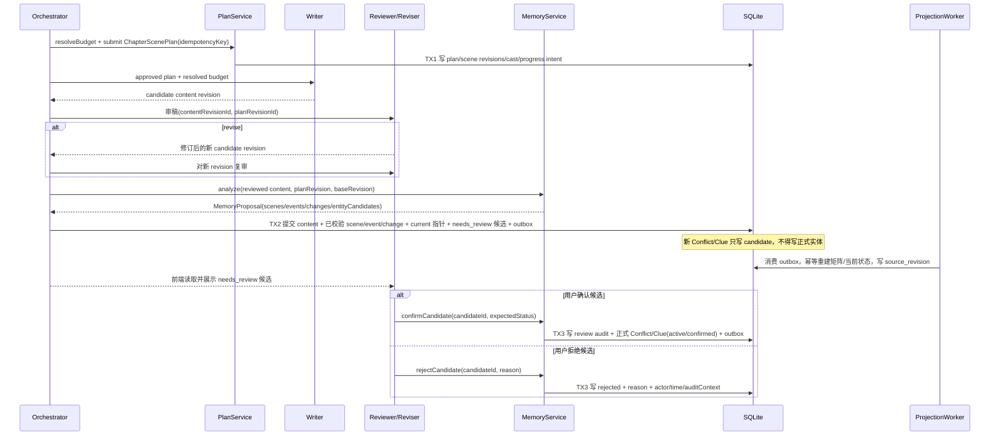
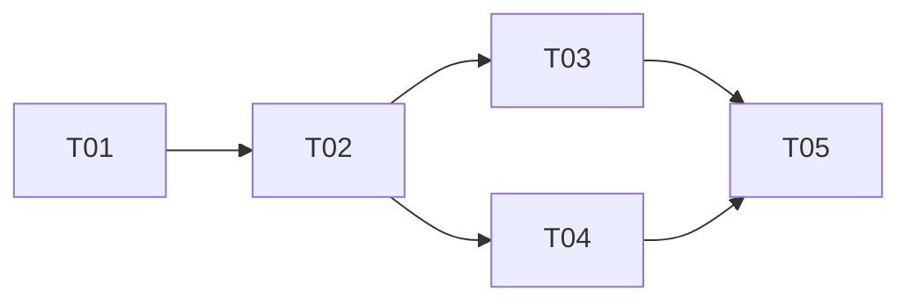

# 剧情推进模型重构方案

状态：核心产品决策已确认；历史迁移采用可逆默认，可进入 T01 架构实施  
日期：2026-08-05  
范围：小说章节规划、生成、版本、Memory、事件账本与矩阵投影

## 1. 摘要

本方案不指定现有 `novel_story_events`、群聊 `SceneDefinition`、`novel_discussion_runs.scenes`、章节正文或矩阵字段中的任何一个为正确来源，而从业务不变量重新建模：**章节正文按不可变版本存在；每个正文版本对应一组可追溯的场景事实；规划、Memory 结论和投影均声明其来源版本；重跑、重写、回滚只产生新版本并使旧派生物 superseded/stale，不覆盖历史。**

新模型以统一 `ChapterScenePlan` 连接普通工作流、Director 工具与群聊模式；场景严格区分 POV、focus、present、functional cast；字数预算只解析一次。Storyline/Scene/Progress 承载“故事怎样推进”，StoryEvent/EntityChange 承载“发生了什么及实体怎样改变”，Conflict/Clue 只承载满足长期语义和准入证据的对象。矩阵是带来源修订号的单向读模型，不可反写规范表。

## 2. 目标、非目标与设计原则

### 2.1 目标

- 建立无重复事实的关系型模型、版本语义和事务边界。
- 统一三种创作入口的场景计划、角色笔墨与字数预算。
- 支持 Director 重跑、Writer/Reviser 重写、正文回滚、中间章重写及 Memory 重算。
- 让 Conflict/Clue 从“动作容器”回归持续对抗与可验证证据。
- 支持渐进迁移、双写对账、可回退切读和历史只读兼容。

### 2.2 非目标

- 不自动修正文、合并历史实体或批量推断旧场景。
- 不重做 LLM/Moderator 通用引擎，不改变现有角色静态档案。
- 不保证旧 JSON 章节跨度本身正确；它们只作为迁移期对账输入。

### 2.3 原则与业务不变量

1. 同一事实只在规范表保存一次；运行快照可复制输入，投影可冗余，但必须带 `source_revision/updated_from` 且禁止反写。
2. `targetWords` 默认是项目硬目标。章节定位最多在可配置上限内调整一次；上限 `±15%`（已确认）、默认不调整。Rhythm 只描述节奏，**不得改字数**。因此 3000 字即使同时为 `climax + high_pressure` 也不能变为 5070。
3. 每个场景只有一个 `pov_mode`：`single` 必须恰好一个 POV 角色；`omniscient/none` 必须没有 POV 角色。`omniscient` 明确允许配置 focus/present；不保留 `ensemble`，群像由 focus/present 表达。
4. POV 是叙述视点，focus 是本场笔墨中心，present 是物理在场，functional cast 是承担剧情功能者；四者不可互相推导。functional cast 必须 present，single POV 必须 present。
5. 同一场景可推进多条 Storyline，但只能有一个 primary Progress；场景不因故事线数量复制。
6. 所有 AI 输出先成为带版本的候选；只有通过校验且绑定具体正文版本的 Memory 确认结果才能提交规范事实。
7. 版本历史不可更新。当前版本通过指针选择；旧版本使用 `superseded`，受上游变化影响但未重算使用 `stale`。
8. 章节号是可变展示顺序，引用一律使用 `chapter_id`；删章/插章只改章节排序，不重写事实外键。

## 3. 现状确认、问题与废弃清单

### 3.1 现状确认：多套数据来源与处理链确实存在

代码核对确认（`core/matrix-projection.ts` 头部注释、`core/stores/chapter-store.ts`、`core/agent/chapter-finalizer.ts` 等），当前不是单一事实源，而是多条链路分别承载正文、计划、场景、事件、实体状态和矩阵展示。它们不是“都错”：每条链路都承担了一部分合理职责；真正的问题是跨层字段重复、缺少统一的 content/plan revision 绑定，且不同入口可以互相覆盖或绕过，导致同一业务事实无法稳定追踪。

按风险等级分类（⚠️=当前已造成实际不一致；△=结构风险，尚未必然触发）：

- **⚠️ 矩阵存在显式双源**：`matrix-projection.ts` 文件注释直接声明“本章有哪些实体出场”这件事有**两个事实源**（A. 实体的章节维度字段 `character_history/chapterSpans/beats/appearChapters`；B. 事件账本 `novel_story_events + change records`），并给出已确认的漂移来源：ai-arrange 早期不写账本、伏笔复用不落 beat、**手工编辑实体字段不产生账本记录**（未修，属结构问题）。该模块只做对账、不做裁决。
- **⚠️ 版本列表的当前判定错误**：`chapter-store.listChapterVersions()` 把版本表最后一行标记为 `isCurrent`，但版本表只保存“覆盖前快照”，真正当前正文在 `novel_chapters.content`。两者语义分裂：最后一份快照不是当前正文，历史版本中没有一版是真正的当前版。
- **⚠️ Finalizer 先写派生物、后写正文**：`finalize()` 顺序为 Memory 提取 → 实体状态变更记录 → 章节维度同步 → 快照 → 最后 `updateChapter` 写正文。任一环节失败会留下“实体已改、正文未写”的半提交状态；中间章重写走 `historicalRewrite` 分支跳过全部派生写入（保护后续时间线），但被跳过的旧派生数据没有标记 stale，前端无从知道该章时间线已失效。
- **△ 计划三入口并存**：Director `NarrativeTask`（工具提交结构化对象）、群聊 Markdown `SceneDefinition`（正则解析写 `novel_discussion_runs.scenes`）、`creation-flow` 手动编排 `arrangedEntities`。三者都能进入 Writer 上下文，但只有章节级 `povCharacters/sceneCount`，没有逐场景的 POV/focus/present/progress 契约，也无法证明同属一份 plan。
- **△ 事件账本场景字段无版本绑定**：`NovelStoryEvent.sceneId/sceneOrder/chapterNumber` 由 Memory 写入，但正文变化后这些字段不会失效或重算；`sceneId` 多为 null 且未指向任何规范场景表（当前不存在场景表）。
- **△ 实体出场字段多写面**：冲突/线索/势力/物品的 `chapterSpans`、伏笔 `beats`、地点 `appearChapters`、角色 `character_history` 分别由 Memory、实体生成器、手工编辑（route PATCH）写入，且手工编辑不产生账本记录，矩阵无法区分“计划出场”与“正文确认出场”。

| 现有链路 | 主要写入 | 主要读取/用途 | 当前问题（上表对应的代码依据） |
| --- | --- | --- | --- |
| `novel_chapters.content` + `novel_chapter_versions` | Finalizer、章节保存/重写/回滚流程写当前正文及覆盖前快照 | 章节展示、Writer/Reviser 上下文、版本恢复 | ⚠️ 当前正文与历史版本语义分裂，版本仅保存覆盖前快照，`isCurrent` 依赖序号推断；Memory/Scene 未稳定绑定具体正文 revision |
| Director `NarrativeTask` + `novel_submit_narrative_task` | Director 生成章节级 `povCharacters/sceneCount` 并通过工具提交 | Writer、章节生成编排读取 NarrativeTask | △ 只有章节级约束，无法表达逐场景 POV/focus/present/Progress；可绕过群聊 SceneDefinition 或与其产生另一份计划 |
| 群聊 Markdown `SceneDefinition` + `novel_discussion_runs.scenes` | 群聊输出 Markdown，经正则解析后把 Scene JSON 写入 discussion run | discussion runner/team engine 恢复运行和驱动分场写作 | △ Markdown 协议脆弱，运行快照同时承担业务计划；未绑定规范 plan/content revision，重跑可能覆盖或分叉 |
| `NovelStoryEvent.sceneId/sceneOrder` + story ledger | Memory/事件抽取写 Event、场景标识、章号和顺序 | 故事账本、时间线、Memory 上下文、矩阵聚合 | △ `sceneId/sceneOrder/chapterNumber` 与计划场景重复，缺少稳定 SceneRevision FK；正文变化后事件仍可能看似有效 |
| `EntityChange` / Memory 当前状态写入 | Finalizer/Memory 先写变化记录并更新实体当前状态 | 后续生成 prompt、实体状态展示、矩阵 | ⚠️ 当前链路可能先于正文提交，失败会半提交；current state 与来源 Event/content revision 关联不足，重算和回滚难以恢复 |
| entity `chapterSpans/appearChapters/beats` + matrix projection | 实体更新/Memory 写 JSON 跨度、出场章与 beats，并投射矩阵 | 人物/地点/物品出场、剧情节点、矩阵行列 | ⚠️ 矩阵文件注释自述双源：同一出场/推进事实同时存在实体 JSON、Event/Change 和投影，手工编辑不产生账本记录 |
| 前端 narrative matrix（`matrix-aggregation`） | 后端只读聚合故事账本、实体跨度 | 前端矩阵、章节进展与故事线视图 | △ 纯读聚合，未发现回写路径；但聚合两侧对账不一致时无版本信息可判定来源优先级 |

代码核对的具体表现还包括：`matrix-projection.ts` 注释列出三类已知漂移（ai-arrange 早期不写账本、伏笔复用不落 beat、手工编辑实体不产生账本记录）；Finalizer 先写 Memory/矩阵维度，后写正文；中间章重写仅跳过 Memory 且不标记旧派生物 stale；Conflict/Clue 准入仍含线索关键词、每章最多一条和冲突二元字覆盖率。

### 3.2 统一整改目标

重构目标不是从上述旧实现中挑一套继续作为唯一真相，而是抽取各链路中的业务事实并重新划分职责：**业务事实规范化落库，运行数据只留可审计快照，矩阵成为可按 revision 重建的只读模型。** 所有旧路径先通过 adapter 映射到 V2 契约；完成灰度和对账后，停止写入 `sceneOrder`、实体跨度、discussion scenes 等重复业务字段，只保留明确的兼容读取或运行审计用途。

### 3.3 废弃与保留清单

| 对象/逻辑 | 代码位置（供 T01 定位） | 最终处理 |
| --- | --- | --- |
| `NarrativeTask.povCharacters/sceneCount`、Director 当前 schema | `packages/shared/src/novel/index.ts:1191-1194`（类型字段）；`apps/agent-server/src/plugins/novel-plugin/core/novel-tools.ts:2165-2169`（工具 schema `povCharacters`/`sceneCount`）、2233-2238（写入 task） | 由 `ChapterScenePlan` 取代；兼容读取后删除写入 |
| `SceneDefinition.sceneId:number`、Markdown `parseScenes` | `apps/agent-server/src/core/agent/discussion-types.ts:102`（`sceneId: number`）、127（可选 `sceneId?: number`）；`apps/agent-server/src/core/agent/team-discussion-engine.ts:1289`（`parseScenes` 定义）、135（调用写入 `novel_discussion_runs.scenes`） | 改为 Plan adapter；旧协议仅兼容运行中旧 run |
| `novel_discussion_runs.scenes/arranged_entities/content` | `apps/agent-server/src/plugins/novel-plugin/novel-migrations.ts:789-809`（建表）；`apps/agent-server/src/plugins/novel-plugin/core/discussion-run-store.ts:34-36`（列）、48-64（upsert 写入） | 停止保存规范字段；保留 transcript/错误快照，新增 plan/content revision FK |
| `NovelStoryEvent.chapterNumber/sceneOrder/sceneId` | `apps/agent-server/src/plugins/novel-plugin/core/novel-memory-store.ts:88`（`sceneOrder?: number`）、808-809（写 `scene_id/scene_order`）、1435-1436/1466（读回）；`routes/story-ledger-routes.ts:35,186,233`（schema 与排序） | 改由 `scene_revision_id/content_revision_id` 派生；旧列只读后废弃 |
| `novel_chapter_versions` + `novel_chapters.content` 当前判定 | `apps/agent-server/src/plugins/novel-plugin/core/stores/chapter-store.ts:114`（`saveChapterVersionInternal`）、141-166（`listChapterVersions`，`isCurrent: idx === rows.length - 1` 在 161 行）、205（`rollbackToVersion`）；`packages/shared/src/novel/index.ts:197-209`（`ChapterVersionSummary.isCurrent` 契约） | 迁为不可变 content revision + 显式 current 指针；旧表只读归档 |
| 实体 `chapterSpans/appearChapters/beats` 作为矩阵写面 | `apps/agent-server/src/plugins/novel-plugin/novel-routes.ts:662,747,792,916,1280,1333,1386`（PATCH schema 接受跨度字段）；`apps/agent-server/src/plugins/novel-plugin/core/chapter-projection-fields.ts:24-50`（投影展开）；`core/matrix-projection.ts:1-25`（双源注释） | 停旧写；能表达事实的 beats 保留领域用途，其余转投影/兼容列 |
| `computeChapterTargetWords` 的 rhythm 倍率、`POSITIONING_RULES.wordBudgetMultiplier` | `apps/agent-server/src/plugins/novel-plugin/core/prompt-builder.ts:701-709`（rhythm 倍率：climax ×1.3、breather/setup ×0.85）、1263（调用点）；`apps/agent-server/src/plugins/novel-plugin/core/rhythm-controller.ts:93-148`（`POSITIONING_RULES.wordBudgetMultiplier`）；`apps/agent-server/src/plugins/novel-plugin/core/novel-engine.ts:255-278`（buildChapterConstraints 内联定位倍率）；`apps/agent-server/src/plugins/novel-plugin/core/novel-orchestrator.ts:1441-1455`（PostWriteGuard 复用） | 废弃；统一交给 `WordBudgetResolver` |
| 关键词/限额/二元字 Conflict/Clue 准入 | `apps/agent-server/src/plugins/novel-plugin/core/entity-admission-policy.ts:22`（默认每章至多新增一条）、43-78（`toBigrams`/`findCoveredConflict` 二元词覆盖率） | 废弃；改为结构化证据与待人工决策 |
| 角色档案、StoryEvent/EntityChange 账本、章节评审、Agent 日志 | 保留（无废弃点，仅补版本 FK/状态） | 保留并补版本 FK/状态 |
| 实体手工编辑（route PATCH 改 `chapterSpans/appearChapters` 等） | `apps/agent-server/src/plugins/novel-plugin/novel-routes.ts:662,1333`（PATCH schema）；`core/matrix-projection.ts:14-17`（手工编辑不产生账本记录，未修） | 迁移到“revision 化编辑 + 必产生账本记录”；旧 PATCH 路径在 adapter 期保留读、禁止无版本写入 |

## 4. 概念边界与三层职责

| 概念 | 规范职责 | 不承担 |
| --- | --- | --- |
| Storyline | 跨场景持续的叙事方向与生命周期 | 单场动作、当前状态副本 |
| Scene | 一段连续时空/行动边界的稳定身份 | 具体版本摘要、POV、角色数组 |
| SceneRevision | 某计划或正文版本下的场景序位、摘要、POV、预算 | 实体状态变化 |
| StorylineProgress | 某 SceneRevision 对一条 Storyline 的前后变化 | 冲突/线索本体 |
| StoryEvent | SceneRevision 中可命名的事实发生 | 场景身份、故事线状态 |
| EntityChange | 由 Event 导致的实体维度 before/after | 当前快照直接覆盖 |
| Conflict | 跨场景持续施压的对抗结构 | 当场已完成的选择/危险 |
| Clue | 服务明确问题的可复验证据 | 氛围、异常感、泛化怀疑 |

三层职责：

- **规范事实表**：project/chapter、content revision、scene/scene revision、storyline/progress、event/change、Conflict/Clue 及关系表。由领域服务在事务中写入。
- **运行时快照**：creation/discussion run、transcript、模型原始输出、checkpoint、plan draft。用于恢复和审计，可 stale，不参与业务查询。
- **投影/缓存**：章节当前正文镜像、实体当前状态、矩阵节点。投影器单向消费已提交 revision，记录 `source_revision` 与 `updated_from`；API 不接受对投影字段的 PATCH。

## 5. 统一 ChapterScenePlan 契约

```ts
interface ChapterScenePlan {
  planRevisionId: string; chapterId: string; baseContentRevisionId: string | null;
  positioning: ChapterPositioning; rhythm: ChapterRhythm;
  budget: { baseTarget: number; adjustmentPct: number; resolvedTarget: number; min: number; max: number };
  scenes: Array<{
    sceneKey: string; order: number; title: string; goal: string;
    locationText: string; timeText: string;
    povMode: 'single' | 'omniscient' | 'none'; povCharacterId: string | null;
    focusCharacterIds: string[]; presentCharacterIds: string[];
    functionalCast: Array<{ characterId: string; function: PlotFunction; prominence: 'lead'|'support'|'brief' }>;
    targetWords: number;
    progresses: Array<{ storylineId: string; primary: boolean; type: 'setup'|'advance'|'turn'|'reveal'|'resolve'|'pause'; expectedChange: string }>;
  }>;
}
```

数组是 API 表达，落库必须拆为关系行。Director 工具直接提交该契约；普通工作流读取 approved plan；群聊引擎把 plan scene 转为通用运行 DTO，不再反向解析出另一份场景计划。校验：`sceneKey/order` 章内唯一；scene target 之和等于 resolved target（舍入差额给最后一场）；每场最多 5 个 focus、functional cast 必须带 function；功能角色默认 `brief`，不得获得独立内心/背景段，除非同时为 POV 或 focus。

字数唯一解析：`baseTarget = project.targetWords > 0 ? targetWords : 3000`；产品允许定位调整时，`adjustmentPct=clamp(config[positioning], -cap, cap)` 且只执行一次；`resolvedTarget=round(baseTarget*(1+adjustmentPct))`。已确认默认 `adjustmentPct=0`、`cap=15%`、范围 `85%-115%`；Guard/Writer/Reviewer/群聊都只读取 plan budget，禁止自行重算。

场景切换只在时间、地点、核心行动目标或 POV 改变时发生；POV 改变必须新建场景。单场中 focus 可轮换但 POV 不变；present 不代表需要台词，functional cast 不代表需要背景展开。

## 6. 推荐数据库 ER 设计



核心表（时间均为 UTC epoch；状态用 CHECK）：

- plan/scene revision：`draft → approved → consumed → confirmed`，任一步可到 `superseded`；上游改变进入 `stale`。
- content revision：`candidate → reviewed → committed → superseded`；回滚仍创建新 committed revision。
- creation run：`running → waiting_review → waiting_memory_confirm → completed/error/cancelled/stale`。
- Storyline：`active/paused/resolved/abandoned`，成熟度 `candidate/established`；候选故事线在至少两个不同 Scene 上出现两条 `confirmed` Progress 或经人工确认后 established，不要求严格相邻（避免因插入过渡场景改变晋级结果）。
- Event/Change/Progress：`planned/confirmed/superseded/stale`；矩阵只读取 confirmed 且非 stale。
- Memory 新 Conflict/Clue 候选：`needs_review → confirmed/rejected`；候选不得直接成为正式实体。`rejected` 必须记录 reason、操作者、时间与审计上下文。

| 表 | 关键字段与约束 | 写入所有者/索引 |
| --- | --- | --- |
| `novel_chapters` | PK `id`；`project_id,display_order` UNIQUE；`current_content_revision_id` FK | ChapterService；按 project/order |
| `novel_chapter_content_revisions` | PK `id`；FK chapter/run/parent；`revision`；`content,word_count,phase,status`；UNIQUE(chapter_id,revision) | ContentRevisionService；chapter/status |
| `novel_chapter_plan_revisions` | PK `id`；FK chapter/run/supersedes/base_content；预算解析字段、`status,revision,idempotency_key`；UNIQUE(chapter_id,revision)、UNIQUE(idempotency_key) | PlanService |
| `novel_scenes` | PK `id`；FK chapter；`stable_key`；UNIQUE(chapter_id,stable_key) | SceneService；只保存稳定身份 |
| `novel_scene_revisions` | PK `id`；FK scene/plan/content/supersedes；`order,title,goal,summary,location_text,time_text,pov_mode,pov_character_id,target_words,status`；UNIQUE(plan_revision_id,order) | Plan/MemoryService；content/status |
| `novel_scene_focus/presence` | 复合 PK(scene_revision_id,character_id)，均为 FK | SceneService；禁止 JSON 多对多 |
| `novel_scene_functions` | 复合 PK(scene_revision_id,character_id,function)；`prominence,note` | SceneService |
| `novel_storylines` | PK；FK project；`name,kind,lifecycle,maturity,description`；UNIQUE(project_id,name) | StorylineService |
| `novel_storyline_progress` | PK；FK scene_revision/storyline；`primary_flag,type,before_state,after_state,summary,status`；UNIQUE(scene_revision_id,storyline_id)，partial UNIQUE(scene_revision_id) WHERE primary | MemoryService |
| `novel_story_events` | PK；FK scene_revision/content_revision/parent；`type,title,summary,outcome,status,source` | MemoryService；scene/status |
| `novel_story_event_entities` | 复合 PK(event_id,entity_type,entity_id,role) | MemoryService |
| `novel_entity_changes` | PK；FK event/content_revision/supersedes；`subject_type/id,dimension,target_type/id,value_type,before,after,status`；UNIQUE(content_revision_id,event_id,subject_type,subject_id,dimension,target_id) | MemoryService；subject/dimension/status |
| `novel_conflicts` | PK；`opposing_force,stakes,unresolved_pressure,next_impact,stage,status,revision` | EntityService |
| `novel_conflict_participants` | 复合 PK(conflict_id,entity_type,entity_id,side) | EntityService |
| `novel_clues` | PK；`question,judgment_before,judgment_after,verification_action,status,revision` | EntityService |
| `novel_clue_evidence` | PK；FK clue/event；`evidence_text,source_locator`；UNIQUE(clue_id,event_id,source_locator) | EntityService |
| `novel_memory_proposals` | PK；FK content/plan/run；`status,raw_output_hash,created_at`；UNIQUE(content_revision_id,raw_output_hash) | MemoryService；只保存候选批次与分析来源 |
| `novel_entity_candidates` | PK；FK proposal/source scene/event；`entity_type,payload,status,reason_code`；新 Conflict/Clue 初始必须为 `needs_review` | EntityAdmissionService；status/type |
| `novel_entity_candidate_reviews` | PK；FK candidate；`decision,reason,actor_id,created_at,audit_context`；拒绝时 `reason` NOT NULL | EntityAdmissionService；candidate/time，追加写不可修改 |
| `novel_creation_runs` | PK；FK chapter/plan/produced content/supersedes；`mode,stage,status,idempotency_key,stale_reason` UNIQUE(idempotency_key) | Orchestrator |
| `novel_matrix_projection` | PK；`project_id,row_type,row_id,chapter_id,scene_id,payload,source_revision,updated_from`；UNIQUE(row_type,row_id,chapter_id,scene_id) | ProjectionWorker；只读 API |

状态机：



## 7. 时序、事务、版本与回滚



LLM 调用不占事务。TX1 只批准计划；TX2 原子提交正文、可直接确认的 Memory 事实和 `needs_review` 候选，解决当前“Memory 已写、正文未写”。新 Conflict/Clue 不参与 TX2 的正式实体写入；只有用户审核触发的 TX3 才能将候选晋升为 `active/confirmed`，或以 reason 和完整审计记录拒绝。投影采用同库 outbox，至少一次投递、幂等覆盖。

- 幂等键：`project:chapter:operation:clientRequestId`；重试返回同一 revision，payload hash 不同则 409。
- revision：章内单调整数；写入带 `expectedCurrentRevision`，冲突返回 409。
- supersede：同一层的新选择替代旧选择，历史可读；stale：内容未被替代但其上游已变化，禁止进入当前态/矩阵。
- Director 重跑只 supersede 未消费 plan；已消费 plan 保留，创建新 plan。Writer/Reviser 每次均创建 content revision，绝不原位修改。
- 正文回滚不是把旧行设为 current，而是以目标版本为 parent 创建 `rollback_applied` 新 revision，再令原 current 及其 Memory/投影 superseded。
- 中间章重写或删/插章：新正文成功保存后，立即从该 `chapter_id` 起把后续 plan、Memory 确认、状态投影标记为 `stale`，同时把本次重写覆盖的旧正文与旧派生数据标记 `superseded`；旧正文仍可读，矩阵显示“待重建”。保存响应返回受影响章节/派生物范围，前端必须提示影响并提供“从本章开始重建”按钮。只有用户查看范围并再次确认后才创建顺序重建 job；保存正文不得隐式启动重建。顺序重放期间禁止把第 N 章变化叠加到含 N+1 结果的当前快照。

## 8. Conflict/Clue 准入与 Memory schema

Memory 输出 `MemoryProposal { contentRevisionId, planRevisionId, scenes[], events[], changes[], conflictDecisions[], clueDecisions[] }`。每项优先使用已有 ID；无 ID 时只能按项目内规范名称精确匹配，不得模糊合并。无法匹配但满足新实体结构要求的 Conflict/Clue 必须生成持久化 `needs_review` 候选并在前端展示，不得静默创建或自动晋升。

新 Conflict 必须同时提供：`opposingForce`、至少两个可解析 participant/side（内心冲突可用 character vs self-goal 的显式两方）、`stakes`、`unresolvedPressure`、`nextImpact`、来源 scene/event。缺项降级为 Event/Change，不生成可晋升候选。

新 Clue 必须同时提供：明确 `question`、正文证据 `evidenceText + sourceLocator`、`judgmentBefore/After`、可执行 `verificationAction`、来源 scene/event。无关键词规则、无每章数量上限。准入服务返回 `reuse/needs_review/rejected` 与 reason code：已有 ID 或精确匹配对象可按策略更新；所有新 Conflict/Clue 一律为 `needs_review`。用户确认后才创建正式对象并进入 `active/confirmed`；用户拒绝时必须提交非空 `reason`，追加审核记录（actor、timestamp、来源 revision、决定前后状态），候选保持可审计但不进入 prompt 当前态或矩阵正式节点。

## 9. API 与矩阵读模型

- `POST /chapters/:id/plans`：提交统一契约，需 `Idempotency-Key`、`If-Match`。
- `GET /chapters/:id/plans/current`；`POST /plans/:id/approve|supersede`。
- `POST /chapters/:id/content-revisions`；`POST /chapters/:id/rollback`。
- `POST /content-revisions/:id/memory-proposals`；`POST /memory-proposals/:id/confirm`。
- `POST /projects/:id/rebuild?fromChapterId=`；返回 stale 范围和 jobId。
- `GET /projects/:id/narrative-matrix?asOfRevision=`：返回 Storyline rows、Scene nodes、Progress links、`sourceRevision/projectionLag/stale`。
- Storyline/Scene 人工编辑必须创建 revision；矩阵接口只读。旧 `/matrix-aggregation`、`/story-events` 在兼容期返回 `legacy=true`。

## 10. 渐进迁移与历史策略

Feature flags：`scenePlanV2Write`、`scenePlanV2DualWrite`、`memoryProposalV2`、`matrixProjectionV2Read`、`legacyNarrativeWriteDisabled`，均按项目灰度。

1. **建表与影子写**：新表上线，旧读写不变；新 run 同时写 V2，记录映射和差异，不阻断用户。
2. **双写对账**：比较章节目标字数、场景数/POV、实体出场、Event/Change 数、projection hash；V2 只作为影子。
3. **切 V2 写/旧读**：新工作流以 V2 提交，再派生旧兼容字段；差异告警。
4. **切读**：按项目切矩阵和 prompt 到 V2；可即时回退旧读。
5. **停旧写**：对账连续达标后禁用旧场景/跨度写面，最终移除适配代码和废弃列。

历史数据：只回填可确定的章节/正文版本标识和现有 revision 链；**不回填无法可靠推断的历史 Scene/Progress/POV**。旧章节通过 legacy adapter 只读展示，标注 `unmodeled`；用户主动重写或“校准本章”后才建立 V2 场景。历史 discussion run 保留原 JSON 以供审计，不转成规范场景。

## 11. 分阶段文件清单、任务与依赖

### 文件清单

- 契约/迁移：`packages/shared/src/novel/index.ts`、`novel-migrations.ts`、`core/word-budget-resolver.ts`、`core/chapter-scene-plan.ts`
- 存储/版本：`core/stores/chapter-store.ts`、`core/stores/scene-plan-store.ts`、`core/stores/narrative-ledger-store.ts`、`core/stores/chapter-renumber-service.ts`
- 工作流：`core/novel-orchestrator.ts`、`core/novel-engine.ts`、`core/novel-tools.ts`、`core/agent/chapter-finalizer.ts`
- 群聊/Memory：`core/novel-discussion-runner.ts`、`core/agent/discussion-types.ts`、`core/agent/team-discussion-engine.ts`、`core/novel-memory-generator.ts`、`core/entity-admission-policy.ts`
- 投影/API/测试：`core/matrix-projection.ts`、`routes/creation-flow-routes.ts`、`routes/narrative-matrix-routes.ts`、`src/__tests__/novel-*-v2.test.ts`

| ID | 任务 | 文件（至少 3 个） | 依赖 | 优先级 |
| --- | --- | --- | --- | --- |
| T01 | 项目基础设施与领域契约：类型、迁移、预算解析、flag | shared index、migrations、word-budget-resolver、chapter-scene-plan | 无 | P0 |
| T02 | 版本化存储与事务服务 | chapter-store、scene-plan-store、narrative-ledger-store、chapter-renumber-service | T01 | P0 |
| T03 | 普通工作流与群聊统一接入 | orchestrator、engine、novel-tools、chapter-finalizer、discussion runner/types/engine | T01,T02 | P0 |
| T04 | Memory 准入、失效与投影/API | memory-generator、entity-admission-policy、matrix-projection、相关 routes | T01,T02 | P0 |
| T05 | 双写迁移、对账、测试与停旧写 | migrations、projection、creation routes、V2 tests | T03,T04 | P1 |



共享约定：API 响应 `{code,data,message}`；时间为 UTC；ID 为 UUID；所有变更携带 runId、revision、idempotencyKey；规范写入必须事务化，投影只能由 outbox 更新。

## 12. 测试矩阵、可观测性与回滚

| 维度 | 必测场景 |
| --- | --- |
| 预算 | 3000 + climax + high_pressure 仍为唯一 resolved 值；定位仅一次且不超 cap；三流程一致 |
| 场景/角色 | single/omniscient/none；拒绝 ensemble；POV 切换强制拆场；functional cast 不被扩写 |
| 版本 | Director 重跑、Writer/Reviser 多版、并发 If-Match、幂等重试、回滚生成新版本 |
| Memory | 确认/拒绝/人工审核；Conflict/Clue 全字段准入；TX2 故障无半提交 |
| 时间线 | 中间章重写、删/插章后 stale 范围、顺序重建与当前态恢复 |
| 投影 | sourceRevision、重复 outbox、投影延迟、V1/V2 对账、禁止反写 |
| 兼容 | 未建模历史章节只读；旧 discussion run 可查看不可晋升 |

指标：`plan_validation_fail_total{reason}`、`word_budget_resolved`、`pov_violation_total`、`memory_admission_total{type,decision,reason}`、`stale_revision_count`、`projection_lag_seconds`、`dual_write_mismatch_total{dimension}`、`idempotency_conflict_total`。日志必须含 project/chapter/run/plan/content revision；禁止记录全文和秘密字段。

回滚：flag 逐项目关闭 V2 读写；切读回退不删除 V2 数据；影子/双写期旧写仍可继续。停旧写后若回滚，仅恢复旧兼容投影写入，不允许旧数据反灌 V2 规范表。迁移只增表/索引，删列在至少一个版本周期后单独执行并先备份。

## 13. 产品决策（已确认 + 推荐默认）

以下 1–4 项为用户正式确认的决策，5 项为用户授权采用的可逆迁移默认（后续可产品化校准功能，不视为未决项）：

1. 字数策略（已确认）：`targetWords` 为项目硬目标；章节定位默认 `0%`，可配置上限 `±15%` 且最多执行一次；Rhythm 永不调整字数；Guard/Writer/Reviewer/群聊只读取 `WordBudgetResolver` 结果，禁止自行重算。
2. omniscient（已确认）：允许配置 focus/present，但 POV 角色必须为空；`none` 仅用于转场/记录式片段。
3. Memory 新实体（已确认）：新 Conflict/Clue 一律落为持久化 `needs_review` 候选并在前端展示确认/拒绝；用户确认后才晋升 `active/confirmed`；拒绝必须记录非空 reason、操作者与审计上下文。已有 ID 的更新可按策略自动确认。不得静默创建、不得自动晋升。
4. 中间章重写（已确认）：新正文保存后立即将后续派生物标 `stale`，矩阵显著告警并提示影响范围；重建必须由用户显式启动（前端提供“从本章开始重建”按钮），保存正文不得隐式触发重建。
5. 历史迁移（采用推荐默认，可逆）：不批量回填无法可靠推断的历史 Scene/Progress/POV；旧章节通过 legacy adapter 只读展示并标注 `unmodeled`；用户主动重写或“校准本章”时逐章建立 V2。该默认可在后续产品化为人工辅助校准，但系统永不自动猜测历史。

## 14. T01 开工清单（基础设施与领域契约）

T01 只做“纯函数 + 契约 + flag”，不建表、不迁移、不改任何工作流行为；所有改动在 `scenePlanV2Write` 关闭时保持现状（fallback 等价）。按依赖顺序执行，每项附验证方法。

### 14.1 新建 `core/word-budget-resolver.ts`（字数唯一解析，纯函数）

- **意图**：取代 `computeChapterTargetWords` 的 rhythm 倍率与 `POSITIONING_RULES.wordBudgetMultiplier`，成为全系统唯一的字数解析点；不变量“Rhythm 不得改字数、定位最多一次、不超过 cap”从此只在一处实现。
- **文件**：`apps/agent-server/src/plugins/novel-plugin/core/word-budget-resolver.ts`（新）。
- **关键导出**：

```ts
export interface WordBudgetResolution {
  baseTarget: number        // project.targetWords > 0 ? round(targetWords) : 3000
  adjustmentPct: number     // clamp(config[positioning], -cap, cap)；无定位=0
  cap: number               // 默认 0.15
  resolvedTarget: number    // round(baseTarget * (1 + adjustmentPct))
  min: number               // round(resolvedTarget * (1 - cap))
  max: number               // round(resolvedTarget * (1 + cap))
  adjustedOnce: boolean     // 本解析是否执行过定位调整（用于 Guard/对账断言）
}

export function resolveWordBudget(input: {
  baseTarget: number
  adjustmentPct?: number   // 已 clamp 的定位调整值；缺省/0 = 不调整
  cap?: number             // 缺省 0.15
}): WordBudgetResolution
```

- **不变量**：`|adjustmentPct| <= cap`；`resolvedTarget = round(baseTarget*(1+adjustmentPct))`；`min/max` 围绕 resolvedTarget 对称；**输入不含 rhythm**；同输入幂等。
- **验证**：新增 `src/__tests__/word-budget-resolver.test.ts` 断言：3000+无定位 → resolved 3000/min 2550/max 3450；定位 +10% → 3300 且 min/max 对称；定位 30% 被 clamp 到 15%；重复调用返回值全等（幂等）；`resolveWordBudget({baseTarget:3000})` 与 `resolveWordBudget({baseTarget:3000, adjustmentPct:0})` 结果一致。

### 14.2 替换三个调用点（flag `scenePlanV2Write` 控制）

- **意图**：Writer 提示词、PostWriteGuard、buildChapterConstraints 三处共用同一 resolved 结果，消除“定位叠加节奏”与“各环节自算不一致”。
- **文件**：
  - `apps/agent-server/src/plugins/novel-plugin/core/prompt-builder.ts:1263`：`constraints.wordBudget?.target ?? computeChapterTargetWords(...)` → `resolveWordBudget({ baseTarget: baseOf(project) })`（flag 关闭时保持原 `computeChapterTargetWords` 行为）。
  - `apps/agent-server/src/plugins/novel-plugin/core/novel-orchestrator.ts:1441-1455`（PostWriteGuard 字数检测）：复用 `buildChapterConstraints` 返回的 `wordBudget.target`，不再直接调 `computeChapterTargetWords`。
  - `apps/agent-server/src/plugins/novel-plugin/core/novel-engine.ts:255-278`（buildChapterConstraints 内联定位倍率）：删除内联 `positioningMultipliers`，改为 `resolveWordBudget`；返回值 `WordBudget` 结构不变（min/target/max），调用方无感。
- **行为差异（改前 → 改后）**：

| 输入 | 改前 | 改后（flag 开） |
| --- | --- | --- |
| 3000 + rhythm=climax + positioning=high_pressure | 5070（1.3 × 1.3 叠加） | 3000（定位默认 0% 不调整；rhythm 不参与） |
| 3000 + rhythm=climax + 无定位 | 3900（节奏回退） | 3000（已确认：Rhythm 永不调整字数，无定位即不调整；resolved 结果对 Writer/Guard/Reviewer 一致） |
| 3000 + positioning=high_pressure（配置调整 +10%） | 3900（内联 1.3 倍率） | 3300（adjustmentPct=+0.1，clamp 内） |

- **验证**：
  - 受影响现有测试：`word-budget-stacking.test.ts`（当前断言 5070 叠加场景，需改为断言 resolved=3000 或按新契约）、`golden-prompt.snapshot.test.ts`（Writer 提示词 `target_words` 快照）、`post-write-guard` 相关（novel-orchestrator 测试里 guard 阈值用例）。
  - 新增断言：flag 开时 3000+climax+high_pressure → `resolvedTarget=3000`；flag 关时快照与旧行为逐字节一致。

### 14.3 新建 `core/chapter-scene-plan.ts`（契约类型 + 校验纯函数）

- **意图**：为 §5 的 `ChapterScenePlan` 提供权威 TS 类型（供 shared 包 re-export）与可单测的校验函数，T02 的 plan store 与 T03 的 Director/群聊 adapter 直接复用。
- **文件**：`apps/agent-server/src/plugins/novel-plugin/core/chapter-scene-plan.ts`（新）；类型经 `packages/shared/src/novel/index.ts` re-export。
- **关键导出**：

```ts
export type ScenePovMode = 'single' | 'omniscient' | 'none'
export interface ChapterScenePlan { /* §5 契约逐字段 */ }
export interface ScenePlanValidationIssue { code: string; sceneKey?: string; message: string }

export function validateChapterScenePlan(plan: ChapterScenePlan): ScenePlanValidationIssue[]
// 规则：
// - sceneKey/order 章内唯一（duplicate_scene_key / duplicate_scene_order）
// - sum(scenes.targetWords) === resolvedTarget（容差 ±1，差额舍入给最后一场）
// - focusCharacterIds.length <= 5（too_many_focus）
// - functionalCast 每项必须带 function（functional_cast_missing_function）
// - povMode='single' → 恰 1 个 povCharacterId；omniscient/none → 0 个（pov_count_mismatch）
// - omniscient 允许 focus/present；POV 改变必须新建 scene（pov_change_requires_new_scene）
// - functional cast 默认 prominence='brief'，brief 且非 POV/focus 不得有内心/背景段（由 Writer 提示词约束，此处仅校验结构）
```

- **验证**：新增 `src/__tests__/chapter-scene-plan.test.ts`，对每条规则构造违规样例断言返回对应 code；合法样例返回空数组；`scene target 之和 2999/3001`（±1 容差）不报错。

### 14.4 Feature flag 最小实现（按项目灰度，默认关闭）

- **意图**：§10 的五个 flag（`scenePlanV2Write`、`scenePlanV2DualWrite`、`memoryProposalV2`、`matrixProjectionV2Read`、`legacyNarrativeWriteDisabled`）需要统一读取入口，T01 先落最小实现，T02-T05 逐步消费。
- **文件**：`apps/agent-server/src/plugins/novel-plugin/core/novel-feature-flags.ts`（新）。
- **关键导出**：

```ts
export type NovelFeatureFlag =
  | 'scenePlanV2Write' | 'scenePlanV2DualWrite' | 'memoryProposalV2'
  | 'matrixProjectionV2Read' | 'legacyNarrativeWriteDisabled'
export const NOVEL_FEATURE_FLAGS: NovelFeatureFlag[] = [/* 上述 5 个 */]
export function isNovelFeatureEnabled(store: { getProject(id: string): { flags?: Record<string, boolean> } | undefined }, projectId: string, flag: NovelFeatureFlag): boolean
```

- **最小实现建议**：读 `novel_projects` 上的 `feature_flags` JSON 列（或新增 `novel_project_feature_flags` 表，二选一，T01 先读列、T05 再定表）；未配置一律 `false`（除 `scenePlanV2Write` 外均默认关闭）；空值/缺列安全返回 false，不抛错。
- **验证**：新增 `src/__tests__/novel-feature-flags.test.ts`：未配置 → false；配置 `{scenePlanV2Write:true}` → 该项目 true、其他项目 false、其他 flag false；缺列项目 → false 不抛错。

### 14.5 T01 完成定义（DoD）

- `word-budget-resolver.ts`、`chapter-scene-plan.ts`、`novel-feature-flags.ts` 三个新文件 + 三个新测试文件通过；flag 关闭时现有测试（含 golden-prompt 快照）不回归；flag 开启时叠加场景断言更新为“不叠加”。
- 明确**不做**：不建 V2 表、不写迁移、不改 chapter-store/矩阵/讨论引擎、不接工作流（T02-T05 范围）。
