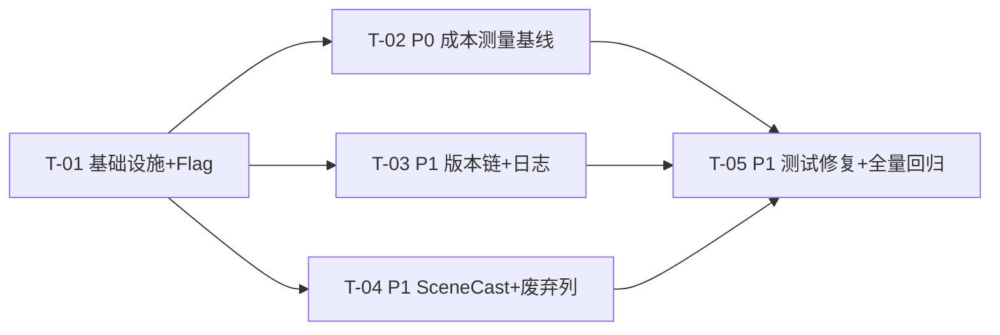

# 2026-08-07 P0+P1 增量架构设计与任务分解

> 状态：P0+P1 增量架构设计（基于已批准的《2026-08-07-P0P1-增量PRD.md》与《数据结构与生成架构统一方案.md》）
>
> 上位文档：
> - 《2026-08-07-P0P1-增量PRD.md》（本次需求权威，§4 需求池 / §5 Flag / §6 迁移）
> - 《2026-08-07-数据结构与生成架构统一方案.md》（§4.1 版本链 / §4.3 SceneCast / §4.5 日志 / §5.1 测量 / §7 P0/P1 / §9 迁移 / §13 执行配套）
>
> 范围：P0 成本测量基线 + P1 五项低风险止血。P2/P3/P4 不在此文档展开。
>
> 所有结构迁移遵循「新增结构 → 双写 → 对账 → 切读 → 停旧写 → 观察一个版本 → 删除旧结构」，Feature Flag 默认关闭，每个迁移任务携带 `MigrationAcceptance`。

---

## 1. 实现方案概览与框架选型

### 1.1 核心思路

本次不引入新框架、不改变生成行为。全部改动围绕「**旁路测量** + **低风险止血**」两条主线：

1. **P0 测量**：在 `runAgentOnce` 上下文组装处做**纯内存旁路埋点**（不改 prompt 内容、不改生成路径），把 section 级字符数/token 估算/内容哈希落到独立度量表；报表与重复率统计全部从 `novel_agent_logs` + 度量表只读聚合。
2. **P1 止血**：五处改动全部由默认关闭的 Feature Flag 控制，遵循双写对账规范，任意一步可切回旧路径。

### 1.2 框架选型（沿用现有栈，不新增依赖）

| 关注点 | 选型 | 理由 |
|---|---|---|
| 数据库 | `better-sqlite3@^12.11.1`（内嵌 SQLite ≥ 3.4x） | 已用；`DROP COLUMN`（3.35+）、JSON 函数、`ALTER TABLE` 均可用 |
| 迁移机制 | `novel-migrations.ts` 静态 `MigrationDefinition[]`（`IF NOT EXISTS` 幂等） | 已用；plugin 启动前执行，新增 087/088/089 三段 |
| Feature Flag | `novel-feature-flags.ts` + `novel_projects.feature_flags` JSON（默认 false，解析失败安全 false） | 已用；新增 5 个 flag 消费 |
| 压缩 | `node:zlib`（内置 gzip） | 日志 payload 外置压缩，无第三方依赖 |
| 哈希 | `node:crypto` `createHash('sha256')` | `sourceHash` / `content_hash` 稳定可复现 |
| 对账/报表脚本 | Node ESM `.mjs`（读 `wenlang-agent.db` 只读） | 复用 `scripts/e2e-test/lib/db-verify.mjs` 模式 |
| 测试 | `vitest` + `better-sqlite3 :memory:` | 沿用现有单测模式 |

### 1.3 架构模式

- **Store 层**：继续使用现有 `ChapterStore / GraphStore / ScenePlanStore` 类，通过**构造函数注入 `FeatureFlagProjectSource`** 读取项目级 flag，不新增抽象层。
- **旁路测量**：新增 `ContextSectionCollector`（内存收集器），由 `NovelOrchestrator.runAgentOnce` 在既有 section 组装点**只读**采集，`finally` 中随 `insertAgentLog` 一并持久化。
- **报表/对账**：新增 `CostReportService`（REST 只读聚合）与 `scripts/novel-migration-tools/*.mjs`（CLI 对账/导出），两者共用同一组只读 SQL，保证口径一致。
- **冷热分离**：`novel_agent_logs` 保持元数据列，大文本走 `novel_agent_log_payloads`（gzip BLOB + `content_hash` + `expires_at`）；读取时按需解压、缺 payload 兜底旧列。

---

## 2. 文件级改动清单

> 标注：`[新增]` / `[修改]` / `[删除]`。路径均相对仓库根 `D:\WebWork\AI\pi-agent`。

### 2.1 P0 成本测量基线（T-02）

| 文件 | 改动 |
|---|---|
| `[新增] apps/agent-server/src/plugins/novel-plugin/core/context-section-metrics.ts` | `ContextSectionMetric` 类型、`ContextSectionCollector`（`add(type, sectionId, content, mode)`）、`estimateTokensFromChars()`、`hashText()`（sha256） |
| `[新增] apps/agent-server/src/plugins/novel-plugin/core/cost-report-service.ts` | `CostReportService`：章成本报表、Agent 成本占比、`formatArrangedEntities` 占 shared 比例、tool schema 占输入比例、round-trip、cache-read/input 比例；JSON/CSV 导出 |
| `[新增] apps/agent-server/src/plugins/novel-plugin/core/shared-overlap-analyzer.ts` | 相邻章 shared 重复率：归一化（去空白/换行）后重复字符占比；全 shared 与「仅实体档案 section」双口径；top 高频重复 section |
| `[修改] apps/agent-server/src/plugins/novel-plugin/core/stores/graph-store.ts` | 新增 `insertContextSectionMetrics()` / `listContextSectionMetrics()`（独立度量表） |
| `[修改] apps/agent-server/src/plugins/novel-plugin/core/novel-orchestrator.ts` | `runAgentOnce`：在 system/shared/identity/suffix/dynamic/tool-schema 组装点调用 `collector.add()`；`finally` 中随 `insertAgentLog` 写度量；**不改 prompt 内容** |
| `[修改] apps/agent-server/src/plugins/novel-plugin/core/prompt-builder.ts` | 仅暴露可被收集器引用的 section 构建辅助（如把 `formatArrangedEntities` 输出单独取一次），保证「实体档案」可单独计量；不改输出文本 |
| `[修改] apps/agent-server/src/plugins/novel-plugin/novel-migrations.ts` | 新增 `087_create_context_section_metrics`（建 `novel_context_section_metrics`） |
| `[修改] apps/agent-server/src/plugins/novel-plugin/novel-routes.ts` | 新增 `GET /projects/:projectId/cost-report`、`GET /projects/:projectId/agent-cost-share`、`GET /projects/:projectId/shared-overlap` |
| `[新增] apps/agent-server/scripts/novel-migration-tools/cost-report.mjs` | CLI：按 project_id + chapter_number 输出 JSON/CSV 报表 |
| `[新增] apps/agent-server/scripts/novel-migration-tools/sample-baseline.mjs` | CLI：按 §13.3 采样要求跑批，落盘基线报告 |
| `[新增] docs/novel/2026-08-07-成本基线采样结论模板.md` | P0-4 结论模板（固定字段，见 §5.4） |
| `[新增] apps/agent-server/src/plugins/novel-plugin/__tests__/context-section-metrics.test.ts` | 埋点结构/sourceHash/开销/不改变输出 |
| `[新增] apps/agent-server/src/plugins/novel-plugin/__tests__/cost-report-service.test.ts` | 报表六项指标 + 可下钻 |

### 2.2 P1-1 版本链收敛（T-03 之一）

| 文件 | 改动 |
|---|---|
| `[修改] apps/agent-server/src/plugins/novel-plugin/core/novel-feature-flags.ts` | `NovelFeatureFlag` 新增 `versionChainV2Read` / `versionChainV2Write`，`NOVEL_FEATURE_FLAGS` 同步 |
| `[修改] apps/agent-server/src/plugins/novel-plugin/core/stores/chapter-store.ts` | 构造注入 `FeatureFlagProjectSource`；`listChapterVersions/getChapterVersion/getLatestVersion/rollbackToVersion` 在 `versionChainV2Read` 开启时**委托 V2 方法**；`saveChapterVersionInternal` 在 `versionChainV2Write` 开启时**不再 INSERT 旧表**；新增 `reconcileVersionChains()` |
| `[修改] apps/agent-server/src/plugins/novel-plugin/core/novel-store.ts` | 构造透传 flags；新增 `reconcileVersionChains` 透传 |
| `[修改] apps/agent-server/src/plugins/novel-plugin/routes/chapter-routes.ts` | `/chapters/:id/versions*` 读源按 flag 切 V2（复用现有 `content-revisions` 语义） |
| `[修改] apps/desktop/src/renderer/src/components/novel/chapter-version-panel.tsx` | 版本列表/详情/回滚主读源切 V2（`listContentRevisions` / `rollbackToContentRevision` 已具备，补默认展示与回滚文案） |
| `[新增] apps/agent-server/scripts/novel-migration-tools/reconcile-version-chains.mjs` | 新旧版本按 (chapter_id, content hash) 对账，输出报告 |
| `[修改] apps/agent-server/src/plugins/novel-plugin/__tests__/content-revision-store.test.ts` | 覆盖 flag 开/关两态 + 对账方法 |

### 2.3 P1-2 Agent 日志冷热分离（T-03 之二）

| 文件 | 改动 |
|---|---|
| `[修改] apps/agent-server/src/plugins/novel-plugin/core/novel-feature-flags.ts` | 新增 `logPayloadExternalized` |
| `[修改] apps/agent-server/src/plugins/novel-plugin/novel-migrations.ts` | 新增 `087_create_agent_log_payloads`（建 `novel_agent_log_payloads` + `ALTER novel_agent_logs ADD COLUMN payload_id`） |
| `[修改] apps/agent-server/src/plugins/novel-plugin/core/stores/graph-store.ts` | `insertAgentLog` 在 flag 开时：主表写元数据 + `payload_id`，大文本字段 gzip 写 payload 表；`getAgentLog` 按需解压、缺 payload 兜底旧列；列表查询**不加载 payload**；新增 `cleanupExpiredPayloads()` |
| `[新增] apps/agent-server/src/plugins/novel-plugin/core/log-payload-service.ts` | gzip/解压、`content_hash`（对非空字段 JSON 规范化后 sha256）、保留策略常量（成功 30d / 失败 90d / 收藏审计 365d / 元数据长期） |
| `[修改] apps/agent-server/src/plugins/novel-plugin/core/novel-store.ts` | 透传 `cleanupExpiredPayloads` / payload 读取选项 |
| `[修改] apps/agent-server/src/plugins/novel-plugin/novel-routes.ts` | 新增 `POST /admin/agent-log-payloads/cleanup`（手动触发清理，可选） |
| `[新增] apps/agent-server/scripts/novel-migration-tools/verify-log-payloads.mjs` | payload 解压回读校验（content_hash + 字段完整性） |
| `[新增] apps/agent-server/scripts/novel-migration-tools/cleanup-log-payloads.mjs` | 按保留策略清理过期 payload（元数据不删） |
| `[新增] apps/agent-server/src/plugins/novel-plugin/__tests__/log-payload-store.test.ts` | 写/读兼容/行体积下降/清理 |

### 2.4 P1-3 Scene Cast 合并（T-04 之一）

| 文件 | 改动 |
|---|---|
| `[修改] apps/agent-server/src/plugins/novel-plugin/core/novel-feature-flags.ts` | 新增 `sceneCastV2Write` / `sceneCastV2Read` |
| `[修改] apps/agent-server/src/plugins/novel-plugin/novel-migrations.ts` | 新增 `088_create_novel_scene_cast` |
| `[修改] apps/agent-server/src/plugins/novel-plugin/core/stores/scene-plan-store.ts` | 构造注入 flags；`replaceCast` 在 `sceneCastV2Write`（与 `scenePlanV2DualWrite` 联动）开启时**三表 + cast 影子写**；`getSceneRevisionCast` 在 `sceneCastV2Read` 开启时**读 cast 表**；新增 `getSceneCast()` / `reconcileSceneCast()`；focus+present 并存去重规则（见 §4.4） |
| `[修改] apps/agent-server/src/plugins/novel-plugin/core/novel-store.ts` | 透传新方法 |
| `[新增] apps/agent-server/scripts/novel-migration-tools/reconcile-scene-cast.mjs` | 三表 → cast 往返对账 |
| `[修改] apps/agent-server/src/plugins/novel-plugin/__tests__/scene-plan-store.test.ts` | 兼容 flag 关（旧路径）断言 |
| `[新增] apps/agent-server/src/plugins/novel-plugin/__tests__/scene-cast-merge.test.ts` | 影子写/切读/往返数量/功能位不丢/去重规则 |

### 2.5 P1-4 废弃列清理（T-04 之二）

| 文件 | 改动 |
|---|---|
| `[修改] apps/agent-server/src/plugins/novel-plugin/novel-migrations.ts` | 新增 `089_drop_conflicts_factions_deprecated_columns`（`DROP COLUMN` × 4） |
| `[修改] apps/agent-server/src/plugins/novel-plugin/core/stores/conflict-store.ts` | `createConflict/updateConflict` 移除 `first_chapter/last_chapter` 写（保留 `chapter_spans`） |
| `[修改] apps/agent-server/src/plugins/novel-plugin/core/stores/faction-store.ts` | 同上 |
| `[修改] apps/agent-server/scripts/e2e-test/lib/db-verify.mjs` | `verifyChapterDimensions`（GAP C）改为读 `chapter_spans`（不再读废弃列） |
| `[修改] apps/agent-server/scripts/e2e-test/run-e2e.mjs` | 同步调用口径 |
| `[新增] apps/agent-server/scripts/novel-migration-tools/scan-deprecated-columns.mjs` | 删除前引用扫描（业务代码 + SQL + e2e 断言，输出 = 0） |
| `[修改] apps/agent-server/src/plugins/novel-plugin/__tests__/matrix-projection.test.ts` 等 | 若 fixture 含废弃列字段则同步清理 |

### 2.6 P1-5 Prompt 协议测试修复（T-05）

| 文件 | 改动 |
|---|---|
| `[修改] apps/agent-server/src/plugins/novel-plugin/__tests__/prompt-protocol.test.ts` | 断言对齐当前 `core/prompts/*.md`；引用共享常量；移除/修正过时断言 |
| `[新增] apps/agent-server/src/plugins/novel-plugin/core/prompts-protocol-constants.ts` | 协议关键词/因果链/比喻约束等共享常量（防再漂移） |
| `[修改] apps/agent-server/src/plugins/novel-plugin/core/prompts/role-writer.md` 等（按需） | 仅当「协议意图优先」判定需要修正提示词时才改（默认先改断言） |
| `[新增] apps/agent-server/src/plugins/novel-plugin/__tests__/prompt-protocol-constants.test.ts` | 常量与提示词文件内容一致性守卫 |

### 2.7 共享基础设施（T-01）

| 文件 | 改动 |
|---|---|
| `[修改] apps/agent-server/src/plugins/novel-plugin/core/novel-feature-flags.ts` | 新增 5 个 flag 类型 + 常量（见 §3） |
| `[修改] apps/agent-server/src/plugins/novel-plugin/__tests__/novel-feature-flags.test.ts` | 覆盖新增 flag 默认关闭 |
| `[新增] apps/agent-server/src/plugins/novel-plugin/core/migration-acceptance.ts` | `MigrationAcceptance` 接口 + 报告工具函数 |
| `[新增] apps/agent-server/scripts/novel-migration-tools/README.md` | 对账/报表脚本用法与输出格式约定 |
| `[修改] apps/agent-server/scripts/e2e-test/lib/db-verify.mjs` | 预留版本链 / payload / scene_cast 验证函数骨架（T-03/T-04 填充） |

---

## 3. Feature Flag 设计（新增 5 个，默认全关）

> 现状：`novel-feature-flags.ts` 已实现 5 个（`scenePlanV2Write / scenePlanV2DualWrite / memoryProposalV2 / matrixProjectionV2Read / legacyNarrativeWriteDisabled`）。
> 方案 §13.1 目标清单 13 个；本次新增 PRD §5 的 5 个，累计消费 10 个；其余 8 个（`appearanceV2Write/Read / memoryOperationLedger / contextChunksEnabled / contextSummaryMode / thinAgentIdentity / crossChapterChunkCache / sceneLevelWriter`）属 P2+ 预留，本次不建。

| Flag | 默认 | 影响面 | 开启前提（PRD §5） | 关闭方式 |
|---|---|---|---|---|
| `versionChainV2Read` | 关 | 前端版本面板、版本回滚 API 读源切 `content_revisions` | 版本对账差异 = 0（P1-1-5） | 切回旧读 API |
| `versionChainV2Write` | 关 | 新正文只写 V2 版本链（旧表停止 INSERT） | 所有消费者已切 V2 读 | 恢复双写 |
| `logPayloadExternalized` | 关 | Agent 日志大文本写入 payload 表（gzip） | payload 读写兼容旧字段（P1-2-3） | 读旧字段兜底 |
| `sceneCastV2Write` | 关 | Scene 角色只写 `novel_scene_cast`（三表停新增） | 三表→cast 转换对账一致（P1-3-1/2/3） | 恢复三表写 |
| `sceneCastV2Read` | 关 | ScenePlan 往返读取 cast 表 | 影子写对账无差异（P1-3-3） | 读旧三表 |

**联动规则**：
- `sceneCastV2Write/Read` 与既有 `scenePlanV2DualWrite` 联动（`scenePlanV2DualWrite` 开启是影子写的前提），但不互相替代。
- P0 埋点**不引入 flag**：使用独立开关 `contextSectionMetricEnabled`（常量/env `NOVEL_CONTEXT_METRIC_ENABLED`，默认 true），不进 `feature_flags` JSON（flag 机制默认 false，不适合"默认开"开关）。
- 删除列（P1-4）不设 flag（不可逆，靠引用扫描 + 观察期控制）。
- 新增 flag 必须同步更新 `NOVEL_FEATURE_FLAGS` 常量与 `NovelFeatureFlag` 联合类型。

---

## 4. 数据结构与接口

### 4.1 新表 SQL（迁移 087 / 088 / 089）

#### 087a：`novel_agent_log_payloads`（P1-2 冷热分离）

```sql
CREATE TABLE IF NOT EXISTS novel_agent_log_payloads (
  id                    TEXT PRIMARY KEY,          -- 与 novel_agent_logs.payload_id 对应
  agent_log_id          TEXT NOT NULL UNIQUE,      -- 反查主表，级联删除
  compression           TEXT NOT NULL DEFAULT 'gzip',
  system_prompt_blob    BLOB,
  chapter_context_blob  BLOB,
  user_message_blob     BLOB,
  task_input_blob       BLOB,
  user_instructions_blob BLOB,
  tools_blob            BLOB,
  result_blob           BLOB,
  error_blob            BLOB,
  content_hash          TEXT NOT NULL,             -- 非空字段 JSON 规范化后 sha256
  expires_at            INTEGER,                   -- 保留策略到期时间戳（NULL=长期）
  created_at            INTEGER NOT NULL,
  FOREIGN KEY (agent_log_id) REFERENCES novel_agent_logs(id) ON DELETE CASCADE
);
CREATE INDEX IF NOT EXISTS idx_agent_log_payloads_expires ON novel_agent_log_payloads(expires_at);
CREATE INDEX IF NOT EXISTS idx_agent_log_payloads_log ON novel_agent_log_payloads(agent_log_id);

-- 主表加 payload_id（元数据仍留在主表，大文本外置）
ALTER TABLE novel_agent_logs ADD COLUMN payload_id TEXT;
```

#### 087b：`novel_context_section_metrics`（P0-1 埋点）

```sql
CREATE TABLE IF NOT EXISTS novel_context_section_metrics (
  id               TEXT PRIMARY KEY,
  agent_log_id     TEXT NOT NULL,
  project_id       TEXT NOT NULL,
  chapter_number   INTEGER NOT NULL,
  agent_type       TEXT NOT NULL,
  section_type     TEXT NOT NULL,                  -- system | shared | identity | suffix | dynamic | tool_schema
  section_id       TEXT NOT NULL,                  -- 如 chapter-info / story-ledger / arranged-entities / ...
  chars            INTEGER NOT NULL,
  estimated_tokens INTEGER NOT NULL,
  source_hash      TEXT NOT NULL,                  -- sha256(规范化文本)
  mode             TEXT NOT NULL DEFAULT 'full',   -- full | summary | on-demand
  created_at       INTEGER NOT NULL,
  FOREIGN KEY (agent_log_id) REFERENCES novel_agent_logs(id) ON DELETE CASCADE
);
CREATE INDEX IF NOT EXISTS idx_context_section_metrics_log ON novel_context_section_metrics(agent_log_id);
CREATE INDEX IF NOT EXISTS idx_context_section_metrics_project ON novel_context_section_metrics(project_id, chapter_number);
```

#### 088：`novel_scene_cast`（P1-3 三表合并）

```sql
CREATE TABLE IF NOT EXISTS novel_scene_cast (
  scene_revision_id TEXT NOT NULL,
  character_id      TEXT NOT NULL,
  role              TEXT NOT NULL,                 -- focus | present | functional
  function          TEXT,                          -- 仅 functional 必填
  prominence        TEXT,                          -- lead | support | brief（对齐现有 functions.prominence 语义，TEXT 非 REAL）
  note              TEXT,
  PRIMARY KEY (scene_revision_id, character_id, role),
  FOREIGN KEY (scene_revision_id) REFERENCES novel_scene_revisions(id) ON DELETE CASCADE,
  CHECK (role IN ('focus', 'present', 'functional')),
  CHECK (role != 'functional' OR function IS NOT NULL)
);
CREATE INDEX IF NOT EXISTS idx_scene_cast_revision ON novel_scene_cast(scene_revision_id);
```

> ⚠️ 与统一方案 §4.3 的差异说明：方案 SQL 中 `prominence REAL`，但现有 `novel_scene_functions.prominence` 为 TEXT（`lead/support/brief`，见 `chapter-scene-plan.ts` `CastProminence`）。为保证 P1-3「功能位字段级对比差异 = 0」，本设计采用 **TEXT**。此为已明确的实现修正。

#### 089：`DROP COLUMN`（P1-4 废弃列）

```sql
ALTER TABLE novel_conflicts DROP COLUMN first_chapter;
ALTER TABLE novel_conflicts DROP COLUMN last_chapter;
ALTER TABLE novel_factions  DROP COLUMN first_chapter;
ALTER TABLE novel_factions  DROP COLUMN last_chapter;
```

> 前置：`045_add_chapter_spans_to_conflicts_factions` 已把旧值回填进 `chapter_spans`；`089` 在 `045` 之后执行，两列无索引/无约束依赖，SQLite 3.35+ 可安全 DROP。`foreshadowing / locations / items` 的 first_chapter 不在本次范围。

### 4.2 Store API 签名

```ts
// ── GraphStore（graph-store.ts）──
export interface InsertAgentLogOptions {
  externalizePayload?: boolean   // 由 flag logPayloadExternalized 驱动
}
insertAgentLog(input: Omit<NovelAgentLog, 'id' | 'createdAt'>, opts?: InsertAgentLogOptions): NovelAgentLog
getAgentLog(id: string, opts?: { loadPayload?: boolean }): NovelAgentLog          // loadPayload=false 时大文本字段以旧列兜底
listAgentLogs(projectId, filter?, limit?): NovelAgentLogSummary[]                 // 永不加载 payload
cleanupExpiredPayloads(nowMs?: number): { deleted: number; scanned: number }
insertContextSectionMetrics(rows: ContextSectionMetricInput[]): void
listContextSectionMetrics(projectId: string, chapterNumber?: number): ContextSectionMetric[]

// ── ChapterStore（chapter-store.ts）──
constructor(db, deleteEdgesByEntity, renumberService, flags?: FeatureFlagProjectSource)
listChapterVersions(chapterId): ChapterVersionSummary[]       // versionChainV2Read → listContentRevisions 包装
getChapterVersion(versionId): ChapterVersion | undefined      // versionChainV2Read → getContentRevision 包装
getLatestVersion(chapterId): ChapterVersion | undefined       // versionChainV2Read → getCurrentContentRevision 包装
rollbackToVersion(chapterId, versionId): RollbackResult       // versionChainV2Read → rollbackToContentRevision 包装
saveChapterVersionInternal(chapter, source): void             // versionChainV2Write 开启时 no-op（停旧写点）
reconcileVersionChains(projectId): VersionChainReconcileReport

// ── ScenePlanStore（scene-plan-store.ts）──
constructor(db, flags?: FeatureFlagProjectSource)
replaceCast(sceneRevisionId, scene): void                     // sceneCastV2Write 开启时：三表 + cast 影子写
getSceneRevisionCast(sceneRevisionId): { focus; present; functions }  // sceneCastV2Read 开启时读 cast 表
getSceneCast(sceneRevisionId): NovelSceneCast[]
reconcileSceneCast(projectId?): SceneCastReconcileReport
```

### 4.3 类型定义（@repo/shared/novel 或 core 内新增）

```ts
type ContextSectionType = 'system' | 'shared' | 'identity' | 'suffix' | 'dynamic' | 'tool_schema'
type ContextSectionMode = 'full' | 'summary' | 'on-demand'

interface ContextSectionMetric {
  id: string
  agentLogId: string
  projectId: string
  chapterNumber: number
  agentType: string
  sectionType: ContextSectionType
  sectionId: string
  chars: number
  estimatedTokens: number
  sourceHash: string
  mode: ContextSectionMode
  createdAt: number
}

interface MigrationAcceptance {
  sourceRows: number
  targetRows: number
  mismatchRows: number        // 验收 = 0
  orphanRows: number          // 验收 = 0
  duplicateRows: number       // 验收 = 0
  rollbackVerified: boolean   // 验收 = true
}

interface VersionChainReconcileReport extends MigrationAcceptance {
  checkedChapters: number
  mismatchedChapters: Array<{ chapterId: string; oldHash: string; newHash: string }>
}
interface SceneCastReconcileReport extends MigrationAcceptance {
  checkedSceneRevisions: number
  mismatchByRole: Record<'focus' | 'present' | 'functional', number>
}
```

### 4.4 关键语义决策

- **focus + present 并存去重规则**：同一 `(scene_revision_id, character_id)` 可同时存在 `focus` 与 `present` 两行（主键含 role 允许）。读取侧规则：**focus 优先**——`getSceneRevisionCast` 返回的 `present` 列表**排除**同时是 focus 的角色；`getSceneCast` 原样返回全部行（数据层保真）。单测覆盖。
- **P0 六类 section 映射**：
  - `system` ← `buildSystemPrompt` 输出；
  - `shared` ← `buildChapterContextShared` 输出（含 `formatArrangedEntities` 子 section，单独计 `sectionId='arranged-entities'`）；
  - `identity` ← `buildAgentIdentity` 输出；
  - `suffix` ← `buildChapterContextSuffix` 输出；
  - `dynamic` ← `userMessage` / `taskInput`；
  - `tool_schema` ← `finalTools.map(t => JSON.stringify({name, description}))` 序列化后。
- **token 估算**：`estimateTokensFromChars(chars) = Math.ceil(chars * RATIO)`，中文文本 `RATIO=0.8`（注释口径：1 中文字符 ≤ 1 token），纯 ASCII 段 `RATIO=0.25`；仅用于 section 级相对占比，真实 token 仍以 `novel_agent_logs.input_tokens/cache_read_tokens` 为准。
- **保留策略（§4.5）**：成功 payload 30 天 / 失败 90 天 / 收藏或审计锁定 365 天 / 元数据长期。清理任务首版提供**手动触发接口 + CLI**，定时调度由部署侧 cron/env 决定（不内置常驻定时器，避免隐式副作用）。

---

## 5. 数据迁移方案（每迁移：双写/对账/切读/停旧写/回滚 + MigrationAcceptance）

> 通用安全规范（PRD §6.1）：禁止新表一建好就删旧列；禁止未填消费者清单就删表；禁止无 Flag 就切核心路径；禁止不可靠推断批量回填；禁止删审计字段。

### 5.1 P1-1 版本链收敛（迁移对象 `novel_chapter_versions` → `novel_chapter_content_revisions`）

**消费者清单（迁移第一步，填不满不动结构）**：

| 消费者 | 读/写 | 迁移方式 | 完成标记 |
|---|---|---|---|
| `chapter-version-panel.tsx`（版本列表/详情/回滚） | 读 | 切 V2 读源（flag `versionChainV2Read`） | ☐ |
| `chapter-routes.ts` `/chapters/:id/versions*` | 读/写 | 切 V2 + 写（flag） | ☐ |
| `chapter-store.ts` 旧表读方法（list/get/getLatest） | 读 | 切 V2 委托 | ☐ |
| `chapter-finalizer` / `chapter-store.updateChapter/updateChapterContent/rollback*` | 写 | 停旧写（flag `versionChainV2Write`） | ☐ |
| e2e `db-verify.mjs` | 读 | 新增版本链验证 | ☐ |

- **双写点**：现状已双写（`saveChapterVersionInternal` 与 `appendContentRevision` 同路径执行）。
- **对账脚本**：`reconcile-version-chains.mjs` 按 `(chapter_id, content)` sha256 对比旧表全部行与 V2 链，并校验 `novel_chapters.current_content_revision_id` 指向的 content == `novel_chapters.content`。
- **切读开关**：`versionChainV2Read`（前端面板 + 后端 versions API）。
- **停旧写点**：`saveChapterVersionInternal` 在 `versionChainV2Write` 开启时直接 return（不再 INSERT）。
- **观察期**：旧表保留只读 ≥ 1 个发布版本，**本次不删除**。
- **回滚方式**：关闭 `versionChainV2Read` 恢复旧读 API；关闭 `versionChainV2Write` 恢复双写；旧表数据未动。

```ts
const acceptance: MigrationAcceptance = {
  sourceRows: 旧表行数, targetRows: V2 链行数,
  mismatchRows: 0, orphanRows: 0, duplicateRows: 0, rollbackVerified: true,
}
```

### 5.2 P1-2 Agent 日志冷热分离（新增 `novel_agent_log_payloads`）

- **双写点**：`insertAgentLog` 在 `logPayloadExternalized` 开启时：主表写元数据 + `payload_id`，大文本 gzip 写 payload 表；关闭时保持现状（全量写主表）。
- **对账脚本**：`verify-log-payloads.mjs` 解压 payload 与主表旧字段做 `content_hash` 校验 + 字段完整性对比（system/context/user/task/result/error）。
- **切读**：`getAgentLog` 按需解压（`loadPayload=true`）；列表查询不加载 payload。
- **停旧写**：无"旧写停止"——flag 开即改走 payload（旧列不再写大文本，旧列保留只读兼容）。
- **观察期**：保留策略验证期（≥ 1 个发布版本）。
- **回滚方式**：关闭 flag 后新日志全量写主表；既有 payload 行仍可读（`loadPayload=false` 时兜底旧列为空串，详情按需解压）。

```ts
const acceptance: MigrationAcceptance = {
  sourceRows: 主表行数, targetRows: payload 行数,
  mismatchRows: 0, orphanRows: 0, duplicateRows: 0, rollbackVerified: true, // 关闭 flag 读旧列回放
}
```

### 5.3 P1-3 Scene Cast 合并（新增 `novel_scene_cast`）

- **双写点**：`replaceCast` 在 `sceneCastV2Write`（前提 `scenePlanV2DualWrite` 开启）时：三表写 + cast 影子写（同一事务）。
- **对账脚本**：`reconcile-scene-cast.mjs` 按 `scene_revision_id` 对比三表 → cast 往返数量（focus/present/functionalCast 各角色集合与字段）。
- **切读开关**：`sceneCastV2Read`（`getSceneRevisionCast` 读 cast 表）。
- **停旧写点**：`sceneCastV2Write` 开启后三表不再新增（影子写升为主写）。
- **观察期**：旧三表保留只读 ≥ 1 个发布版本，**本次不删除**。
- **回滚方式**：关闭 `sceneCastV2Read` 读旧三表；关闭 `sceneCastV2Write` 恢复三表写。

```ts
const acceptance: MigrationAcceptance = {
  sourceRows: 三表行数之和, targetRows: cast 行数,
  mismatchRows: 0, orphanRows: 0, duplicateRows: 0, rollbackVerified: true,
}
```

### 5.4 P1-4 废弃列清理（`conflicts/factions` first_chapter/last_chapter）

- **双写点**：无（现状 `conflict-store/faction-store` 仍写派生值，先摘除写路径）。
- **对账**：删除前导出两表 `(id, chapter_spans, first_chapter, last_chapter)` 一致性快照 JSON 存档；`chapterSpans` 可推导性对账（`first = spans[0][0]`，`last = spans[0][1]`，差异 = 0）。
- **切读开关**：无（读路径已由 `chapterSpans` 兜底）。
- **停旧写点**：`createConflict/updateConflict/createFaction/updateFaction` 移除两列写。
- **观察期**：引用扫描（`scan-deprecated-columns.mjs` 输出业务引用 = 0）+ 观察。
- **删除**：迁移 089 `DROP COLUMN` × 4（SQLite 3.35+，`better-sqlite3@^12` 满足）。
- **回滚方式**：删除前快照导出（JSON）+ 建表迁移回放（旧库备份）。不可逆操作，靠前置扫描与观察期控制。

```ts
const acceptance: MigrationAcceptance = {
  sourceRows: conflicts 行数 + factions 行数, targetRows: 同（行数不变）,
  mismatchRows: 0, orphanRows: 0, duplicateRows: 0, rollbackVerified: true, // 快照可恢复
}
```

### 5.5 P1-5 Prompt 协议测试修复（无结构迁移）

- 漂移判定：见 §8 待明确事项 Q-4 的初查结论（当前测试 10/10 通过，但存在**子串匹配掩盖意图漂移**，如 4 元素 vs 5 元素因果链）。
- 处理原则：协议意图优先——先核对断言是否为产品既定协议（场景动力五要素、信息差、反 AI 规则、比喻约束），是则以协议为准修正提示词或断言；引用已删内容则更新断言。
- 防再漂移：协议关键词抽为 `prompts-protocol-constants.ts` 常量，测试引用常量。

---

## 6. 任务列表（有序、含依赖）

> 任务按「基础设施 → P0 → P1」串行主线；T-03 与 T-04 无强依赖（可并行，推荐顺序执行以保证迁移编号稳定）。

### T-01：P0/P1 基础设施与 Feature Flag（依赖：无，P0）
- **Source Files**：`core/novel-feature-flags.ts`、`__tests__/novel-feature-flags.test.ts`、`core/migration-acceptance.ts`、`scripts/novel-migration-tools/README.md`、`scripts/e2e-test/lib/db-verify.mjs`（预留骨架）
- **内容**：新增 5 个 flag（`versionChainV2Read/Write`、`logPayloadExternalized`、`sceneCastV2Write/Read`）类型 + 常量 + 测试；`MigrationAcceptance` 类型；对账脚本目录与 e2e 骨架。
- **验收**：flag 默认全关；`isNovelFeatureEnabled` 对新增 flag 安全返回 false；`NOVEL_FEATURE_FLAGS` 长度 = 10。

### T-02：P0 成本测量基线（依赖：T-01，P0）
- **Source Files**：`core/context-section-metrics.ts`、`core/cost-report-service.ts`、`core/shared-overlap-analyzer.ts`、`core/stores/graph-store.ts`、`core/novel-orchestrator.ts`、`core/prompt-builder.ts`、`novel-migrations.ts`（087b）、`novel-routes.ts`、`scripts/novel-migration-tools/cost-report.mjs`、`scripts/novel-migration-tools/sample-baseline.mjs`、`docs/novel/2026-08-07-成本基线采样结论模板.md`、`__tests__/context-section-metrics.test.ts`、`__tests__/cost-report-service.test.ts`
- **内容**：PRD T00-1~4。旁路埋点（六类 section）+ 度量表 + 报表服务 + 相邻章重复率 + 基线模板 + CLI。
- **验收**：PRD §4.1 全部量化标准（见 §7）。

### T-03：P1 版本链收敛 + 日志冷热分离（依赖：T-01，P1）
- **Source Files**：`core/novel-feature-flags.ts`、`core/stores/chapter-store.ts`、`core/stores/graph-store.ts`、`core/log-payload-service.ts`、`core/novel-store.ts`、`novel-migrations.ts`（087a）、`routes/chapter-routes.ts`、`novel-routes.ts`、`apps/desktop/.../chapter-version-panel.tsx`、`scripts/novel-migration-tools/reconcile-version-chains.mjs`、`scripts/novel-migration-tools/verify-log-payloads.mjs`、`scripts/novel-migration-tools/cleanup-log-payloads.mjs`、`__tests__/content-revision-store.test.ts`、`__tests__/log-payload-store.test.ts`
- **内容**：PRD T01-1~4。版本链消费者清单 + V2 切读 + 停旧写 + 对账；日志 payload 外置 + 保留策略。
- **验收**：PRD §4.2 P1-1 / P1-2 全部量化标准（见 §7）。

### T-04：P1 Scene Cast 合并 + 废弃列清理（依赖：T-01，P1）
- **Source Files**：`core/novel-feature-flags.ts`、`core/stores/scene-plan-store.ts`、`core/stores/conflict-store.ts`、`core/stores/faction-store.ts`、`core/novel-store.ts`、`novel-migrations.ts`（088、089）、`scripts/novel-migration-tools/reconcile-scene-cast.mjs`、`scripts/novel-migration-tools/scan-deprecated-columns.mjs`、`scripts/e2e-test/lib/db-verify.mjs`、`scripts/e2e-test/run-e2e.mjs`、`__tests__/scene-plan-store.test.ts`、`__tests__/scene-cast-merge.test.ts`
- **内容**：PRD T01-5~6。cast 影子写 + 切读 + 对账 + focus/present 去重规则；废弃列引用扫描 + DROP COLUMN + e2e GAP C 同步。
- **验收**：PRD §4.2 P1-3 / P1-4 全部量化标准（见 §7）。

### T-05：P1 Prompt 协议测试修复 + 全量回归验收（依赖：T-02/T-03/T-04，P1）
- **Source Files**：`__tests__/prompt-protocol.test.ts`、`core/prompts-protocol-constants.ts`、`__tests__/prompt-protocol-constants.test.ts`、`core/prompts/*.md`（按需）
- **内容**：PRD T01-7。断言对齐 + 常量抽取 + 全量 `npm test` + e2e 回归。
- **验收**：PRD §4.2 P1-5 全部量化标准（见 §7）。

### 依赖图



---

## 7. 验收指标对照（引用 PRD 量化标准）

| PRD 条目 | 量化验收标准 | 责任任务 |
|---|---|---|
| P0-1-1 | 埋点开启后每个 Agent 调用 ≥ 1 条含六类 section 的度量记录 | T-02 |
| P0-1-2 | `sourceHash` 同文本稳定、异文本可区分 | T-02 |
| P0-1-3 | 抽样 5 章生成结果与埋点前 diff = 0（不改变 prompt 输出） | T-02 |
| P0-1-4 | 单次调用额外耗时 < 50ms（纯内存） | T-02 |
| P0-2-1 | 报表可按 project_id + chapter_number 过滤，输出 6 项指标 | T-02 |
| P0-2-2 | 报表可下钻到 `novel_agent_logs` 原始记录 | T-02 |
| P0-2-3 | ≤ 100 章规模一次采样报告 5 分钟内生成 | T-02 |
| P0-3-1 | 相邻章重复率（0~100%）分布 p50/p75/max | T-02 |
| P0-3-2 | top 高频重复 section 输出 | T-02 |
| P0-3-3 | 结果写入基线报告（P3 决策输入） | T-02 |
| P0-4-1 | 采样 ≥ 30 普通 + 10 多实体 + 10 修订/重写，≥ 2 Provider | T-02 |
| P0-4-2 | 结论模板回答方案 §5.1 全部 8 问 | T-02 |
| P0-4-3 | 报告落盘 docs/novel 可追溯，标注采样时间/Provider/模型/版本 | T-02 |
| P1-1-1 | 旧版本表新增行 = 0（观察期） | T-03 |
| P1-1-2 | 抽查 ≥ 20 章 current revision 与正文 hash 一致，差异 = 0 | T-03 |
| P1-1-3 | 修订/重写/手工保存产生正确 `VersionSource` | T-03 |
| P1-1-4 | 版本面板历史顺序无跳变 | T-03 |
| P1-1-5 | 对账 mismatch = 0；`rollbackVerified = true` | T-03 |
| P1-2-1 | 日志主表平均行体积下降 ≥ 80% | T-03 |
| P1-2-2 | 审计列表查询不加载 payload，按需解压 | T-03 |
| P1-2-3 | flag 开启后面板详情字段与迁移前一致 | T-03 |
| P1-2-4 | 保留策略生效：过期 payload 可清理，元数据不删 | T-03 |
| P1-2-5 | `content_hash` 可去重/校验解压完整性 | T-03 |
| P1-3-1 | 三表→cast 对账（抽样 ≥ 20 scene revision）差异 = 0 | T-04 |
| P1-3-2 | functional 的 function/prominence/note 字段级对比差异 = 0 | T-04 |
| P1-3-3 | 影子写对账差异 = 0 | T-04 |
| P1-3-4 | 旧三表新增写入 = 0（观察期） | T-04 |
| P1-3-5 | focus+present 并存有明确读取规则 + 单测 | T-04 |
| P1-4-1 | 删除后全仓 grep 业务引用 = 0（含 e2e 脚本） | T-04 |
| P1-4-2 | 新库建表迁移不再含这两列 | T-04 |
| P1-4-3 | `chapterSpans` 可推导出场区间（对账差异 = 0） | T-04 |
| P1-4-4 | 全量测试 + e2e 通过 | T-04/T-05 |
| P1-5-1 | `prompt-protocol.test.ts` 全绿（10/10 保持或按协议修正后全绿） | T-05 |
| P1-5-2 | 无断言引用已删除章节/段落 | T-05 |
| P1-5-3 | agent-server `npm test` 全量通过，无新增回归 | T-05 |

---

## 8. 共享知识（跨文件约定）

1. **Feature Flag 命名**：全部小驼峰，存于 `novel_projects.feature_flags` JSON；默认 false；读取失败安全返回 false；新增必须同步 `NovelFeatureFlag` 联合类型 + `NOVEL_FEATURE_FLAGS` 常量 + 单测。
2. **迁移脚本位置**：`apps/agent-server/scripts/novel-migration-tools/`（新增目录），只读打开 `~/.pi/wenlang-agent.db`（`PI_DATA_DIR` 可覆盖），输出 JSON 报告到 `scripts/novel-migration-tools/output/`。对账脚本**只读**，不做写操作。
3. **迁移编号**：`novel-migrations.ts` 顺序追加 `087`（payload + context metrics）、`088`（scene_cast）、`089`（drop 列）；一律 `IF NOT EXISTS` 幂等。
4. **P0 埋点开关**：`contextSectionMetricEnabled` 用常量/env（`NOVEL_CONTEXT_METRIC_ENABLED` 默认 true），**不进入** project feature_flags。
5. **哈希约定**：`sourceHash`/`content_hash` 一律 `sha256`，计算前先归一化（`text.replace(/\s+/g, ' ').trim()`），保证跨环境稳定。
6. **保留策略常量**：成功 30d / 失败 90d / 收藏审计 365d / 元数据长期；`expires_at = created_at + 策略天数`。
7. **所有日期时间戳**：沿用现有 `unixepoch()` 秒级 INTEGER。
8. **审计字段保留**：日志元数据、`display_agent_type/display_agent_name` 本次**不删**（方案 §4.5 明确）。
9. **e2e 口径**：`db-verify.mjs` GAP C 由本团队负责同步（P1-4 后不再读废弃列）；版本链/payload/scene_cast 验证函数在 T-01 预留骨架、T-03/T-04 填充。
10. **禁止事项**：禁止新表一建好就删旧列；禁止未填消费者清单就删表；禁止用不可靠推断批量回填历史数据；禁止删除关键审计字段。

---

## 9. 待明确事项（Open Questions & 架构师决策）

| # | 问题 | 架构师决策 / 假设 |
|---|---|---|
| Q-1 | P0 埋点数据载体 | **决策**：独立 `novel_context_section_metrics` 表 + 随 P1-2 同批次建表（087）。独立表利于按 section_type 聚合报表；payload 表专职大文本冷存储。 |
| Q-2 | P0 报表载体 | **决策**：CLI 脚本 + JSON/CSV 导出 + REST 接口；前端面板（cache-monitor-panel 复用）作为 P2+ 可选增强。理由：报表为一次性/定时使用，CLI 成本最低且满足 PRD Q-5 底线。 |
| Q-3 | 日志 payload 观察期/清理任务 | **决策**：首版提供手动触发接口（`POST /admin/agent-log-payloads/cleanup`）+ CLI；不内置常驻定时器（由部署侧 cron/env 调度）。观察期 = 保留策略验证期（≥ 1 发布版本）。 |
| Q-4 | prompt-protocol 漂移清单 | **初查**：当前测试 10/10 通过，但存在子串匹配掩盖意图漂移——如断言「欲望 → 具体阻力 → 选择 → 后果」（4 元素）而当前提示词统一为「…→ 新问题」（5 元素，见 role-director/role-writer/role-reviewer/chapter-instruction/role-writer-discussion）；writer「写前只确认场景的四件事」vs 当前「…和一条修辞红线」。**处理**：抽共享常量 + 对齐 5 元素因果链断言（协议意图优先）。完整漂移清单由 T-05 逐条核对后记录在案。 |
| Q-5 | 废弃列删除是否允许改 e2e | **决策**：允许，e2e 验收口径由本团队负责（T-04 同步 db-verify GAP C）。 |
| Q-6 | Scene Cast 是否清理 `scene_revisions` 冗余列 | **决策**：本次不动（避免范围膨胀，对齐 PRD Q-6）。 |
| Q-7 | 版本链观察期时长 | **决策**：旧表停写后保留只读 ≥ 1 个发布版本，本次不删除（下个主版本再删）。 |
| Q-8 | `novel_scene_cast.prominence` 类型 | **决策**：TEXT（对齐现有 `CastProminence`），偏离方案 SQL 的 REAL，保证字段级对比差异 = 0。 |
