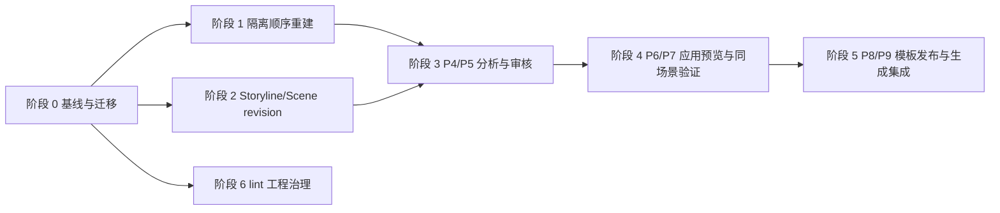

# 小说未交付功能实施方案

> 日期：2026-08-18  
> 依据：`2026-08-10-新增小说功能接口清单.md`、`2026-08-03-参考小说分析功能设计.md`、`2026-08-03-参考小说分析功能接口设计.md`、`2026-08-05-剧情推进模型重构方案.md`、`2026-08-07-数据结构与生成架构最终实施方案.md`  
> 文档性质：实现排期、接口补全、验收与风险控制方案

## 1. 目标与范围

本方案用于完成最近审查中确认的三条产品链路，并把全仓 lint 债务单独纳入工程治理，不将历史债务误写成产品功能已交付：

1. 中间章正文变化后的隔离顺序重建，以及重建完成后的当前态恢复。
2. Storyline/Scene 人工 revision、审核、比较、回滚和矩阵重投影。
3. 参考小说 P4-P9：远端分析运行、结果审核、应用预览、同场景验证、模板发布/绑定、章节生成集成。
4. 全仓 lint 债务的独立清理与门禁恢复。

已交付的参考小说阶段 1（参考源、导入、解析、质量确认、本地报告）以及“章节文风专家蒸馏并在工作流中召集”的轻量链路作为基线保留。本方案不重新实现这些功能，也不把轻量链路当作 P4-P9 的替代品。

## 2. 当前基线

### 2.1 已交付并继续复用

- 参考源、分段、导入预检、解析、质量报告和本地确定性报告。
- `style-distill` 草稿、逐手法卡、证据和排除项审核，以及独立文风专家库。
- 工作流、群聊和自由聊天的定向 Agent 选择与状态透传。
- 章纲 POV 类型约束、JSON 协议失败整体失败、文风 Prompt 字符预算和 Golden Prompt 快照。
- Finalizer 原子提交、正文/content revision、Memory 准入、`stale` 影响标记、剧情轨道只读矩阵和重建影响预览。

### 2.2 部分交付

| 范围 | 已有能力 | 缺口 |
| --- | --- | --- |
| 参考小说 P5 | 文风手法卡保留/丢弃，证据、置信度、排除项 | 统一 profile、finding 全量审核、批量审核、安全报告、版本比较 |
| 中间章重建 | 保存后事务内标记后续派生物 `stale`；影响预览和确认 token | 隔离副本、顺序重放 job、进度/取消/恢复、逐章应用、当前态切换 |
| Storyline/Scene | Store 内有 Storyline、Scene、SceneRevision、Progress | 桌面 CRUD、审核、比较、回滚、矩阵重投影 |

### 2.3 明确未交付

| 产品链路 | 未交付能力 |
| --- | --- |
| P4 | 持久远端分析 run、SSE 进度、取消、失败重试、断点恢复 |
| P5 | Profile/Findings 完整审核和安全检查闭环 |
| P6 | 应用预览、Prompt diff、Token/冲突/专名安全阻断、模板草稿 |
| P7 | 原创同场景基准与模板生成、整改、重新生成、最终决定 |
| P8 | 私人模板库、不可变版本、复制/归档/发布、项目绑定 |
| P9 | 章节生成显式开关、固定版本、实际使用记录和相似度报告 |

## 3. 实施原则与不变量

1. `stale` 只表示派生数据失效，不能冒充重建完成；重建必须显式确认并产生可追踪 job。
2. 本地统计报告只覆盖阶段 1，不能冒充 P4 远端分析 run 或 P5-P9 模板链路。
3. 正文、Storyline、Scene 和模板规则均通过不可变 revision 变更；矩阵只能读，不能通过 PATCH 投影字段改事实。
4. 中间章重建在隔离副本中顺序重放；第 N 章结果未成功应用前，不得污染包含第 N+1 章派生结果的当前快照。
5. 参考原文与当前项目事实隔离。参考原文人物、地点、专名、独特物件、精确剧情序列不得进入当前项目实体库、Memory、Prompt 或原创验证场景。
6. 新 Conflict/Clue 先落 `needs_review` 候选，用户确认后才能晋升正式实体；拒绝必须有原因和审计记录。
7. 模板版本发布后不可变；项目绑定固定 `templateVersionId`，模板库出现新版本不得静默升级项目。
8. 外部模型调用必须记录 provider、model、提取器/Prompt 版本、usage、费用和安全结果；事件表不保存原文、完整 Prompt 或完整生成正文。
9. 所有写接口使用 `{code,data,message}`、UTC 时间、UUID、`runId/revision/idempotencyKey`；并发修改使用 `If-Match` 或版本字段。

## 4. 总体顺序与依赖

阶段 1 和阶段 2 可并行开发，但必须先完成阶段 0 的 revision、outbox、feature flag 和历史基线判定。P4-P9 只能在隔离的参考数据模型上实现，不能直接复用当前项目人物或故事账本。

## 5. 阶段 0：工程基线、迁移与验收环境

### 目标

建立所有后续阶段共同依赖的 V2 契约、持久化表、幂等/乐观锁、投影和回滚开关；明确哪些历史章节可安全重建。

### 主要工作

- 完成 `ChapterScenePlan`、`ContentRevision`、`SceneRevision`、`StorylineProgress`、MemoryProposal 和矩阵投影契约。
- 建立参考链路持久化表：`novel_reference_analysis_runs`、`novel_reference_observations`、`novel_reference_profiles`、`novel_reference_finding_reviews`、`novel_reference_templates`、`novel_project_reference_templates`、`novel_reference_validation_runs`、`novel_reference_template_usages`、`novel_reference_run_events`。
- 启用 `scenePlanV2Write`、`memoryProposalV2`、`matrixProjectionV2Read` 等按项目 feature flag；保留 legacy adapter，只读展示无法建模的历史。
- 建立 fixture：短篇、含中间章修改、删章/插章、旧历史缺 revision、重复 outbox、并发修改和模板安全阻断。

### 接口与页面

阶段 0 没有新的用户页面，接口作为后续页面的公共基础：

| 接口 | 用途 |
| --- | --- |
| `POST /chapters/:id/plans`、`GET /chapters/:id/plans/current` | 统一章纲/场景计划并支持幂等与乐观锁 |
| `POST /chapters/:id/content-revisions`、`POST /chapters/:id/rollback` | 正文版本链和回滚新 revision |
| `POST /content-revisions/:id/memory-proposals` | 从审阅正文生成可审核 MemoryProposal |
| `GET /projects/:id/narrative-matrix?asOfRevision=` | 只读矩阵，返回 `sourceRevision/projectionLag/stale` |

### 复用与验收

- 复用现有 `Finalizer`、`TimelineConsistencyStore`、outbox、`ContentRevisionService`、Provider 配置和 AG-UI/SSE envelope。
- 验收：幂等重试返回同一 revision；并发 `If-Match` 返回 409；投影重复消费不重复写；V2 可按项目回退旧读；不可确定的历史标记 `unmodeled` 而不是猜测 POV/Progress。

## 6. 阶段 1：中间章隔离顺序重建

### 目标

把“保存后 stale + 用户显式确认”扩展成可恢复的顺序重放系统，保证从第 N 章重建时，只有已通过校验的前缀结果才进入当前态。

### 接口清单与用户路径

用户路径：编辑中间章正文 → 保存成功 → 查看影响范围 → 二次确认“从本章开始重建” → 观察进度/取消/恢复 → 逐章审核应用 → 完成后切换当前态。

| 页面/动作 | 方法与接口 | 关键响应/字段 | 状态 |
| --- | --- | --- | --- |
| 保存正文 | `PATCH /chapters/:id`、已有 rollback 接口 | `invalidationId/startChapterNumber/affectedChapters/staleCounts/rebuildAvailable` | 已有，需接入 job 前置状态 |
| 影响预览 | `GET /projects/:projectId/timeline-rebuild/preview` | 受影响章节、派生物计数、预计 LLM 次数、`blockedReasons`、`confirmationToken` | 已有 |
| 启动重建 | `POST /projects/:projectId/timeline-rebuild/start` | `confirmationToken/confirmed=true`，返回持久 `jobId` 或 409 阻塞原因 | 已实现持久 job 创建；隔离执行器待接入 |
| 重建详情 | `GET /projects/:projectId/timeline-rebuild/jobs/:jobId` | `status/currentChapter/totalChapters/completed/failed/skipped/checkpoint/blockedReason` | 已实现 |
| 重建事件 | `GET /projects/:projectId/timeline-rebuild/jobs/:jobId/events` | SSE 重放已持久事件，支持 `Last-Event-ID` | 已实现；执行器进度事件待接入 |
| 取消重建 | `POST /projects/:projectId/timeline-rebuild/jobs/:jobId/cancel` | 返回 `cancelled` 与可恢复 checkpoint | 已实现 |
| 恢复重建 | `POST /projects/:projectId/timeline-rebuild/jobs/:jobId/resume` | 返回同一 job 的恢复状态与 eventsUrl | 已实现；尚未创建新的 attempt 实体 |
| 章节准备 | `POST /projects/:projectId/timeline-rebuild/jobs/:jobId/chapters/:chapterId/ready` | 锁定 `expectedContentRevision` 后标记待应用 | 已实现，用于隔离重放执行器接入 |
| 章节应用 | `POST /projects/:projectId/timeline-rebuild/jobs/:jobId/chapters/:chapterId/apply` | `expectedContentRevision`、按顺序应用检查点 | 已实现；当前不伪造派生状态重算 |
| 完成切换 | `POST /projects/:projectId/timeline-rebuild/jobs/:jobId/complete` | 全部章节应用后解除时间线闸门 | 已实现 |

### 数据与状态

新增 `novel_timeline_rebuild_jobs`、`novel_timeline_rebuild_chapters`、`novel_timeline_rebuild_checkpoints`、`novel_timeline_rebuild_events`。job 状态：`previewed → queued → running → paused|cancelling → cancelled|failed|completed`；章节状态：`pending → replaying → ready_to_apply → applied|failed|blocked`。

每个 job 固定：`invalidationId`、起始章节、隔离副本 ID、源 revision、目标 revision、费用确认、创建者和 feature flag 快照。每章完成后持久化 content/plan/Memory/projection 结果，成功应用后才推进下一章；失败只允许从最近安全 checkpoint 恢复。

### 复用、阻塞与验收

- 复用 `TimelineConsistencyStore` 的影响预览和闸门、`ChapterRenumberService`、`ContentRevisionService`、MemoryProposal 校验、矩阵投影 worker、现有 SSE 重连机制。
- 旧历史没有完整 content revision 与 Memory 操作账本时，启动接口继续返回 409，并显示“需历史校准/隔离重放基线”，不得自动推断第 N-1 章状态。
- 验收：重建期间普通 Workflow、群聊、断点续跑、团队创作、反推编排和发布被闸门阻止；取消可恢复；重试不重复计费；任意中间章节失败不会污染后续当前态；完成后 `staleCount=0` 或明确列出仍阻塞章节。

## 7. 阶段 2：Storyline/Scene 人工 revision 与矩阵重投影

### 目标

提供桌面端可审核的规范事实编辑能力，所有人工修改都生成 revision，再由投影器重建只读矩阵。

### 接口清单与用户路径

用户路径：打开剧情轨道 → 选择 Storyline 或 Scene → 编辑草稿 → 查看影响和冲突 → 提交审核 → 比较版本/回滚 → 触发矩阵重投影。

| 页面/动作 | 方法与接口 | 主要字段 |
| --- | --- | --- |
| Storyline 列表/详情 | `GET /projects/:projectId/storylines`、`GET /storylines/:storylineId` | `id/name/kind/lifecycle/maturity/description/currentRevisionId/version/status` |
| Storyline 草稿 | `POST /storylines/:storylineId/revisions` | `expectedRevision/summary/goal/stakes/status/actor` |
| Storyline 审核 | `POST /storyline-revisions/:revisionId/submit`、`POST /storyline-revisions/:revisionId/approve|reject` | `decision/note/version/audit` |
| Scene 列表/详情 | `GET /projects/:projectId/scenes`、`GET /scenes/:sceneId` | `sceneKey/chapterId/chapterNumber/order/title/currentRevisionId/status` |
| Scene 草稿 | `POST /scenes/:sceneId/revisions` | `expectedRevision/summary/pov/positioning/rhythm/narrativeTaskTypes/focus/present/cast` |
| Scene 审核 | `POST /scene-revisions/:revisionId/submit`、`POST /scene-revisions/:revisionId/approve|reject` | `decision/note/version/audit` |
| 版本比较 | `GET /storylines/:id/revisions/compare`、`GET /scenes/:id/revisions/compare` | 前后 revision、字段 diff、受影响 Progress/Memory/章节 |
| 版本回滚 | `POST /storylines/:id/revisions/rollback`、`POST /scenes/:id/revisions/rollback` | `targetRevisionId/note`，创建新 rollback revision |
| 重投影 | `POST /projects/:projectId/narrative-matrix/rebuild` | `revisionIds/idempotencyKey`，返回 projection job |
| 投影状态 | `GET /projects/:projectId/narrative-matrix/rebuild/:jobId`、`GET .../events` | `sourceRevision/projectionLag/stale/failedNodes` |

### 数据、复用与验收

- Storyline/Scene revision 状态：`draft → submitted → approved|rejected|superseded`；只有 `approved` revision 可成为当前规范事实。
- Progress、StoryEvent、Memory 和场景计划通过 revision FK 关联；人工修改产生影响预览，不能直接改 `rows[]` 或 `sceneNodes[]`。
- 复用现有 Store、`ChapterScenePlan` 校验、矩阵 projection worker、`If-Match` 和审核审计模型。
- 验收：桌面编辑后旧版本仍可读；回滚创建新版本；POV/章节类型校验和已有约束一致；矩阵只读接口的 `sourceRevision` 与已审核 revision 一致；投影失败可重试且不丢失规范事实。

## 8. 阶段 3：P4/P5 远端分析与结果审核

### P4 分析进度页

用户路径：选择最终 sections → 费用确认 → 启动分析 → 订阅 SSE → 取消，或从 checkpoint 重试/恢复 → 完成后进入 P5。

| 方法与接口 | 主要请求/响应字段 |
| --- | --- |
| `POST /reference-sources/:sourceId/analysis-runs` | `providerId/modelId/includedSectionIds/estimateHash/highCostConfirmed/semanticCoveragePolicy`；返回 `runId/status=queued/estimateSnapshot/createdAt/eventsUrl` |
| `GET /reference-analysis-runs/:runId` | `status/currentStage/progress/coverage/providerId/modelId/extractorVersion/promptVersion/estimatedUsage/actualUsage/checkpoint/error/timestamps/profileId` |
| `GET /reference-analysis-runs/:runId/observations` | `level/metric/sectionId/cursor/limit`；返回 `value/measurementMethod/confidence/evidenceOffsets/counterexampleOffsets/safety` |
| `GET /reference-analysis-runs/:runId/events` | `Last-Event-ID`；SSE 状态、阶段、进度、usage、警告、checkpoint、结果和错误 |
| `POST /reference-analysis-runs/:runId/cancel` | `reason`；返回 `cancelRequested/cancelledAt/resumableCheckpoint` |
| `POST /reference-analysis-runs/:runId/retry` | `fromCheckpoint/failedChunkIds/highCostConfirmed`；返回新 attempt、费用和复用 chunk 数 |
| `POST /reference-analysis-runs/:runId/resume` | `checkpointId/highCostConfirmed`；返回 attempt 与 eventsUrl |

阶段枚举固定为：`validating_source`、`parsing_text`、`deterministic_analysis`、`scene_analysis`、`chapter_aggregation`、`book_aggregation`、`safety_scan`、`awaiting_review`、`completed`、`failed`、`cancelled`。只有结构化 chunk 结果落库后才写 checkpoint；断线不等于取消。

### P5 分析结果审核页

用户路径：切换文风精神、文笔技法、笔力控制、推进节奏四个标签 → 看支持证据/反例 → 接受、拒绝或编辑 → 设定强度、Agent、章节类型 → 进入 P6。

| 方法与接口 | 主要请求/响应字段 |
| --- | --- |
| `GET /reference-profiles/:profileId` | 四类 profile、`storyElements/chapterPatterns/findings/safetyReport/coverage/status/version/previousVersionId/profileHash` |
| `GET /reference-profiles/:profileId/findings` | `category/decision/strength/agent/positioning/rhythm/narrativeTaskType/risk/cursor/limit`；返回 findings 与分类计数 |
| `GET /reference-profiles/:profileId/findings/:findingKey/evidence` | 支持/反例、section、偏移、最短片段、content hash、置信度；原文删除返回 410 |
| `PATCH /reference-profiles/:profileId/findings/:findingKey/review` | `decision/editedObservation/editedRule/strength/promptEnabled/agentTargets/chapterScope/version` |
| `POST /reference-profiles/:profileId/finding-reviews/batch` | `reviews[]/version`；逐项结果、分类计数、新草稿版本 |
| `GET /reference-profiles/:profileId/safety-report` | 直接引用、专名、剧情摘要、精确序列、单场景高独特性、作者名、相似度和阻断项 |
| `GET /reference-profiles/:profileId/versions` | 版本、父版本、hash、状态、变更摘要、创建/激活时间 |
| `GET /reference-profiles/:profileId/compare` | `fromVersion/toVersion`；四类档案、findings、review、覆盖率和安全差异 |

审核决定映射为 `accepted/rejected/edited`；强度为 `hard/soft/reference`；Agent 只允许 Director、Writer、Reviser、Reviewer，Memory 不接收参考分析；章节范围为空表示全局。

## 9. 阶段 4：P6 应用预览与 P7 同场景验证

### P6 应用预览页

用户路径：完成必要审核 → 生成应用预览 → 查看现有字段变化、各 Agent Prompt diff、Token、项目冲突和安全阻断 → 创建模板草稿 → 进入 P7。

| 方法与接口 | 主要字段/约束 |
| --- | --- |
| 复用 `GET /projects/:projectId/writing-style-profile` | 当前项目文风档案，作为差异基线 |
| 复用 `GET /projects/:projectId/writing-style-profile/preview?target=` | Writer/Reviser/Reviewer 的现有 Prompt 基线 |
| `POST /reference-profiles/:profileId/application-preview` | `fieldChanges/compiledRules/agentPromptDiffs/promptCharacters/estimatedTokens/projectRuleConflicts/emergentStyleConflicts/sourceSpecificMatches/safetyBlockers/profileHash` |
| `POST /reference-profiles/:profileId/template-drafts` | `name/description/findingKeys/defaultAgentScopes/chapterRuleSets/previewHash`；创建 `draft` 模板版本 |
| `POST /reference-template-versions/:versionId/revisions` | 规则、强度、Agent、章节范围、项目覆盖项和版本；返回 diff、hash、安全结果 |

Writer 3500、Director 2000、Reviewer 2000 字符建议值超限时必须告警或阻断；预览只能产生候选，不得直接覆盖 `NovelWritingStyleProfile`。必须列出参考专名、直接表达、具体剧情和精确章节序列残留。

### P7 同场景验证页

用户路径：选择系统原创、用户输入或当前项目事实 → 固定场景版本与 facts hash → 同模型同参数生成基准/模板两路示例 → 查看规则命中和安全/相似度 → 提交整改 → 用同一场景重新生成 → 接受或拒绝。

| 方法与接口 | 主要请求/响应字段 |
| --- | --- |
| `POST /reference-template-versions/:versionId/validation-runs` | `scenarioSource/scenarioType/scenarioFacts/providerId/modelId/highCostConfirmed`；返回 `fixedScenarioVersion/fixedFactsHash/baselineConfig/templateConfig/estimate/eventsUrl` |
| `GET /reference-validation-runs/:runId` | 固定场景、基准/模板输出、四类规则命中、状态、模型、token、费用和安全报告 |
| `GET /reference-validation-runs/:runId/events` | 两路生成进度、usage、结果和错误 SSE |
| `POST /reference-validation-runs/:runId/feedback` | `feedback/targetFindingKeys/version`；生成规则建议、diff 和新草稿版本 |
| `POST /reference-validation-runs/:runId/regenerate` | `templateVersionId/reuseFixedScenario=true/highCostConfirmed`；必须复用同一 facts hash |
| `POST /reference-validation-runs/:runId/decision` | `decision=accepted|rejected/note/version`；接受后 `publishable=true` |

服务端拒绝含参考作品人物、地点、专名、独特物件或精确事件组合的场景。验收记录必须保存固定输入、两路输出、整改前后规则 diff、重生成、最终决定、provider/model、usage、费用、相似度和安全结果。

## 10. 阶段 5：P8 模板库、项目绑定与 P9 章节生成

### P8 私人模板库与绑定页

用户路径 A：参考小说分析 → 模板库 → 查看/比较/复制/编辑元数据/回滚/归档/删除。  
用户路径 B：项目 → 参考模板 → 绑定固定版本 → 配置默认开关、Agent 和章节类型范围。

| 方法与接口 | 主要字段/约束 |
| --- | --- |
| `GET /reference-templates` | `status/projectId/sourceTextState/cursor/limit`；返回 owner、visibility、状态、版本数、来源、绑定数、归档/删除时间 |
| `GET /reference-templates/:templateId`、`GET .../versions`、`GET .../compare` | 四类规则、章节规则、Agent 范围、来源/hash、版本验证和安全差异 |
| `PATCH /reference-templates/:templateId` | 只改名称/说明，不改不可变规则版本 |
| `POST /reference-templates/:templateId/copy` | 新私人模板和独立版本链 |
| `POST /reference-templates/:templateId/rollback` | 目标版本复制成新当前版本，历史不变 |
| `GET /reference-templates/:templateId/deletion-impact`、`DELETE /reference-templates/:templateId` | `mode=archive|purge`、`impactHash`；绑定或历史使用版本禁止 purge |
| `POST /reference-template-versions/:versionId/publish` | `validationRunId/decisionHash`；未通过验证或安全检查返回 422 |
| `GET /projects/:projectId/reference-template-bindings` | 绑定模板、固定版本、默认值、Agent/章节开关、覆盖规则、最后使用时间 |
| `PUT /projects/:projectId/reference-template-bindings/:templateId` | `templateVersionId/bound/defaultEnabled/agentScopes/chapterScopes/projectOverrides/version` |
| `DELETE /projects/:projectId/reference-template-bindings/:templateId` | 解除绑定，不删除模板和历史 usage |

### P9 章节生成入口与结果页

用户路径：进入章节创作 → 查看绑定模板 → 打开/关闭“采用参考模板” → 选择固定版本和章节类型 → resolve → create-flow → 查看实际使用和相似度结果。

| 方法与接口 | 主要字段/约束 |
| --- | --- |
| 复用 `GET /projects/:projectId/reference-template-bindings` | 入口展示可选版本、默认值、Agent 和章节范围 |
| `POST /projects/:projectId/reference-template-bindings/resolve` | `enabled/templateId/templateVersionId/chapterClassification/chapterNumber`；返回 `effectiveRules/agentScopes/promptCharacters/estimatedTokens/profileHash/templateHash/conflicts/warnings` |
| 扩展 `POST /projects/:projectId/chapters/:chapterNumber/create-flow` | 增加 `referenceTemplate`；SSE/result 返回实际开关、版本/hash、章节类型和各 Agent 注入摘要 |
| 复用 `POST /projects/:projectId/chapters/:chapterNumber/cancel-active-flow` | 取消含参考模板的工作流 |
| `GET /projects/:projectId/chapters/:chapterNumber/reference-usage` | 实际 `templateVersionId/profileHash/chapterClassification/agentScopes/promptHashes` |
| `GET /projects/:projectId/chapters/:chapterNumber/reference-similarity-report` | 连续短语、n-gram、稀有短语、专名、LCS、节拍序列相似度和阻断结论 |

`enabled=false` 时规则必须为空且不得沿用上一章选择；`enabled=true` 时必须已发布、已绑定并匹配用户确认 hash，否则 409 `TEMPLATE_SELECTION_STALE`。Memory 永不接收参考分析；章节历史保存实际模板版本和 Prompt hash；原文删除后检测能力降级为 HMAC 精确重叠时必须明确标注。

## 11. 数据模型与外部系统映射

### 11.1 参考链路数据表

| 表 | 责任 | 关键字段 |
| --- | --- | --- |
| `novel_reference_analysis_runs` | P4 持久分析任务 | source、状态/阶段/覆盖率、provider/model、版本、usage/费用、checkpoint、错误 |
| `novel_reference_observations` | 原始测量/场景/章节/全书观察 | analysis/section、level、metric、value、置信度、证据/反例偏移、安全标记 |
| `novel_reference_profiles` | P5 汇总档案版本 | 四类 profile、findings、status、version、parent、hash、analysis IDs、安全结果 |
| `novel_reference_finding_reviews` | 逐项/批量审核审计 | decision、编辑值、强度、Prompt 开关、Agent/章节范围、操作者/时间 |
| `novel_reference_templates` | 私人模板及不可变版本链 | 规则、来源、可见性、状态、currentVersion、hash、原文状态 |
| `novel_project_reference_templates` | 项目固定绑定 | template/version、默认值、Agent/章节开关、覆盖规则、最后使用 |
| `novel_reference_validation_runs` | P7 验收记录 | 固定场景/hash、两路输出、规则命中、整改、决定、usage/费用/安全 |
| `novel_reference_template_usages` | P9 历史实际使用 | chapter/version、enabled、profile/template hash、Agent、Prompt hash、相似度摘要 |
| `novel_reference_run_events` | SSE 断点续传 | run/event、类型、游标、阶段、摘要、时间；不得存原文/完整正文/Prompt |

### 11.2 外部系统与内部设施

| 系统/设施 | 使用范围 | 失败边界与处理 |
| --- | --- | --- |
| `/api/providers` 与远端 LLM | P4 分析、P7 基准/模板验证、P9 章节生成 | 记录 provider/model/usage/费用；预算未确认或超限阻断；失败按 checkpoint 重试 |
| AG-UI/SSE | P4/P7/P9 进度和结果 | 15 秒心跳、`Last-Event-ID` 重连；断线不自动取消 |
| SQLite/迁移/outbox | revision、job、profile、模板、投影 | 事务写规范事实，投影幂等消费；失败可重试 |
| HMAC/安全密钥 | 原文删除后的精确重叠检查 | 当前未交付；未启用时不能宣称已具备原文删除后的完整相似度能力 |
| React Flow / dnd-kit | 剧情矩阵布局与交互 | 仅前端布局，实体/边/版本变更仍走小说接口 |

## 12. 复用边界

- P4/P7 复用现有 Provider 列表、模型配置、SSE envelope、费用预估和分析 worker 基础设施，但新增持久 run/profile/template 资源。
- P6 复用项目文风档案和 PromptManager 的编译顺序；不在页面建立第二套模板解析器。
- P9 扩展现有 `create-flow`，不新增旁路创作流；章节取消复用现有 `cancel-active-flow`。
- 中间章重建复用 TimelineConsistencyStore、ContentRevisionService、Memory 准入和矩阵投影；不复制一套章节保存逻辑。
- Storyline/Scene 复用 Store、ChapterScenePlan 校验、审核审计和矩阵投影；人工写入只产生 revision。
- 参考源、参考 profile 与当前项目人物/故事账本严格分离；不能用项目实体接口替代参考数据表。

## 13. 验收矩阵与质量门禁

| 维度 | 必测验收 |
| --- | --- |
| 重建一致性 | 中间章改写、删章、插章、取消、失败恢复；当前态不出现 N+1 结果覆盖 N 章未应用结果 |
| revision | 并发编辑、比较、回滚、审核拒绝、旧版本可读、矩阵 `sourceRevision` 对齐 |
| P4 | 全部阶段枚举、SSE 断线重连、checkpoint 计费不重复、cancel/retry/resume、费用阻断 |
| P5 | 四标签、证据/反例、单项/批量审核、强度/Agent/章节范围、原文删除 410、安全阻断、版本比较 |
| P6 | 字符/token 阈值、字段 diff、项目规则/剧情/专名冲突、预览不覆盖当前档案、草稿 hash |
| P7 | 同一 facts hash、同模型同参数、原创场景拦截、整改修改规则而非正文、最终决定可审计 |
| P8 | 发布前 422、版本不可变、复制/回滚、绑定固定版本、归档/purge 影响检查、解绑保留历史 |
| P9 | 显式开关、关闭规则为空、过期 hash 409、实际 usage、Prompt hash、相似度阻断、原文删除降级标识 |
| 安全/隐私 | 参考原文不进入项目事实、Prompt 和 Memory；日志和事件不记录全文、完整 Prompt、秘密字段 |
| 回滚 | 每个 feature flag 可按项目关闭；切回旧读不删除 V2 数据；停旧写后不允许旧数据反灌规范表 |

质量门禁：服务端、桌面端、shared/protocol 定向测试保持全绿；新增接口必须有路由、契约、状态机、权限/安全、错误码和端到端用户路径测试；`git diff --check` 和定向 ESLint 必须通过。

## 14. 里程碑与任务拆分

| 里程碑 | 交付内容 | 退出条件 |
| --- | --- | --- |
| M0 | 阶段 0 契约、迁移、fixture、flag | 可创建 revision/job/run，历史基线能判定，V2 可回退 |
| M1 | 中间章隔离重建 | 预览→确认→顺序 job→取消/恢复→逐章应用→当前态切换闭环 |
| M2 | Storyline/Scene revision | 桌面 CRUD→审核→比较/回滚→矩阵重投影闭环 |
| M3 | P4/P5 | 远端分析可恢复，统一 profile 可逐项审核并产生安全报告 |
| M4 | P6/P7 | 应用预览、冲突阻断、同场景验收和整改闭环 |
| M5 | P8/P9 | 模板发布/绑定、显式生成、usage 和相似度报告闭环 |
| M6 | lint 治理 | 历史 lint 按批次收敛，新增代码门禁恢复；不阻塞 M1-M5 的产品验收 |

推荐任务顺序：M0-T01 数据与契约 → M1-T02 重建执行器 → M2-T03 revision API/桌面页面 → M3-T04 P4/P5 worker 与审核 → M4-T05 P6/P7 → M5-T06 P8/P9 → M6-T07 lint 分批治理。每个任务独立提交，避免把产品链路和 lint 历史债务混成一个不可回滚变更。

## 15. 风险与应对

| 风险 | 应对 |
| --- | --- |
| 历史数据无法重建 | 默认 `unmodeled`，显示阻塞原因，提供后续逐章历史校准，不自动猜测 |
| 重建费用和耗时不可控 | 预览给出 LLM 次数/费用，启动需 confirmation token 和高费用确认，按 checkpoint 恢复 |
| 异步投影落后造成错觉 | 页面展示 `projectionLag/stale/sourceRevision`，完成态以投影确认而不是 job 结束为准 |
| 参考文本泄漏或复现 | P5 安全报告、P6 专名/剧情阻断、P7 场景校验、P9 相似度阻断；原文删除后能力降级透明化 |
| 模板静默升级破坏历史 | 绑定固定版本，章节记录 template/profile/Prompt hash，发布新版本不自动升级 |
| 新接口形成旁路真相源 | P9 扩展 create-flow，矩阵只读，所有人工事实修改走 revision，复用现有 PromptManager/Finalizer |
| 全仓 lint 影响交付判断 | 单独建立治理任务和基线，先禁止新增错误，再按目录批次清理历史 484 errors/81422 warnings |

## 16. 待产品确认项

以下项目会影响默认值、费用或权限，开发前需形成决策记录；在决策前使用文档中标注的保守默认，不得静默实现：

1. P4 抽样覆盖率、并发 chunk 数、费用二次确认阈值和失败重试上限。
2. P5 Profile 激活权限、审核角色、硬规则默认值和章节类型范围的默认语义。
3. P6 Prompt 字符/token 超限是阻断还是仅警告，以及项目规则冲突的优先级。
4. P7 验证场景的允许来源、相似度和安全阈值、基准与模板的采样参数。
5. P8 模板归档/删除保留期、purge 权限、模板版本升级策略和项目覆盖冲突规则。
6. P9 “采用参考模板”默认开关、单模板限制何时解除、相似度阻断后是否允许人工放行。
7. 重建 job 的锁粒度、是否允许用户逐章应用、费用确认是否按章节重新确认，以及失败后的人工继续方式。
8. Storyline/Scene revision 的审核角色、状态机、与正文/content revision 的绑定关系。
9. 已发布章节的撤回、修订、废弃和删除语义；当前默认继续拒绝破坏性操作。
10. `asOfRevision` 何时从当前事实指纹扩展为历史投影读取，以及原型图片缺失后新增字段的补充流程。

在上述三条产品链路完成并通过验收前，不得用 stale 提示、本地统计报告、Store 内部方法或手工数据库操作替代完整用户操作路径。
