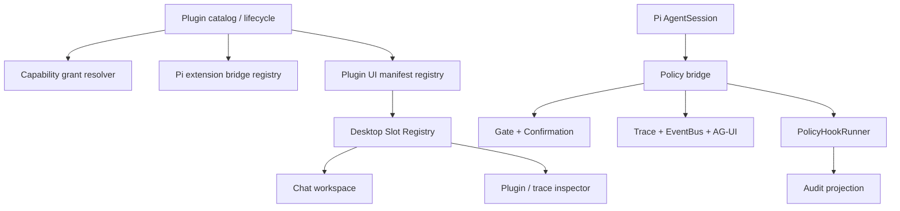

# Pi SDK 与 DeepSeek Harness 插件化升级：探索记录与实施方案

> 状态：方案评审稿。本文仅记录已核对的源码事实和建议，不包含业务代码改动。
>
> 调研对象：
> - 参考项目：`D:\WebWork\AI\deepseek-harness`（下称 DSH）
> - 当前项目：`D:\WebWork\AI\pi-agent`
> - 基座：`@earendil-works/pi-coding-agent`、`pi-agent-core`、`pi-ai` `0.84.1`

## 1. 结论先行

“万物是插件”在 DSH 中不是一个 `PluginManager`，而是四套互相配合的机制：

1. 命令 Hook 协议：面向 Agent 生命周期的可审计策略执行器。
2. 动态 Cordis 包：分离 Host / Client 的运行单元，具备版本、运行实例、审批和撤销语义。
3. Slot 注册表：前端布局、工具视图和会话视图都通过受约束的插槽组合，而非由页面硬编码。
4. 会话策略：权限预设及用户审批作为会话事实保存，不等同于插件安装权限。

Pi 已经提供第 1 类中大部分 Agent 生命周期入口、工具注册、会话持久化、上下文/Provider 改写和命令能力。因此 pi-agent 不应该在 Agent 层重新发明扩展运行时；应在 Pi 事件外层建立产品级适配器，补齐策略合并、能力授权、插件依赖、前端 Slot 和运行审计。

当前项目的 `PluginManager` 已能管理可信后端插件及其工具、路由、迁移、服务和 Pi Session 工具，但 `permissions`、`dependencies` 仍是展示元数据，`PanelDefinition` 也尚未形成桌面端的可运行扩展协议。这是最主要的缺口。

## 1.1 本轮复盘后的产品边界（已定案）

结合当前反馈，以下四项不再作为待评审问题：

1. **插件代码/插件集合不在运行时加载**：安装、升级、启用配置和代码变更进入待重启状态；只有服务重启后才进入新的宿主进程。运行中允许的仅是读取 catalog、预检、授权、禁用意图记录和已有会话的安全收尾，不允许 `import()` 新代码或以 reload 模拟热加载。
2. **隔离采用 Worker，必要时升级为独立进程**：Worker 只承担执行隔离、取消、超时和消息边界；它不是自动的安全沙箱。未经签名/完整性校验的代码不能因为运行在 Worker 就被信任。涉及 native addon、强安全边界或 Worker 可逃逸风险时，方案必须改用独立进程。
3. **Hook 兼容需要支持**：支持导入 DSH/Codex/Claude 风格配置，但通过版本化 adapter 转换为 pi-agent 自有 schema，并在导入时输出 unsupported/degraded 诊断；不直接执行外部配置中的命令或把外部字段当成内部权限。
4. **动态 UI 需求成立**：它不是 P0/P1 的同进程热插件，而是 P3 独立项目；采用不可变 package、approval、Host/Client run、Worker/进程隔离、静态协议化数据和可撤销 Slot effect。
5. **管理 API 采用 trusted-local 模型**：本产品是单用户本地 Electron 工具，不引入 JWT、账户、RBAC 或 Cookie session。Fastify 必须只绑定 loopback（`127.0.0.1`），不支持把管理 API 暴露到局域网或公网；若未来需要远程部署，必须另行设计认证和威胁模型。插件 capability grant 仍保留，但它用于控制插件能力和避免误配置，不等同于用户登录鉴权。

这五项决策覆盖早期章节中“是否运行时安装”“isolate 的含义”“是否导入外部 Hook”“是否需要动态 UI”“是否需要管理 API 鉴权”等表述；后文若出现 `reload`，仅指配置/状态预检或重启编排，不指运行中加载新插件代码。

## 2. 已核对的源码证据

| 主题 | DSH 实现 | Pi 0.84.1 能力 | pi-agent 当前状态 | 结论 |
| --- | --- | --- | --- | --- |
| Agent 生命周期 Hook | `packages/hooks/hook-protocol`，命令进程、超时、取消、JSON 输出、决策合并和审计事件 | `ExtensionAPI.on(...)` 覆盖会话、输入、上下文、Provider、Agent、Turn、消息、工具 | `createPiSession` 仅直接挂了 `beforeToolCall`、`afterToolCall` 和 `session.subscribe` | 复用 Pi 事件，新增产品级 `PolicyHookRunner` |
| 工具阻断/确认 | PreToolUse 的 `deny/ask/allow` 合并后再映射到执行点 | `tool_call` 可阻断；`beforeToolCall` 也可阻断 | `Gate` + `ConfirmationManager` 已经接在 `beforeToolCall` | 保留现有 Gate，Hook Runner 在同一入口参与排序 |
| 工具结果改写 | PostToolUse / Hook 输出可附加上下文 | `tool_result` 和 `afterToolCall` 可改 content/details/error | 已在 `afterToolCall` 做证据记录和输出截断 | 复用，统一为结果策略管道 |
| Provider 请求改写 | DSH 通过 Agent / LLM 层的扩展点 | `before_provider_request` 可串行替换 payload；headers 可原地修改 | 仅部分插件会话有 payload 日志/缓存逻辑 | 直接复用 Pi；按权限暴露 |
| 动态 Host / Client 包 | Cordis Host Runner + Client Runner，运行实例由审批和双端结果共同提交 | Pi 扩展可注册 TUI/RPC UI，但没有 DSH 的浏览器 Slot / 双端动态包协议 | 只有后端插件与面板元数据 | 不直接复制动态 `new Function`；先实现受信任、构建产物式 UI 扩展 |
| 前端组合 | 统一 Slot Registry，有 `single`、`keyed`、`list`、`chain`、优先级、作用域和 disposer | Pi 的 UI 是 CLI/TUI/RPC UI，不是 Electron React Slot 系统 | 桌面端没有消费 `/api/plugins/panels/all` | 新建 React `PluginUiRegistry`，不可把 Pi TUI API 当桌面 UI API |
| 插件权限 | Cordis guard 限制 API 表面；会话权限另存为 Session 事件 | Pi 扩展运行在本机可信进程，有 `exec`、Provider 等能力 | manifest 的 `permissions` 未强制执行 | 新建宿主能力授权；与会话 Gate/确认分离 |
| 会话恢复 | DSH 投影和事件流是 UI 的数据源 | `SessionManager`、自定义 entries、session runtime | Pi SessionStore、Trace、AG-UI 已具备 | 复用当前会话和 trace，增加插件运行投影 |

## 3. DSH 的真实插件模型

### 3.1 命令 Hook 不是普通 EventBus

源文件：

- `deepseek-harness/packages/hooks/hook-protocol/src/runner.ts`
- `deepseek-harness/packages/hooks/hook-protocol/src/codec.ts`
- `deepseek-harness/packages/hooks/hook-protocol/src/merge.ts`
- `deepseek-harness/packages/hooks/hooks-codex/src/index.ts`

DSH 将每个命令 Hook 作为独立子进程运行：JSON payload 写入 stdin，按 Hook 自身 `timeoutSec` 或默认 10 分钟超时，继承取消信号和会话工作目录。基础设施错误、无法启动、被信号杀死等都会被编码成无 exit code 的非阻断结果，主回合继续执行。

协议行为如下：

| Hook 进程结果 | 语义 |
| --- | --- |
| exit `0` + JSON object | 解析 `continue`、`decision`、`hookSpecificOutput` 等结构化字段 |
| exit `0` + 非 JSON stdout | 保留原文本；Codex 的 `SessionStart` / `UserPromptSubmit` 可把它作为上下文 |
| exit `2` | 阻断，stderr 是阻断原因 |
| 其他 exit code / spawn 失败 | 记录错误但不阻断 |
| `hookSpecificOutput.hookEventName` 不匹配 | 保留诊断标识，但丢弃该事件专属字段，防止跨事件误阻断 |

多个 Hook 的合并不是“最后一个覆盖前一个”：`deny/block > ask > allow/approve`，只展示最终最高等级的原因；`additionalContext` 和 `systemMessage` 按顺序累积；第一处 `continue:false` 是粘性的停止请求。每次执行都会追加配对的 `hook/invoked`、`hook/result` 会话事件，持久化 handler id、决策、exit code、截断后的 stderr 和耗时。

Codex 桥接在 DSH 中只接入五个事件：`SessionStart`、`UserPromptSubmit`、`PreToolUse`、`PostToolUse`、`Stop`。它会过滤异步和非 command Hook；PreToolUse 仅支持阻断，PostToolUse 能阻断或注入上下文，Stop 的阻断转为 steering 以继续下一步。

### 3.2 DSH 动态 Cordis 包的生命周期

源文件：

- `deepseek-harness/packages/extensions/cordis-host-runner/src/index.ts`
- `deepseek-harness/packages/extensions/cordis-host-runner/src/registry.ts`
- `deepseek-harness/packages/extensions/cordis-host-runner/src/lifecycle.ts`
- `deepseek-harness/packages/extensions/cordis-client-runner/src/client/index.ts`

DSH 区分四个身份，避免“重载”覆盖掉历史和运行状态：

| 身份 | 含义 |
| --- | --- |
| `pluginId` | 稳定插件身份，可保留多个历史版本 |
| `packageId` | 不可变包版本 |
| `pluginRunId` | 一次激活运行实例 |
| `approvalRequestId` | 一次待审批请求，采用 first-answer-wins 领取语义 |

一次激活先创建 Host run；Host 代码存在时挂到 `cordis-dynamic` group fiber 下并等待其 settled。若 Host 已注册成功而 Client 代码存在，状态仍是 `client-pending`。客户端拿到同一 `pluginId/packageId/pluginRunId` 的源码后加载，只有客户端确认成功时才 `commitActivation`；任一侧失败会 retract 当前 run，旧的成功 package 保留。停止会撤销运行实例及其 effects，但保留包版本；移除才删除插件及所有版本。

这比当前的 `stop -> delete entry -> load -> start` 更适合运行时插件，因为它保留了“新版本失败，旧版本仍可观察/回退”的事实。

### 3.3 Host / Client 并非无边界执行

DSH 的 guard 很细：

- Host `sandboxContext()` 只暴露 `ctx.on`、`ctx.effect`、`ctx.provide`、声明过的服务和受控工具注册；未注入服务及 Cordis 内部对象均拒绝访问。
- 动态工具的输入 schema、输出 schema、`execute` 返回值、渲染返回值都要求可验证 JSON；`harness.defineTool()` 会克隆和验证。
- Client 代码通过异步 closure 取回插件对象；`fetch`、`require`、计时器、`process`、`Buffer` 等会被替换为带修复建议的陷阱。Client 通过 `host.call()` 调用自己 Host half 的 handler。
- `slots.register()` 会强制为动态包分配优先级、写入贡献 ledger，并保存组件所有权；`theme.overrideTokens()` 的来源被强制替换为当前 package id。
- Host / Client 侧都可上报 guard 或渲染失败，宿主将其归属到对应 run。

关键限制：DSH 源码明确说明这只是 API discipline，**不是安全边界**；动态包代码仍与接受它的宿主同等可信。因此 pi-agent 不能以“有 guard”为理由运行未经信任的 npm 或模型生成 JavaScript。

### 3.4 DSH 的前端 Slot 与布局做法

源文件：

- `deepseek-harness/packages/client/ui-slots/src/index.ts`
- `deepseek-harness/packages/client/runtime/src/client/slots.ts`
- `deepseek-harness/packages/client/ui-layout/src/client/AppFrame.tsx`
- `deepseek-harness/packages/client/ui-conversation/src/client/contract/slots.ts`

DSH 的页面骨架是左侧 sidebar、中央 conversation、右侧 details column，宽度可拖拽、可折叠。功能不直接把组件塞进页面，而是声明 Slot：

- `single`：一个占位单元，替换整块能力。
- `keyed`：按 key 派发，例如某工具或某节点类型的专用视图。
- `list`：按 order 追加操作、工具栏按钮或 dock 内容。
- `chain`：多个候选者按 selector 竞选，例如 composer takeover。

注册会校验 Slot 是否已由父级声明、种类约束、key/id/selector、同优先级冲突以及 store 作用域。每次注册都返回 idempotent disposer；插件 fiber 卸载时，Slot、子 Slot 声明、关联 store 和主题层会一起撤销。非 chain Slot 的同一 cell 按 priority shadow，`entriesOfSlot()` 只返回当前胜者；原始 entries 仍保留给诊断。

这套模型解决了 UI 插件最容易遗漏的三件事：冲突规则、卸载清理、运行中错误归属。当前 `PanelDefinition { id, title, component, position }` 只足以描述菜单项，不足以构成 Slot 协议。

### 3.5 DSH 的 inspect 与会话权限

`CordisInspectRegistryService` 维护 Host provider 和 Client manifest。每个 provider/method 必须有非空 id、描述、唯一方法名、输入/输出 JSON schema；客户端查询通过 request id 等待首个有效响应，并支持 AbortSignal 取消。这个机制值得用于“运行中插件检查器”，而非让 UI 直接读取任意服务。

DSH 的 `PermissionPresetService` / `ApprovalService` 则是另一层：sandbox mode、approval policy、会话初始事实和 UI projection 被持久化为 Session event。它解决的是“本次 Agent 是否能执行操作”，不是“这个插件可否安装、可否访问 DB/网络”。

## 4. Pi SDK 已提供的底座

### 4.1 原生扩展事件

源文件：`apps/agent-server/node_modules/@earendil-works/pi-coding-agent/dist/core/extensions/types.d.ts`

Pi 扩展可监听以下类别：

| 类别 | 事件 |
| --- | --- |
| 会话 | `session_start`、`session_before_switch`、`session_before_fork`、`session_before_compact`、`session_compact`、`session_shutdown`、`session_before_tree`、`session_tree` |
| 输入与上下文 | `input`、`context`、`before_agent_start` |
| Provider | `before_provider_request`、`before_provider_headers`、`after_provider_response` |
| Agent / Turn | `agent_start`、`agent_end`、`agent_settled`、`turn_start`、`turn_end` |
| 消息与工具 | `message_start/update/end`、`tool_execution_start/update/end`、`tool_call`、`tool_result`、`user_bash` |
| 设置 | `model_select`、`thinking_level_select`、`project_trust`、`resources_discover` |

可拦截语义也已经存在：

- `input`：`continue`、`transform` 或 `handled`。
- `tool_call`：返回 `{ block, reason, terminate }`；参数可原地改写。
- `tool_result`：可改 `content`、`details`、`isError`、`usage`。
- `context`、`before_provider_request`、`before_agent_start`：可串行替换消息、payload、system prompt 或插入隐藏消息。
- session 的 before 事件可 cancel/覆盖 compact、fork、tree 行为。

Pi 的 `ExtensionRunner` 按扩展注册顺序串行调用处理器，`input`、context、Provider payload、message end 和 tool result 是链式传递。绝大多数处理器异常会通过 `ExtensionError` 上报而不中断后续运行；但 `emitToolCall()` 本身没有 catch，因此产品适配器必须把第三方策略 Handler 的异常转为可审计的 fail-open 或 fail-closed 结果，不能让它直接冒泡破坏 Agent 回合。

### 4.2 原生能力与示例对应关系

| 需要的效果 | Pi 已有做法 | 可直接利用 |
| --- | --- | --- |
| 危险操作确认 | `examples/extensions/permission-gate.ts` 的 `tool_call` + `ctx.ui.select` | 当前项目的 `Gate` + `ConfirmationManager` 更适合作为统一实现 |
| 计划模式 | `plan-mode` 动态切换 active tools、`tool_call` 阻断、`before_agent_start` 注入、custom entry 保存状态 | 现有计划模式应基于这一模型收敛 |
| 动态工具 | `dynamic-tools.ts` 在 session start 和命令中 `registerTool` | 可支持可信插件的 Pi 工具注册 |
| Provider 改写 | `provider-payload.ts` 的 `before_provider_request` / `after_provider_response` | 用于缓存、遥测、路由；需能力授权 |
| 项目可信 | `project-trust.ts` 先于资源加载作出 trusted/undecided 决策 | 安装本地项目插件前可复用为前置条件 |
| 自定义压缩 | `custom-compaction.ts` 的 `session_before_compact` | 适合记忆/长会话插件，不需改核心 SessionManager |
| 会话替换 | `13-session-runtime.ts` 使用 `AgentSessionRuntime` 后重新 bind 订阅和 extensions | 当前 SessionStore 恢复/淘汰流程应引入相同 rebinding 纪律 |

### 4.3 当前 pi-agent 已经在使用的 Pi 能力

源文件：`apps/agent-server/src/core/agent/pi-session.ts`

当前 `createPiSession()` 已完成：

- `DefaultResourceLoader` + `createAgentSession` 创建 Pi session。
- Chat 线程加载 Pi 资源；`plugin:*` 线程显式禁用扩展、上下文文件、提示词模板和默认 skills，并仅注入授权 skill path。
- `session.agent.beforeToolCall` 接 `Gate.check()` 与 `ConfirmationManager.requestConfirmation()`。
- `session.agent.afterToolCall` 写 Evidence Ledger、EventBus、输出截断。
- `session.subscribe()` 已转发工具开始、assistant message 结束和 turn 结束，并驱动 Storm Breaker、上下文用量和 memory ticker。

因此升级重点不是替换这里的会话创建，而是把目前散落在这里的横切逻辑组织为确定顺序的策略管道，并让可信插件能声明其所需的 Pi 事件适配器。

## 5. 当前插件系统的能力与缺口

### 已有能力

源文件：

- `apps/agent-server/src/core/plugin/plugin-manager.ts`
- `apps/agent-server/src/core/plugin/plugin-types.ts`
- `apps/agent-server/src/plugins/plugin-loader.plugin.ts`
- `apps/agent-server/src/routes/plugins.route.ts`

`PluginManager` 支持 builtin、local、npm 扫描的基础设施，状态 `loaded/enabled/disabled/error`，以及 setup/teardown、工具、HTTP 路由、事件、面板、迁移、Pi Session tools、服务、提示词模板和独立插件会话。停用时会从聚合视图去掉注册项目并清理事件监听。插件加载器在启动期依次执行静态迁移、setup 中新增迁移、服务装饰和路由挂载。

### 已确认缺口

1. `config/plugins.yml` 当前只真正实例化 `builtin` 条目；`local` 和 `npm` 条目会写“待实现”日志。环境变量扫描与配置文件语义不一致。
2. `manifest.dependencies` 未构成依赖图、拓扑排序或缺失依赖阻断；`manifest.permissions` 只在 API 详情中返回，未约束任何能力。
3. 插件运行在 Node 主进程，现有 `isolate` 不是进程/能力沙箱。应明确仅加载可信包。
4. Fastify 不能动态注销已注册 route，因此 reload 后新 route 需要服务重启；现有 API 已提示这一限制。
5. 后端暴露 `/api/plugins/panels/all`，但桌面端未检索/消费该 endpoint；目前没有 component registry、manifest、bundle 生命周期或卸载协议。
6. `createPiSession()` 对 `plugin:*` 线程禁用了 Pi extensions。这对领域编排减 token 是正确的，但也意味着不要假设一个 Pi extension 自动覆盖每类插件会话。

## 6. 建议的目标架构



### 6.1 后端可信插件契约

保留 `Plugin` / `PluginContext`，但将注册拆成显式 capability：

```ts
type PluginCapability =
  | 'tools.register'
  | 'agent.hooks'
  | 'provider.observe'
  | 'provider.transform'
  | 'routes.register'
  | 'storage.plugin'
  | 'ui.contribute'
  | 'network.outbound'
  | 'process.exec'
```

安装/启用前由宿主将 manifest 请求与用户授予的 grants 求交集。`PluginContext` 只提供已授权的注册函数；其余调用失败并产生诊断。`process.exec`、`provider.transform`、`ui.contribute` 应默认不授予。这个模型防止“声明了 permissions 但任何插件都能拿 db/exec”的假安全感，但并不声称能隔离同进程恶意代码。

### 6.2 Pi Hook 适配矩阵

| 产品 Hook 点 | DSH 对照 | Pi 首选入口 | 当前实现 | 目标处理顺序 |
| --- | --- | --- | --- | --- |
| 会话创建/恢复 | `SessionStart` | `session_start` | 无统一桥 | 恢复 session state -> 记录运行投影 -> 允许注入一次性上下文 |
| 用户输入 | `UserPromptSubmit` | `input` | 前端直接送入 AG-UI | Hook Runner -> 输入 transform/handled -> 记录审计 -> prompt |
| LLM 前 | DSH 注入 context | `before_agent_start`、`context` | system prompt 自定义 | 合并 plugin context -> 生成隐藏 message / system prompt -> 审计 |
| Provider 前/后 | Provider 扩展 | `before_provider_request/headers`、`after_provider_response` | 零散缓存逻辑 | 授权校验 -> 串行变换 -> 遥测；敏感 payload 默认脱敏 |
| 工具前 | `PreToolUse` | 优先 `session.agent.beforeToolCall`；扩展使用 `tool_call` | Gate + 确认 | PolicyHookRunner -> Gate -> Confirmation -> Pi 执行；首个 deny 终止 |
| 工具中 | DSH 工具投影 | `tool_execution_start/update/end` | EventBus 部分转发 | 统一 trace 和 AG-UI 事件投影 |
| 工具后 | `PostToolUse` | `afterToolCall`，必要时 `tool_result` | Evidence / truncation | 结果规整 -> 策略附加上下文 -> evidence -> trace |
| Turn 停止 | `Stop` | `agent_end` / `agent_settled` | memory ticker 仅监听 turn end | 仅显式、带回合次数 guard 的 follow-up；不能无界自行续跑 |
| 压缩/树操作 | DSH 事件模型 | `session_before_compact/tree` | 部分 session API | 允许可信插件提供摘要策略；取消/超时有 trace |

`PolicyHookRunner` 应继承 DSH 的优点：命令 JSON stdin、每项超时/AbortSignal、`deny > ask > allow` 合并、审计记录、stderr 截断及明确的失败策略。它不应直接调用 `EventBus` listeners 来冒充策略，因为 EventBus 缺少结果合并、取消、超时和 handler 身份。

### 6.3 运行时插件的范围控制

运行中不加载任何新的插件代码。插件来源可以是仓库 builtin、锁定版本且通过完整性校验的 local/npm 包，但它们都只在服务启动/重启阶段装载；安装器负责下载、lockfile、integrity、离线回滚和重启编排，`PluginManager` 不负责动态 import。

动态 UI/工具需求仍支持，但放在 P3：模型或用户只能创建不可变 package 的运行请求，Host/Client 通过 Worker（必要时独立进程）和消息协议交互，完成 approval、`pluginRunId` 握手、能力校验、静态 schema 数据交换和撤销后才可成为 active。P3 不能把 Worker、guard 或 `new Function` 单独宣传为安全边界。

### 6.4 桌面 UI Slot 方案

建议在 Electron renderer 建立 `PluginUiRegistry`，slot key 和插入种类固定为代码契约，而不是让插件传任意 `component` 字符串：

| Slot | 种类 | 用途 | 初始数据来源 |
| --- | --- | --- | --- |
| `sidebar.navigation` | list | 左侧会话/工作区下面的插件入口 | 插件 UI manifest |
| `chat.header.actions` | list | 对话页头的次级操作 | 当前 thread、权限模式 |
| `chat.composer.left/right/dock` | list | 输入区小控制和状态条 | session / hook projection |
| `chat.message.actions` | list | 消息悬停动作 | message id |
| `chat.tool.detail` | keyed | 右侧工具详情的专用视图 | tool name、tool call/result |
| `right-panel.tab` | list | Trace、Context、Plugin Inspect 等标签页 | pane store |
| `workspace.main` | keyed | 插件专属工作区 | route state + plugin data |

规则采用 DSH 的必要子集：唯一 `pluginId:contributionId`、显式 priority/order、scope（app/session）、返回 disposer、冲突诊断、禁用插件时自动卸载。前期仅允许编译进 desktop 的 React contribution module；后期再讨论签名的 UI bundle loader。这样可让布局保持三列工作台结构：左侧导航，中央对话/插件工作区，右侧可切换 Details/Trace/Inspect；不会把产品页面堆成互相嵌套的浮层卡片。

## 7. 页面与接口映射（方案阶段）

本节按页面列出所有计划能力、当前接口和需新增接口，供后续实现文档逐页核对。外部系统均标记在来源栏。

| 页面/区域 | 用户操作路径 | 数据字段 | 复用接口 | 新接口或扩展 | 来源 |
| --- | --- | --- | --- | --- | --- |
| 插件管理 | 查看 -> 校验 -> 授权 -> 启用/禁用/重载 | catalogId、pluginId、版本、来源、状态、依赖、请求能力、已授予能力、错误、运行数、`restartRequired`、`unloadScope` | `GET /api/plugins`、`GET /api/plugins/:name`、enable/disable/reload | `POST /api/plugins/validate`、`GET/PUT /api/plugins/:id/grants`、`GET /api/plugins/:id/diagnostics` | local/npm registry、插件 manifest |
| 安装向导 | 选择 local/npm -> 预检 -> 显示权限差异 -> 确认安装 | package spec、resolved version、integrity、依赖图、风险项、grant diff | 无 | `POST /api/plugins/install`、`POST /api/plugins/uninstall`、`GET /api/plugins/install/:operationId` | npm / 本地目录（外部系统） |
| 对话工作区 | 输入 -> Hook -> 工具确认 -> 查看结果/Trace | hook point、handler、决策、原因、耗时、toolCallId、approval 状态 | AG-UI run/steer/follow-up、确认接口、trace 接口 | `GET /api/sessions/:id/policy-events`；AG-UI custom event `POLICY_HOOK_*` | Pi Session / Provider（外部） |
| 右侧 Inspect | 选择插件/运行实例 -> 查看 Host/Client 贡献与错误 | pluginId、packageId、runId、slot ledger、tools、waiting services、error | `GET /api/plugins/:name`、`GET /api/plugins/:name/tools` | `GET /api/plugins/:id/runs`、`GET /api/plugins/:id/inspect` | Pi runtime、desktop Slot registry |
| 设置/权限 | 选择会话执行模式 -> 保存 -> 对话中确认 | session policy、Gate mode、用户选择、过期时间 | `GET/PUT /api/gate/mode`、confirmation routes | `GET/PUT /api/sessions/:id/policy`；必须与 plugin grants 分页分域 | 无 |
| 插件 UI 贡献 | 启用插件 -> renderer 注册静态 contribution -> 进入/离开 session 或页面 -> 自动卸载 | contributionId、slot、kind、scope、priority、entry key、owner、状态、渲染错误、是否已让出席位 | `GET /api/plugins/panels/all`（仅作为旧面板兼容数据） | `GET /api/plugins/ui-manifest`；renderer 本地 `PluginUiRegistry` | desktop 编译产物；运行时 bundle 属 P3（外部来源） |
| 全局运行/审批中心（P3） | 查看任意会话请求 -> 允许/拒绝 -> 本页加载 Client half -> 停止或移除 | approvalRequestId、pluginId、packageId、pluginRunId、ownerSessionId、host/client 状态、页面加载状态、失败阶段 | confirmation 的 pending/response 模式 | `GET /api/plugins/runs`、`POST /api/plugins/runs/:approvalId/resolve`、`POST /api/plugins/:id/runs/:runId/stop` | 主进程 Host、renderer Client（外部边界） |

接口复用原则：插件详情、工具清单、面板清单和现有 Gate/confirmation 不重复造入口；新增接口只承担安装、capability grants、动态运行投影和策略审计。当前不存在原型图或完整源需求文档，因此视觉字段和外部系统条目以上述已知源码为准；拿到原型后需逐字段补齐此表。

## 8. 分期实施计划

### P0：可信后端插件可控化

1. 统一 `plugins.yml`、local、npm 的发现和启用语义；分开保存 `catalogId`（配置/来源身份）与 `pluginId`（manifest 运行身份），实现依赖图、循环依赖和版本不满足诊断。
2. 增加 capability grant 数据模型、验证接口和宿主侧 `PluginContext` 门控；保留“可信 Node 代码”声明。
3. 将每一种注册资源建成带 disposer 的 host effect，并标注其是否能在不重启 Fastify / 不重建 Pi session 的情况下撤销。route、Fastify decoration、既有 session tool 不能假称即时卸载。
4. 将现有 Gate、Confirmation、Evidence、Trace 组合为有序 `PolicyPipeline`，不改变现有用户确认体验。
5. 为现有插件补 manifest capability 声明、显式 teardown 义务和最小迁移测试。

验收：缺失依赖、未授权能力、启用失败、取消、重复启用、配置禁用、service/route/session-tool 的重启边界均有明确状态和测试；页面不会把“已从聚合列表移除”错误展示成“已从进程卸载”。

### P1：Pi 事件桥和 Hook 协议

1. 实现 `PolicyHookRunner`、配置 schema、matcher、timeout/abort、结果合并和审计投影。
2. 以本节 Hook 矩阵接入 `createPiSession`，保持 Gate/Confirmation 为工具前的最终强制层。
3. 把 `tool_call` 的第三方 handler 置于产品适配器的 try/catch 内；Pi 的该事件本身不捕获 handler 异常。仅对明确标记为 fail-closed 且已授权的内置策略允许故障阻断。
4. 将 Pi extension error、Hook spawn error 和策略拒绝分为不同 Trace event，避免把系统故障伪装成用户拒绝。
5. 建立单测：多 Hook 优先级、超时、取消、matcher 方言、provider payload 链、工具前 deny/ask、结果截断顺序、Stop 防循环。

验收：同一回合可从 Trace 追到“哪个 handler、对什么输入、在多久内、以什么决策影响了结果”。

### P2：桌面 Slot Registry 与插件管理界面

1. 实现静态编译的 `PluginUiRegistry` 与以上 slot key；先消费已有 `/api/plugins` 和 panels endpoint。
2. 完成插件管理、授权差异、运行诊断、右侧 Inspect 四个视图。
3. 将工具详情和策略审计作为 keyed/list contribution 接入现有 ChatWorkspace，而非重写聊天页面。
4. 贡献作用域明确为 `app`、`session` 或 `page`；渲染失败必须绑定 contribution 与页面实例，不把单页错误升级为全局插件失败。
5. 在桌面/窄窗口检查文字截断、右栏折叠、未加载插件和插件崩溃降级状态。

验收：禁用插件立即移除其导航、工具详情 renderer 和 action；插件 UI 异常只隔离自身 contribution，并在 Inspect 留下诊断。

### P3：动态 UI/工具运行时（需求已确认，但必须重启宿主）

P3 不提供应用内加载新 npm/JS 包的热更新。包集合或包代码变化必须重启服务；运行期间只允许在已启动的 Worker/独立进程中创建受协议约束的 run。以 DSH 的 `pluginId/packageId/pluginRunId/approvalRequestId`、Host/Client 双端握手、首个有效回执、撤销和诊断 ledger 为最低标准。

主进程负责 catalog、签名/integrity、审批、能力授予和生命周期投影；Worker 负责已批准包的受限执行，所有输入/输出均为版本化 JSON/二进制协议，带 timeout、AbortSignal、资源预算和 worker death 处理；需要真正安全边界时使用独立进程而非 Worker。Renderer 不执行远程源码，只消费 schema 化 UI model，并把 Slot contribution 绑定到 `pluginRunId`。

P3 验收必须包括：旧 run 的迟到回执不能影响新 run；Worker 终止能回收并诊断全部 effect；Host/Client 任一失败不会报告 active；package 变更状态明确为 `restart-required`；渲染器只接收白名单 slot/kind/schema。

## 9. 已定案边界与仍需参数化的实现参数

已定案：插件代码/插件集合变更必须重启；隔离优先 Worker、强安全边界用独立进程；支持 DSH/Codex/Claude Hook adapter 导入；动态 UI/工具需求成立，但只在 P3 的 Host/Client run 协议中实现。

仍需实现阶段确定：npm 锁定与完整性校验的具体格式、各 capability 的默认 grant、Hook timeout 与 fail policy、Worker 资源预算、签名信任根、跨窗口/跨用户授权主体，以及 UI 原型的视觉细节。插件级权限与会话级执行权限仍保持两套页面、两套持久化实体和两套审计字段。

## 10. 二次源码核查：补齐的实现细节

本节是对前述方案的第二轮逐文件核查。它只记录已在源码中确认的事实；产品已定案边界集中在 §1.1 和 §9，源码无法替代的实现参数集中在 §9。

### 10.1 当前 pi-agent 的插件生命周期并不等同于“可动态卸载”

`PluginManager` 的停用会执行插件 `teardown()`、取消它通过 `onEvent()` 注册的 EventBus handler，并清空 `entry.tools/routes/panels/sessionTools/services` 等聚合数组。这里有三层语义必须拆开：

| 注册物 | 当前停用后的真实行为 | 为什么不能称为即时卸载 | P0 处理方式 |
| --- | --- | --- | --- |
| EventBus handler | `stopPlugin()` 明确逐个 `off(type, handler)` | 这是现有唯一完成了可逆清理的注册物 | 保留为 disposer 基线 |
| PluginManager 聚合项 | 从 `getAllTools()`、`getAllPanels()`、新建 session 的 `getAllSessionTools()` 中消失 | 只影响后续聚合读取；不回收先前交给外部宿主的对象 | 将每项登记为 host effect，标示生效/失效范围 |
| Fastify route | 启动时由 `plugin-loader` 从 `getAllRoutes()` 挂载；停用后已有 route handler 仍在 Fastify 路由表内 | Fastify 不提供此处所需的 route unregister；manager 清空数组只会让详情 API 忘记它，现有 reload API 也已注明 route 变更需重启 | route capability 仅允许“启动前注册”；UI 显示 `restartRequired: true`，禁用时提示旧 handler 的进程残留 |
| Fastify decoration/service | 启动时 `app.decorate(name, service)`；停用后 decoration 仍挂在 app 上 | manager 清空 `entry.services` 不会反向删除 Fastify 上的 decoration | service capability 仅允许启动期；或改为可替换的 service registry proxy |
| Pi Session tool | `app.ts` 在**创建新 session**时读取 `app.pluginManager.getAllSessionTools()` | 已创建 AgentSession 的 tool 集不会因 manager 清空而回收 | 禁用后标注“新 session 生效”；高风险工具再加执行期 capability guard |
| Plugin setup 的旁路副作用 | 由插件自己注册的 Agent、Team、计时器、数据库连接等 | `PluginContext` 没有统一 disposer 容器，manager 无法知道这些副作用 | 新契约要求 `context.effect()` / `context.registerDisposable()`，并把旧插件改为显式 teardown |

结论：P0 的“disable”必须输出两件事实：`catalogStatus`（该插件不再向后续会话和 UI 聚合提供能力）与 `processEffects`（哪些旧 route/service/session 仍需重启或重建才能消失）。DSH 的 fiber/disposer 机制正是为了避免把这两件事混为一谈。

### 10.2 配置身份、启用语义和 isolate 的当前失配

`config/plugins.yml` 的 builtin `id` 是 plugin factory key；PluginManager 实际以 `manifest.name` 建索引和生成 `/api/plugins/:name` 路径。例如配置使用 `novel-plugin`，工厂返回的 manifest 名为 `novel`。这不是立即的运行错误，但会让“配置中的插件 id”“API 中的插件 name”“未来安装包名”发生三种身份混用。

另有三个已证实的行为：

1. `plugins.yml` 中 `enabled: false` 的 builtin 根本不会交给 `PluginManager.loadPluginEntry()`，因此既不会出现在列表里，也不能通过当前 `POST /enable` 重新启用。
2. `local` 与 `npm` 配置条目仅记录“待实现”；真正的 local/npm 发现来自 `PI_PLUGINS_DIR` 和 `PI_PLUGINS_ENABLE_NPM` 环境变量，配置与扫描两套语义并存。
3. `isolate` 会从 YAML 传到 `PluginEntry`，reload 时也会原样带回，但源码没有读取它来创建独立进程、独立 EventBus、独立数据库或任何隔离上下文。YAML 注释中关于“独立数据库连接 / 事件总线”的描述与现状不符。
4. YAML 注释还写着 `${VAR_NAME}` 会在启动时自动替换，但加载器只调用 `js-yaml.load()` 并将结果原样交给 factory；当前没有环境变量插值实现。含 `${WEB_SEARCH_API_KEY}` 这类配置不能被视为已解析的密钥。

P0 的最小数据模型应固定为：`catalogId`（配置/安装记录主键）、`pluginId`（manifest 稳定身份）、`source`、`sourceRef`、`resolvedVersion`、`integrity`、`desiredState`、`observedState`、`activationGeneration`、`capabilityRequests`、`grants`、`restartRequired`。不要再使用单个 `id` 承担所有角色。

### 10.3 Pi Extension API 的准确边界和接入纪律

Pi 并非只有“可监听事件”：其 `ExtensionRunner` 已定义了多种不同的合并和短路方式，产品桥不能把它们压成一个通用 EventBus。

| Pi 事件 | runner 的真实规则 | 对本项目的约束 |
| --- | --- | --- |
| `input` | 按扩展、按 handler 顺序串行；`transform` 的文字/图片给下一个 handler；`handled` 立即短路 | `UserPromptSubmit` Hook 应在这里实现；审计要记录 transform 前后摘要，不能记录完整敏感输入 |
| `context` | runner 先 `structuredClone(messages)`，每个 handler 可替换 messages，异常仅报 `ExtensionError` | 上下文注入要有 token/来源预算；禁止插件直接修改 SessionStore 历史 |
| `before_agent_start` | 串行累积隐藏 message；system prompt 使用前一 handler 的改写值 | 用于一次性策略上下文，避免在 user message 中伪造系统指令 |
| `before_provider_request` | payload 引用按 handler 串行替换；`before_provider_headers` 则原地修改 header，返回值无效 | 两种 capability 必须分开：`provider.transform` 与 `provider.headers`；默认只开放 observe/脱敏遥测 |
| `tool_result` | content/details/isError/usage 可逐项覆盖，异常会被记录并继续 | 输出截断、脱敏、evidence 应有固定顺序；禁止不可信插件把失败结果改成成功 |
| `tool_call` | handler 可原地修改 `event.input`；前一 handler 的修改给后一 handler；返回 `block` 会短路；**该方法没有自己的 try/catch** | PolicyHookRunner 必须包住第三方 handler 并完成参数再校验；Gate/Confirmation 必须是最后的不可绕过层 |
| session before 事件 | 处理器顺序执行，最新 result 覆盖先前 result，遇到 `cancel` 立即返回 | 自定义 compact/fork/tree 策略需有独立优先级和取消审计，不能沿用 `deny > ask > allow` |

Pi 示例还给出三项可直接复用的产品模式：`project_trust` 的 `yes/no/undecided + remember` 适合作为“加载项目内 local 插件前”的信任前置；`dynamic-tools` 说明可信 extension 可在 `session_start` 或命令中注册工具；`plan-mode` 以持久化 custom entry 恢复运行状态、在 `before_agent_start` 注入隐藏上下文、在 `tool_call` 执行实际阻断。这三者都在 Pi 的 session 范围内，不应被误当作 Electron renderer 的 UI 插件 API。

### 10.4 DSH Hook 桥的未显式写出的方言细节

DSH 将执行器、解码器和合并器放进共同的 `hook-protocol`，但不抹平 Claude Code 与 Codex 的语言差异。后续 `PolicyHookRunner` 应采用“统一内部协议 + 明确适配器”，不要宣称直接兼容任意配置文件。

| 维度 | Claude Code bridge | Codex bridge | 对 pi-agent 的取舍 |
| --- | --- | --- | --- |
| 支持 Hook 点 | `SessionStart`、`UserPromptSubmit`、Pre/PostTool、`Stop`，另含 Subagent Start/Stop | 仅 `SessionStart`、`UserPromptSubmit`、Pre/PostTool、`Stop` | 第一版按 Pi 可可靠映射的五点实现；子 Agent 另列 `agentScope` 以后再接 |
| matcher | 纯字母/数字/下划线/`|` 是精确候选集；其余为非锚定 regex | 所有非空 matcher 都是非锚定 regex | 方案配置必须带 `matcherMode`，加载时编译诊断；不要把 `foo|bar` 在两个方言中解释成同一件事 |
| command 预处理 | 支持 `${CLAUDE_PLUGIN_ROOT}`、`${CLAUDE_PROJECT_DIR}` 替换并导出项目目录环境变量 | 不替换命令，不额外注入 Hook 环境 | pi-agent 自己的 Hook 只允许显式 `envAllowlist`，禁止继承完整进程环境 |
| stdin framing | JSON 后追加换行 | JSON 不追加换行 | 新协议固定一种 framing；若提供 import adapter，在 adapter 中完成兼容 |
| 配置过滤 | 非 command hook 被跳过并警告 | 非 command 与 `async: true` 都跳过并警告 | UI 必须展示 `skippedHandlers`，不能悄悄当作已启用 |
| PreTool 决策 | `deny`、`ask` 可映射 | 只认可阻断，不实现 ask/rewrite | pi-agent 统一为 `deny/ask/allow`，由 Gate/Confirmation 落地 ask；不承诺外部 Codex 配置的 ask 行为 |

两个 bridge 都有一个需要在产品设计中显式处理的限制：`SessionStart` 是 detached 运行，慢 Hook 可能赶不上第一轮请求；`Stop` 的 deny 是通过 `agent.steer(...)` 让下一步继续，源代码也留下了防无限循环 TODO。因此 P1 必须有 `startupDelivery` 策略（首轮必达或允许晚到）和 `maxForcedContinuations`，不要只照搬 Hook 名称。

### 10.5 DSH 动态包和 UI 的关键状态模型

DSH 的 Cordis 不把“插件正在运行”折叠成单一布尔值。一个 Activation Attempt 至少记录 `awaiting-approval -> starting-host -> client-pending -> running/waiting/failed/cancelled`，并且 host/client 分别有 `absent/pending/stopped/running/waiting/failed`。`commitActivation()` 只在无 Client half，或 Client 对同一 `pluginRunId` 成功回报后更新 `currentPackageId`；失败的目标版本继续保留为 `nextPackageId + latestRun.error`，不会覆盖已成功版本。

前端同样维持两个独立事实：

1. Host inventory 表示“进程中哪一个 package/run 正在运行”。
2. 当前 Electron 页面（DSH 中为浏览器页面）的 live set 表示“本页是否已加载该 Client half”。

这解释了 DSH 为什么可在全局 sidebar footer 打开审批面板：模型在后台会话中发出的 Client-run 请求不能只依赖当前会话消息卡，否则用户切换页面后请求会把模型永久阻塞。面板跨会话读取 inventory，未决请求仍单独占位；审批以 `approvalRequestId` 的 first-answer-wins 领取语义收敛。公告没有完整标签时，客户端会重新读 inventory，而不是凭增量通知猜测最终状态。

另一项必须借鉴的是错误归属：Client load 成功之后，React contribution 仍可能在渲染时崩溃。DSH 通过 Slot registry 的 `onEntryError` 将错误映射到 `pluginId/packageId/pluginRunId/slot`，并记录该 contribution 是否 `abdicated`（优先级遮蔽席位退场，默认 UI 恢复）或仍保留（chain 贡献可能保留部分 UI）。这正是 P2 的 `PluginUiRegistry` 应具备的最小诊断能力；不可只在全局 ErrorBoundary 打日志。

### 10.6 当前桌面布局的接入点，而非重建目标

当前 Desktop 已有与 DSH 相近的骨架：App 的固定 48px 主导航 rail，`ChatWorkspace` 的可折叠左会话栏、中央消息/输入区和可折叠右侧 Context/File 面板；左右 splitter 的现有范围分别为 180-400px 和 240-600px。P2 应在该骨架上扩展，而不是另建页面壳：

- `sidebar.navigation` 首先贡献到 App rail 或 ChatWorkspace 的会话栏，必须规定二者之一，不能让同一 contribution 重复出现。
- `workspace.main` 应复用 App 的 view switch 与 ChatWorkspace 中央区的路由状态；插件专属工作区不能由字符串 `PanelDefinition.component` 直接 `eval` 或动态 import。
- `right-panel.tab` 应扩展当前 `RightPanelType` 联合和 ContextPanel 的 tab 容器，使 Trace、Policy Audit、Plugin Inspect 与 File Preview 共用同一宽度、关闭和窄窗行为。
- 现有 `/api/plugins/panels/all` 没有任何 renderer client、query 或 consumer；`NovelCanvas` 虽注册为 panel，但桌面目前是由 App 硬编码 `NovelWorkspace` 进入。这证明当前 PanelDefinition 是描述性元数据，不是 UI 插件运行时。

作为风格和交互约束，可借鉴 DSH 的三条细节：详情栏关闭时保留既有子树（避免 session/草稿状态无意丢失）；窄屏按可恢复的偏好自动收起侧栏，而不是永久写回宽度；Slot 冲突必须是 priority shadow 加诊断，不能由最后一次网络响应悄悄覆盖。

### 10.7 本轮新增接口契约与测试矩阵

以下是对第 7 节的字段补充，避免后续开发只实现页面而遗漏生命周期事实。

| 契约 | 必填字段 | 操作路径 | 复用/外部边界 | 必测场景 |
| --- | --- | --- | --- | --- |
| Plugin catalog item | `catalogId`、`pluginId`、`source`、`sourceRef`、`desiredState`、`observedState`、`restartRequired`、`unloadScope`、`diagnostics` | 发现 -> 预检 -> 授权 -> 启用/禁用 -> 重启后对账 | local path / npm registry 是外部输入；复用现有 plugins route 的 list/detail 形态 | 配置 id 与 manifest name 不同；disabled 项仍可见；失败不覆盖旧成功项 |
| Capability grant | `pluginId`、`capability`、`requestedByVersion`、`granted`、`grantedAt`、`decisionSource`、`expiry` | 安装预检 -> 差异展示 -> 用户授予/撤销 -> 下一次 activation 应用 | 复用 Confirmation 的 request/resolve 交互，不复用会话 Gate 的持久化实体 | 未授权注册失败；撤销后新 session 不再取得工具；高风险 capability 需要重启提示 |
| Policy audit event | `eventId`、`sessionId`、`turnId`、`hookPoint`、`handlerId`、`matcher`、`decision`、`failureClass`、`durationMs`、`inputDigest`、`outputDigest` | 输入/工具事件 -> 策略执行 -> Trace/右栏筛选 | Pi event 和 Provider 为外部运行时边界；复用 Trace 存储与 AG-UI custom event | timeout/spawn/handler exception 与 deny 分类不同；stop 达到循环上限 |
| UI contribution | `pluginId`、`contributionId`、`slot`、`kind`、`scope`、`priority`、`entryKey`、`state`、`renderFailure` | 启用 -> register -> page/session mount -> disable/dispose | 静态 renderer module 是受信任构建产物；动态 bundle 仅 P3 | 同 priority 冲突诊断；disable 清除；单页渲染失败不影响其他页面 |
| Dynamic run（P3） | `approvalRequestId`、`pluginId`、`packageId`、`pluginRunId`、`ownerSessionId`、`hostState`、`clientState`、`failure.phase`、`startedAt` | 模型请求 -> 全局审批 -> Host -> Client -> commit/retract/stop/remove | Host 主进程与 renderer Client 为显式外部边界 | 过期/重复审批；Client 成功但 render 失败；新版失败保留旧版；跨页重新加载 Client half |

### 10.8 已定案边界与仍需参数化的事项

本节不再把产品已回答的问题伪装成源码无法决定的开放问题：

1. 插件代码和插件集合不在运行时加载，变更必须重启；安装器负责 lockfile、integrity、离线回滚和重启编排。
2. 隔离选 Worker；Worker 不是安全承诺，强安全边界升级为独立进程。
3. 支持 DSH/Codex/Claude Hook 配置导入，但必须通过 adapter、schema 校验和降级报告。
4. 支持动态 UI，但纳入 P3 的 Worker/进程 Host/Client 协议，不纳入 P0-P2 热加载。

源码仍不能替产品决定的参数包括：各 Hook 点 timeout、fail-open/fail-closed、Worker 资源预算、跨窗口/跨用户授权主体、签名信任根和 UI 原型的视觉细节。拿到原型后，应逐页补充视觉状态、空态、错误态和字段映射，不能仅凭源码推断产品要求。

### 10.9 Pi 资源加载、Extension 与 Gate 的实际执行顺序

本节修正一个容易做错的假设：Pi 的 `DefaultResourceLoader` "加载到了 extension"，不等于每一个 Extension 生命周期事件都已经被激活；而且 `Agent.beforeToolCall` 是单值回调，并不是可自动叠加的 Hook 列表。

> **本节状态（P0 完成后复核）**：下表第 1、5、6 行描述的是**修复前**的代码。这三处已经落地：
> `resolveProjectTrust` 现在传给 `reload()`（`pi-session.ts` 的 reload 调用处），
> `bindExtensions({})` 已在设置产品编排器之前调用，
> 原生 `beforeToolCall`/`afterToolCall` 被捕获进唯一的产品编排器而不是覆盖。
> 保留原文是为了记录问题成因与判断依据，不要再把它当作现状清单。

#### 当前 chat session 的真实链路

| 顺序 | 修复前的代码行为 | 已证实的后果 |
| --- | --- | --- |
| 1 | `createPiSession()` 构造 `DefaultResourceLoader` 后直接调用 `await resourceLoader.reload()` | 调用没有传入 `resolveProjectTrust`。Pi 的 "先以不信任模式载入全局/临时 extension -> 发出 project_trust -> 再按结果载入项目 extension" bootstrap 不会执行。**已修复**：现按 `isPluginThread` 决定项目信任并传入 `reload()`。 |
| 2 | `reload()` 解析 package/settings/临时路径，加载 Extension，再加载 skills、prompt templates、theme 和 context files | extension 已被装载进 `resourceLoader.getExtensions()`；对 `plugin:*` session，`noExtensions: true` 会排除 settings 发现的 extension（临时显式路径仍是 Pi 的例外，但当前没有传入）。 |
| 3 | 项目把这个已 reload 的 loader 传给 `createAgentSession()` | SDK 检测到已有 `resourceLoader` 后不会再次 `reload()`；因此信任与资源发现的唯一初始化机会就是步骤 1。 |
| 4 | `AgentSession` 构造时订阅 Agent 事件、调用 `_installAgentToolHooks()`，再在 `_buildRuntime()` 中创建 `ExtensionRunner` | Pi 原本在这里把 `agent.beforeToolCall` 接到 `runner.emitToolCall()`，把 `agent.afterToolCall` 接到 `runner.emitToolResult()` 并在后者之后做图片规范化。Provider request/header、response 和 context 的桥接则在 SDK 创建 Agent 时已挂好。 |
| 5 | 项目在 `createAgentSession()` 返回后，直接重赋 `session.agent.beforeToolCall` 与 `afterToolCall` | 这两个赋值覆盖了步骤 4 的 Pi 回调，而非组合。**已修复**：两个原生回调先被捕获为 `nativeBeforeToolCall`/`nativeAfterToolCall`，再由唯一的产品编排器按下文管道顺序调用；Extension 异常记录后不阻断。 |
| 6 | `session_start` 与 `resources_discover` 由 `session.bindExtensions()` 触发 | 修复前没有调用 `bindExtensions()`，已加载 extension 的 `session_start` handler 不会运行。**已修复**：在捕获原生回调之前调用 `bindExtensions({})`。 |

这段历史说明的判断标准仍然有效：不要把"extension 已被 loader 装载"当成"生命周期事件已激活"。对 `plugin:*` 线程，环境 extension 本就被关闭，产品级策略若要覆盖其工具，只能由 session factory 显式注入，不能寄望于全局 Pi extension 自动生效。

#### 工具调用的精确边界

Pi agent loop 的顺序是：定位工具 -> `prepareToolCallArguments()` -> `validateToolArguments()` -> 调用 `beforeToolCall` -> 执行工具 -> 调用 `afterToolCall`。所以原生 Extension 的 `tool_call` 虽可原地改写 `event.input`，却发生在初始 schema 校验之后；SDK 不会在这个改写之后自动再校验一次。现有 Gate 也位于同一个 "已校验、未执行" 的窗口。

这给目标架构带来三条硬约束：

1. 不要再直接覆盖 `session.agent.beforeToolCall/afterToolCall`。P0 应保存 SDK 已安装的回调，并安装唯一的产品编排器，使 Pi extension bridge、PolicyHookRunner、Gate、Confirmation、evidence 和 truncation 都在一个可审计链中执行。
2. 凡允许某个 handler 改写工具参数，都必须在最后一次改写之后再运行同一工具 schema 的校验；未授权插件默认不得改写参数。Gate 与 Confirmation 必须位于所有可改写 handler 的后面，作为不可绕过的最终执行许可层。
3. `tool_call` 的 SDK runner 会把 Extension handler 异常重新抛给 Agent loop，最终变为失败工具结果；产品编排器必须在调用第三方 Policy handler 时自行记录 `handler_exception`，并按 Hook 点的 fail-open/fail-closed 策略返回明确结果。`tool_result` 则应先保留 Pi 的受控结果改写和图片规范化，再执行产品的脱敏/截断/evidence，避免既丢失 SDK 行为又让不可信插件把失败伪装为成功。

建议的 P0 工具管道如下，其中 `nativeBefore/nativeAfter` 是捕获到的 Pi 原回调，而不是重复实现 ExtensionRunner：

```text
SDK 初始 schema 校验
  -> nativeBefore (受控 Pi Extension tool_call)
  -> 参数再校验
  -> PolicyHookRunner (deny > ask > allow, 有超时/审计)
  -> Gate 硬规则
  -> Confirmation
  -> tool.execute
  -> nativeAfter (Pi Extension tool_result + 图片规范化)
  -> 结果策略/脱敏
  -> Evidence / Trace / 输出截断
```

`project_trust` 也不应被误用为插件安装授权。它可复用为"是否读取当前项目目录声明的 local extension"的前置判定；真正的 catalog install、capability grant 和会话工具确认仍是三套不同的状态与审计记录。

### 10.10 builtin 插件副作用清单与可回收契约

> **本节状态（P0 完成后复核）**：effect ledger 与受控 `context.effect()` / `registerDisposable()`
> / `trackSession()` 已落地；本节开头点出的"`PluginContext` 直接暴露 `subagentManager`、
> `teamManager`、`db` 和 session factory"已改为按 capability 条件注入（`agent.orchestrate` /
> `storage.plugin` / `session.create` / `confirmation.request`），未授予即 undefined 或抛错。
> 仍未闭环：`db` 授权后交出的是原始 handle 而非 query/repository facade；没有 fs facade。

上一节说明了 Pi session 工具在旧 session 中不可回收；继续核查 builtin 插件后，确认问题不只存在于工具。修复前 `PluginContext` 直接暴露 `subagentManager`、`teamManager`、`db` 和 session factory，且没有由 `PluginManager` 追踪的 effect/disposer API。因此 Manager 无法知道插件绕开 `register*()` 做了什么，也无法按插件 generation 安全回收。

| 插件/注册物 | 源码中的实际行为 | disable/reload 后的事实 | P0 必需的 effect 处理 |
| --- | --- | --- | --- |
| `novel` 的 SQLite migrations 与数据回填 | 静态 migration 在 setup 前执行；setup 还会对历史记忆做幂等回填 | schema 和数据是持久事实，不应因 disable 回滚 | ledger 仅记录 migration/version/数据动作，展示为 `persistent`；卸载数据必须另走显式、可备份的产品流程。 |
| `novel` Fastify services | 注册 `novelStore`、`promptManager`、`novelEngine`、`novelOrchestrator` 等 service | 启动期 decoration 留在 Fastify；清空 `entry.services` 不会删除 | 标记 `restart-required`，或改由带 generation 的 service proxy 间接调用；禁止把它宣称为即时卸载。 |
| `novel` Agents | setup 直接调用 `AgentManager.registerAgent()`；Manager 虽有 `unregisterAgent()`，但 novel 没有 `teardown()` 调用它 | 停用后 `novel-*` Agent 仍在内存，可继续被 subagent 路径发现 | 受控 API 应返回 disposer，并记录 owner/generation；只注销本插件本次注册的 id，绝不删除同名的用户持久化 Agent。 |
| `novel` Team | setup 调用 `TeamManager.registerTeam()`（仅内存） | `TeamManager` 只有 `deleteTeam()`，它还可能写入 store；novel 无 teardown，因此 team 仍存在 | 增加仅删除内存、带 owner 校验的 `unregisterEphemeralTeam()`；不能让插件 disable 直接调用可能删除用户数据的 `deleteTeam()`。 |
| `novel` Pi session tools | `registerSessionTools(services.tools)`；`app.ts` 只在创建新 session 时读取 `getAllSessionTools()` | 新建 session 不再获得工具；已创建的 `AgentSession` 仍持有其 customTools | 记录 `new-session-only`，高风险工具同时在 execute 前检查 capability grant；必要时关闭或重建受影响 session。 |
| `novel` REST routes / panel | routes 由启动 loader 一次挂到 Fastify；panel 只进入 PluginManager 聚合 | route 继续可访问；panel 对后续聚合消失 | route 标记 `restart-required`；panel 保持现有聚合清理并在未来 Slot registry 中返回 disposer。 |
| `novel` 内部 Pi sessions | 通过 `PluginContext.createSession/createAgUiSession` 创建临时 session；多个调用点用 `finally { dispose() }` 清理 | 单次调用的 finally 是正确的，但 PluginManager 不持有活动句柄，disable 时无法主动 abort in-flight run | factory 自动登记 run handle；dispose 时移除；disable 先 abort、在有上限的 drain 后 dispose，并将无法及时停止的 run 记为诊断。 |
| `web-search` | 只注册 `web_search` session tool，且没有 `teardown()` | 没有长期资源，但已创建 session 仍会保留该工具 | 与普通 session tool 相同，至少实现新 session 生效和 execute-time grant。 |
| `hello` 示例 | 有 teardown，只重置闭包计数；其 EventBus listener 另由 PluginManager 统一 `off()` | 事件监听确实会消失；两个已挂载 Fastify route 仍不会消失 | 将它作为最小正例：EventBus disposer 有效，但 teardown 不等价于 route/service/session 的完整回收。 |

由此，P0 的 `PluginEffectLedger` 不应只是诊断表，必须是 `PluginContext` 的能力边界。每一项 effect 至少记录 `pluginId`、`activationGeneration`、`kind`、`resourceId`、`owner`、`unloadScope`（`immediate` / `new-session-only` / `restart-required` / `persistent`）、`disposer` 和最后错误。建议的受控接口是：

```ts
const release = context.effect('agent.registration', { agentId }, () => {
  agentManager.registerAgent(config)
  return () => agentManager.unregisterAgent(config.id)
})

context.trackSession(handle, { abort: () => handle.session.abort(), dispose: handle.dispose })
```

旧版 direct manager 引用应逐步收口：短期内以 adapter 列出 legacy side effects 并在插件详情显示不可回收项；新插件只允许使用能返回 disposer 的 capability API。对应验收测试必须覆盖：停用 novel 后 Agent/临时 Team 不再可见；停用 web-search 后新 session 不含该工具而旧 session 被 execute-time grant 阻断；停用 hello 后事件消失但 API 返回 `restartRequired`；in-flight plugin session 在超时后仍能留下可追踪的未回收诊断。

### 10.11 当前激活/重载不是事务，API 状态可与真实宿主状态脱节

DSH 的 `commitActivation/retract` 语义要求新 run 成功后才成为当前版本。当前 `PluginManager` 的 `startPlugin()` 不是这个模型：它先清空 entry 聚合数组，立即执行 `setup()`，成功才把状态改为 `enabled`；异常只把 entry 标成 `error`，不会回滚 setup 已造成的外部副作用。

| 场景 | 当前源码路径 | 真实结果 | 产品风险 |
| --- | --- | --- | --- |
| `setup()` 在 `onEvent()` 之后抛错 | handler 已通过 `eventBus.on()` 注册，catch 仅设 `entry.status = 'error'` | handler 留在 EventBus；`disable()` 和 `stop()` 都只处理 `enabled` entry，不能清理它。下次重试先把 `entry.eventHandlers = []`，也不会先 `off` 旧 handler | 一个失败插件可继续响应事件，且每次重试可能累积幽灵 handler。 |
| 启动完成后调用 `/enable` | API 只调用 `manager.enable()` -> `startPlugin()` | manager 聚合中的 tool/panel/session tool/event handler 会变为新值；但 plugin loader 的 `app.decorate()` 与 `app.get/post/...()` 只在服务启动期执行一次 | API 若仅返回 `status: enabled`，会错误暗示 service 和 route 已可用。 |
| local/npm 插件调用 `/reload` | 先 `stopPlugin()`，重新 import，再 `startPlugin()`；route API 明确不再注册 Fastify route | Fastify 仍保留旧 route handler，旧 service decoration 仍指向旧对象；新 entry 显示的新 route/service 只是 catalog 数据 | HTTP 请求可继续跑旧版本，而插件详情显示新版本，形成不可审计的双重真相。 |
| builtin 插件调用 `/reload` | 代码先 stop、再 `entries.delete(name)`，之后才检查 `source === 'builtin'` 并抛错 | 请求得到 500，但该 builtin 已从 PluginManager catalog 消失；已挂 Fastify route/service 的旧副作用仍可能继续工作 | 这是破坏性的失败路径，且因为 entry 已删除，常规 `/enable` 也无法恢复。 |
| 配置中 `enabled: false` 的 builtin | loader 在创建 `PluginManager` entry 前直接跳过 | 它不在 catalog 中，`POST /enable` 找不到目标 | `desiredState=false` 与"未发现"被混淆，无法形成可管理的 catalog。 |

因此 P0 不应把现有 `/enable`、`/disable`、`/reload` 直接包装成新 UI。至少需要下面的 activation transaction：

```text
catalog item (desiredState)
  -> preflight (source / manifest / grants / dependency / restart plan)
  -> create activationGeneration + empty effect ledger
  -> setup into provisional ledger
  -> validate reversible effects and host attach plan
  -> commit observedState=active
failure at any stage
  -> dispose provisional effects in reverse order
  -> observedState=failed, retain diagnostic and previous active generation
```

其中 Fastify route/decoration、数据库 migration 这类不可在当前进程可靠撤销的 effect 不能混入 "live activation"。它们必须在 preflight 中被标为 `restart-required` 或 `persistent`，并让 API 区分：`desiredState`、`observedState`、`activationGeneration`、`effectiveAfterRestart`、`previousGeneration`、`effects[]`、`diagnostics[]`。同一原则也适用于前端 Slot：只有 contribution 实际 mount 并且 disposer 已登记，才可报告 client half 为 active。

最低限度的回归测试应包括：setup 在 `onEvent` 后失败时 listener 数量归零；builtin reload 预检在 stop/delete 之前拒绝；运行期 enable 返回 `restartRequired` 而不是假成功；local reload 后旧 route/service 的 generation 与 catalog generation 不一致时被明确诊断；新 activation 失败后旧的已提交 generation 仍可被读取和继续服务。

### 10.12 Pi Session 的隔离、失效与回收尚未形成完整生命周期

> **本节状态（P0 完成后复核）**：六行诊断已全部落地，下表描述的是**修复前**的代码。
> 现状：每线程独立 `SessionManager.create()`；`clear()` 已删除，唯一入口是
> `invalidate({ scope, reason, abortActive? })`；epoch 阻止过期 factory 回写；
> idle/LRU/失效/关闭四条路径统一经 `retireSession()` 并发射产品级 `session:retired`；
> `onPayload` 由 Symbol 守卫只安装一次。第 5 行关于"`dispose()` 不是 Extension shutdown
> 通知"的判断仍然成立且已被遵守——`session:retired` 是本仓库自己的事件，不冒充 SDK 回调。

这一轮核查发现的优先级高于新增 Hook：修复前 `PiSessionStore` 的"清缓存"只是删除两个 `Map` 的引用，不是关闭 Pi session。它同时会抹掉同线程的 run lease；在配置变更和并发请求交错时，互斥不变量不再成立。

| 修复前已确认事实 | 源码证据 | 实际风险 | 方案要求（现已实现） |
| --- | --- | --- | --- |
| 所有首次新建的 chat thread 共用一个 `SessionManager` | `pi-sdk.plugin.ts` 只创建一个全局 `SessionManager.create()`；`selectSessionManager()` 对无 `resumePath` 的 chat 直接返回它 | Pi `SessionManager` 持有单个 `sessionId`、`sessionFile`、`fileEntries`、`byId` 和 `leafId`；两个新线程会落入同一会话树/JSONL，历史、模型和上下文可串扰 | 每个非 `plugin:*` thread 首次创建时也必须调用 `SessionManager.create()`；只有身份注册表命中自身 JSONL 时才 `SessionManager.open()`。现有“chat 无 resumePath 复用 shared manager”的单测必须反转。 |
| `clear()` 只执行 `sessions.clear()`、`pendingPromises.clear()` | `session-store.ts`；Provider 新增/删除/切换默认值、`stream_options` 更新和任一 thread 的 thinking level 更新都调用它 | 运行中的旧 run 不会 abort，但 lease 已被删除；同一 thread 的新 run 可重新抢占并创建新 session。旧 run finally 的 `releaseRun()` 又只会看到新的 entry，导致两次运行重叠 | 以有语义的 `invalidateConfig()` 取代全局 `clear()`：先冻结该 scope 的新 run，再等待或按策略 abort 活跃 run，最后 `dispose()` 并删除；配置变更的 scope 必须是全局、provider 相关或单 thread 三选一，不能默认全局。 |
| pending factory 不会随 `clear()` 取消 | factory 完成后仍执行 `sessions.set(threadId, threadSession)` | 已宣告失效的旧配置 session 可在异步 factory 返回后重新进入缓存 | factory 输入和 entry 带 `sessionGeneration/configVersion`；只允许仍是当前 generation 的 factory commit，过期结果立即 `dispose()`，绝不写回。 |
| idle/LRU eviction 只 `Map.delete()` | `sweepIdle()`、`evictLRU()` | Agent 订阅、pending retry/compaction/bash 和 Session 资源没有显式释放；应用关闭时 `sessionStore.dispose()` 仍只会调用该 `clear()` | inactive eviction 统一经过 `retireSession()`：确认无 lease 和 pending tool call，调用 `session.dispose()`，再删除索引并记录原因/耗时/错误。应用关闭也应 await 同一流程。 |
| `AgentSession.dispose()` 不是 Extension shutdown 通知 | Pi SDK `agent-session.js` 的 `dispose()` 只 abort、断开订阅、invalidate Extension context 和清理资源；`session_shutdown` 仅在 `AgentSession.reload()` 的旧 runner 上显式 emit | 不能把“dispose 一次”误报为 Extension 已收到 `session_shutdown`；仅为清理而调用 `reload()` 会改变 session 语义 | P0 验收以“每个 retire 恰好 dispose 一次、无残留运行”为准。若产品确实需要 extension shutdown 回调，需在 Pi SDK 适配层提出正式生命周期 API；不要调用私有 runner，也不要用 `reload()` 冒充 shutdown。 |
| 每次 `streamRun()` 都重写一次 `agent.onPayload` | `pi-agui-agent.ts` 保存 `prevOnPayload` 后重新赋值，finally 不恢复 | 多轮运行产生 wrapper 链；上一轮的 `temperature`、`max_tokens` 或 `strip_stream_options` 逻辑会继续参与下一轮。最底层还可能是 Pi 的 Extension provider-payload bridge | session 创建时只安装一次组合桥。run 开始时在 lease 下设置本次 `RunPayloadOptions`，finally 清除；桥先调用 Pi 原 `onPayload`，再应用当前 run 的产品参数。Policy Hook 也只能接到这条稳定管线。 |

建议将 session 生命周期建模为下列状态，而不是把 `Map` 作为唯一事实源：

```text
creating(generation) -> idle -> running(runId, generation) -> retiring -> disposed
                              |                 |
                              +-- config invalidation / LRU --+
```

`tryAcquireRun()` 必须同时校验 session generation；`invalidateConfig()` 在 `retiring` 前拒绝新 lease。对于正在运行的会话，建议默认“变更已保存，当前 run 结束后才重建”；只有 Provider 被删除、明确退出或应用关闭才 abort，并采用有上限的 drain。不能再用“未强制中断”作为删除 run lease 的理由。

本节新增的测试基线如下：

1. 两个首次新建 chat thread 的 Pi session id、JSONL path 和历史都不同；恢复仅打开各自登记的 path。
2. 配置或 thinking-level 变更与活跃 run 交错时，同 thread 不会成功获得第二个 lease；旧 run 结束后才可按新 generation 建会话。
3. 过期 factory 返回的 session 不会写回 store，且被释放一次。
4. idle eviction、LRU eviction 与 app close 均调用一次 `session.dispose()`；不将 `session_shutdown` 作为 SDK 的自动承诺。
5. 连续两次带不同 temperature/max token 的 run 不叠加 `onPayload` wrapper，第二次 payload 不含第一次的参数。

### 10.13 Desktop 插件 UI 仍是编译期特例，尚未成为 Slot Runtime

> **本节状态（P2 完成后复核）**：本节的诊断已按建议落地，但**不是全部**。已完成：
> `PluginUiRegistry` + 静态 renderer 白名单 + 每 entry Error Boundary + ledger/active 分离；
> 10 个内置 slot 全部有渲染点（App rail、`workspace.main` keyed 视图、右栏 tab registry、
> 5 个 `chat.*`、`chat.tool.detail`、`plugin-page.top`）；运行期 disable 后经增量 diff 撤销贡献；
> `/api/plugins/ui-contributions` 只下发白名单 rendererKey，不下发源码；旧的
> `routes/plugins.route.ts` 已删除，API 由 `plugin-loader.plugin.ts` 提供。
> 仍未完成：`chain` slot 有 registry 支持但没有产品渲染场景；`PanelDefinition` 旧协议仍在
> `GET /api/plugins/panels/all` 保留作兼容读取。下表描述的是**改造前**的边界。

当前桌面端已经有适合作为目标布局骨架的三栏工作台，但没有通用的 Plugin UI 消费者。`NovelWorkspace` 是在 `App.tsx` 中显式 import 和渲染的 builtin 页面，不是 `PluginManager` 面板协议的成功样本。

| 改造前的边界 | 源码证据 | 对升级方案的影响 |
| --- | --- | --- |
| 顶级视图是硬编码联合 | `App.tsx` 的 `AppView` 仅有 `home/chat/settings/novel`，rail 和 workspace 也以条件分支渲染 | 不能把启用插件直接理解为"桌面已多出入口"；P2 需要把导航与主工作区交给注册表投影，同时保持 home/chat/settings 为宿主固定页。**已落地**：`AppView` 增加 `plugin:${string}` 分支走 `workspace.main`。 |
| 前端没有通用插件 API 客户端或面板消费者 | `api/index.ts` 只导出 http、AG-UI、novel client；在 renderer 搜索 `/api/plugins/panels`、`PanelDefinition`、`PluginPanel`、`PluginUi` 均无匹配 | 后端已有 `GET /api/plugins/panels/all` 不产生任何 UI 效果，不能把它当作已完成的前后端契约。**已落地**：新增 `plugin-client.ts` 与 `ui-contributions` 消费路径。 |
| `PanelDefinition` 只是 `id/title/component/position/props` | `plugin-types.ts`；聚合接口也只返回该数组 | `component` 是字符串提示，缺少 plugin owner、generation、slot、scope、priority、renderer provenance、disposer 和错误状态。它不能作为动态 import 或 `eval` 的输入。**已落地**：`PluginUiContribution` 承载这些字段，`PanelDefinition` 仅作兼容读取。 |
| 右栏当前只有二元渲染 | `ui-store.ts` 虽声明 `context/files/memory/preview`，但 `ChatWorkspace` 实际只在 `FilePreviewPanel` 与 `ContextPanel` 间切换 | 直接扩充 `RightPanelType` 不能得到插件面板；应把右栏改为 tab registry，以保留文件预览的临时覆盖和原有 240--600px 可拖拽宽度。**已落地**：`RightPanelTabs` 以 registry 排序渲染 tab，宿主 Context 固定第一位，文件预览仍是临时覆盖。 |
| 后端面板接口不包含客户端激活事实 | 旧 `plugins.route.ts` 返回 Manager 聚合的 `panels`，没有 renderer 是否可用或是否已 mount | catalog 的 `enabled` 不能等同 client half 已 active。该差异应进入 Inspect/诊断，而不是在 UI 中静默失败。**已落地**：contribution 带 `state`，inspect 返回 slots 投影与 diagnostics。 |

P2 应先实现“受信任、静态编译”的 Renderer registry，而不是下载或执行任意插件 JS：

```ts
type PluginUiContribution = {
  pluginId: string
  activationGeneration: number
  contributionId: string
  slot: 'app.navigation' | 'workspace.main' | 'right-panel.tab' | 'tool.detail' | 'trace.detail'
  scope: 'app' | 'page' | 'session'
  priority: number
  rendererKey: string // 仅能解析到 desktop 编译产物中的白名单组件
  dispose(): void
}
```

`PluginUiRegistry` 按 `pluginId + activationGeneration + contributionId` 管理注册与 disposer；它必须在 disable、generation replacement、页面离开和 renderer 抛错时撤销对应实例。右栏以 registry 排序渲染 tab：宿主的 Context/File Preview 始终可用，插件的 Trace、Policy Inspect、tool detail 作为可移除项插入。单个 contribution 的 Error Boundary 只记录自身错误，不能把整个桌面或整个插件标成不可用。

接口层应将“catalog/后端声明”与“客户端渲染投影”分开，避免复用已有宽松面板协议造成安全和状态混淆：

| 页面 | 用户操作路径 | 复用接口 | 新增或调整接口 | 必需字段 |
| --- | --- | --- | --- | --- |
| 插件管理 | 查看 catalog -> 进入详情 -> 启用/停用 -> 查看生效范围 | `GET /api/plugins`、`GET /api/plugins/:name`、现有 enable/disable | 详情返回 effect ledger 和 activation projection；运行期 route/service 需显式 `restartRequired` | pluginId、generation、desired/observed state、effects、diagnostics、clientState |
| 插件 UI manifest | renderer 启动/激活后拉取 -> 本地 registry 解析 rendererKey -> 注册 Slot | 旧 `GET /api/plugins/panels/all` 仅作兼容读取 | `GET /api/plugins/ui-contributions`，只返回受信任 renderer manifest，不传远程源码 | pluginId、generation、contributionId、slot、scope、priority、rendererKey、props schema、state |
| 对话右侧 Inspect | 打开右栏 -> 选择 Context/Trace/插件页 -> 查看当前 session 的贡献与错误 | 现有 trace、plugin detail | `GET /api/plugins/:id/inspect?threadId=...` 或由现有详情扩展 session projection | threadId、contribution state、tool/Hook projection、render error、restart boundary |

动态 bundle、跨窗口 client half 和运行时任意组件仍属于 P3。那时才能采用 DSH 的 approval/package/run 双端握手；在 P2 中，插件能贡献的只是本地白名单 renderer 的声明，服务端不能把 `PanelDefinition.component` 当作可执行代码下发。

### 10.14 DSH 的动态激活协议：身份、回执与撤销均以一次 run 为单位

本轮回到 DSH 的 `cordis-host-runner` 与 `cordis-client-runner` 源码，确认它的“动态插件”不是一个简单的 enable flag，而是四个不可混用的身份和一份跨端状态机：

| 身份/状态 | DSH 的实际用途 | pi-agent 应借鉴的部分 |
| --- | --- | --- |
| `pluginId` | 一个稳定的逻辑插件实例，绑定创建它的 Agent session | catalog/runtime 的稳定 owner，不能用版本号或 npm 包名代替 |
| `packageId` | 同一插件的一个不可变 source version | 新 activation 的输入身份；历史与错误应指向 package，而非被后续更新覆盖 |
| `pluginRunId` | 一次激活尝试的精确身份 | 所有 Client 回执、工具调用和错误报告都必须带 generation/run id，拒绝迟到的旧回执 |
| `approvalRequestId` | 一次模型驱动、可能等待用户同意的 Client 请求 | 与 capability grant 不同；只代表一次待处理请求，`claimRequest()` 使第一个有效答复获胜 |
| `latestRun` + `host/client` half state | `awaiting-approval`、`starting-host`、`client-pending`、`running`、`waiting`、`failed` 等投影 | 将“声明已启用”“Host 已挂载”“Client 已渲染”“等待依赖”拆成可观察状态，不能用一个 `enabled` 混合表达 |

模型驱动的 DSH 动态包实际按如下顺序运行：

```text
define immutable package
  -> run() 创建 pluginRunId + latestRun
  -> 有 client code 时发 cordis/request-run(requestId)
  -> 页面 approve/reject（或已授权自动开始）
  -> runHostHalf() 校验 requestId + plugin/package/mode + latestRun
  -> Host sandbox / guarded Fiber 启动
  -> getClientCode(pluginRunId) -> page load/evaluate/guard/mount
  -> resolveRequestRun(pluginRunId, success | failure)
  -> Host 只在精确的 success 回执后 commitActivation()
```

Host 和 Client 各自还用 `Map<pluginId, Promise>` 串行化启动/加载；Client 的 `load()`、`retract()` 也校验 `pluginRunId`，因此旧页面或旧请求不能卸载新 run。Host 侧的 `retract()` 先移除所有 method disposer，再 `await fiber.dispose()`，最后广播 `cordis/dynamic-retract`；Client 收到后仅撤销相同 run 的模块、Fiber、Slot entry 和样式。这里的关键不是 Cordis 本身，而是“所有 effect 都有一个明确的 run owner 与统一撤销路径”。

#### 一个不能照搬的 DSH 行为

DSH 的 update **并不**提供“新版本失败则旧版本继续服务”的事务语义：`startFresh()` 在启动新 package 前会先 `retract(plugin)`；随后 Host 或 Client 失败只撤销本次 run。`currentPackageId` 仍可记录最后一次成功 package，但 `plugin.run` 已不存在，不能把它解释为旧版仍在服务。

这点与本项目第 10.11 节提出的 activation transaction 不同。pi-agent 的 P0 需要保留已提交 generation，直到新 generation 已通过所要求的 Host 验证；对不能做到这种原子替换的 Fastify route、service 和 migration，应明确返回 `restartRequired`，而不是照搬 DSH 的“先 retract 再 start”。DSH 在这里可借鉴的是版本/回执/诊断模型，不是替换顺序。

Client 渲染失败也不是静默 console error：DSH 用 component identity 将 Slot entry 归属到 `pluginId/pluginRunId`，把 `slot/message/stack/abdicated` 发送回 Host。Host 将其标为 `client-render` diagnostic，并注入给所属 Agent 的后续上下文。pi-agent P2 可借鉴这一审计闭环；P0 的静态 renderer 同样要将 contribution 错误归因到 activation generation，不能仅打印全局 ErrorBoundary 日志。

最低回归测试应覆盖：同一 `requestId` 的重复/迟到回执只有首个有效结果被接受；一个旧 run 的 retract 不影响新 run；Client load 失败只回收本次 effect；package 与 run 的诊断可同时保留。对于 pi-agent 自身，还要新增“新 generation 失败时已提交 generation 仍可服务”的反向测试，以确保没有误复制 DSH 的 destructive update 行为。

### 10.15 DSH Hook 协议的可移植边界：执行、解码、合并与收尾

此前的 Hook 矩阵说明了“在哪些点接 Hook”；本轮补齐了 DSH 如何把外部命令变成可审计且不泄漏进程的实际协议。`hook-protocol` 将桥接器与通用执行层拆开：桥接器决定受信 payload、环境变量、cwd、matcher 方言和该 Hook 点的失败策略，通用层只执行、解码、折叠与记录。

| 阶段 | DSH 的实际规则 | pi-agent 的接入要求 |
| --- | --- | --- |
| 执行 | `runHook()` 经受控 shell 传 JSON stdin、AbortSignal 与 timeout；默认 600 秒，单 Hook 可覆盖 | 复用受控子进程/超时/取消，不允许直接 `spawn`。交互式工具前 Hook 不应直接沿用 10 分钟默认值，应按 Hook 点设更短产品 SLA。 |
| 基础故障 | 进程基础设施错误或被 signal 杀死返回“无 exit code”的普通 outcome，执行器本身不抛出 | `PolicyHookRunner` 必须显式声明每个 Hook 点 fail-open/fail-closed；不能因为 DSH 默认让 turn 继续，就让 pi-agent 的 Gate 被意外绕过。 |
| 解码 | exit `2` 是 block；仅 exit `0` 且 stdout 以 `{` 开头时尝试 JSON；坏 JSON 仅保留 plain stdout | 解析必须宽容但审计必须完整：stdout/stderr 不作为可信指令，结构字段再做 schema 与权限校验。 |
| 事件方言 | 顶层 `decision` 仅接受 `approve/block`；`allow/deny/ask` 只在含正确 `hookEventName` 的 `hookSpecificOutput.permissionDecision` 中有效 | 针对 Pi 的内部 Hook 配置定义一份规范 schema；兼容 Claude/Codex 时使用 adapter，不能把外部 JSON 原样作为产品策略。 |
| 合并 | 决策优先级为 `deny > ask > allow`；第一个 `continue:false` stop 具有粘性；context/system messages 按 handler 顺序累积 | 复用 precedence，但工具参数的最后改写后仍必须重新做 Pi tool schema 校验，并让 Gate/Confirmation 位于可改写 Hook 之后。 |
| 审计与回收 | 每次执行写成同 turn 内配对的 `hook/invoked` / `hook/result`，后者带 handler、decision、exitCode、截断 stderr、duration；异步 emit Hook 进入 `DetachedRuns`，dispose 时 abort 后 drain | Trace/EventBus 应保留相同的配对相关键。后台 Hook 必须由 effect ledger track，plugin/session dispose 必须 cancel + drain，不能 fire-and-forget。 |

因此 P1 的 `PolicyHookRunner` 至少应有 `HookInvocation`、`HookResult`、`MergedOutcome` 和 `DetachedHookRuns` 四个内部模型；其中 `handlerId + hookPoint + turn/runId` 是审计相关键，而非只记录插件名。外部 handler 的 `updatedInput` 仅能进入“改写 -> schema 再校验 -> Gate -> Confirmation”的通道，不能绕过第 10.9 节的最终许可层。

本项目不应把 DSH 的 600 秒设为默认用户体验。建议在设计评审中为 provider payload、工具前、工具后、会话事件分别确定 timeout、取消和 fail policy；这是尚需产品决定的参数，源码只能提供协议结构，不能替代授权决策。

### 10.16 DSH Slot Runtime 与三栏布局：借鉴生命周期和让位规则，不照抄尺寸

DSH 的 `SlotCore` 为“插件 UI 可移除”补上了当前 pi-agent 缺失的两件事：注册物的生命周期，以及渲染失败后的局部退让。

1. 一个 entry 注册到已声明的 `single`、`keyed`、`list` 或 `chain` Slot 后返回幂等 disposer；它会一并折叠该 entry 声明的子 Slot，避免子页/子 store 悬挂。
2. `single/keyed/list` 同一 cell 可按 priority 共存，**数值更小者**先渲染；同 priority 冲突直接抛错。`chain` 不做遮蔽，由自身选择器消费全部 entry。
3. 出现渲染错误时，`single/keyed/list` entry 被标记 `abdicated`，投影立即让出该 cell 给下一候选项；原注册仍留在 ledger，只有 owner disposer 才能真正移除。`chain` 只报告错误，不自动让位。
4. Slot snapshot 既保留原始 occupants，也标示当前 active winner；动态 Client runner 借 component identity 关联错误到 package/run，而非信任 registrant 字符串。

这比“数组里 push 一个 React component，disable 时 filter 一下”更严格。pi-agent 的 P2 `PluginUiRegistry` 应采用相同的两个层面：`contributions()` 是可审计 ledger，`resolveSlot()` 才是 active projection；渲染错误与 disable 都必须经各自路径处理。静态 renderer 的 `rendererKey` 仍须先经本地白名单解析，DSH 的运行时 `evaluateClientHalf()`、ModuleLoader 和 guarded dynamic context 只能放入 P3。

DSH 的 `AppFrame` 提供的是可复用的三栏让位策略，而非本产品应直接复制的像素值：中栏设最小阅读宽度，右侧 Details 先缩小、再视觉关闭，左栏最后才让中栏承受压缩；Details 子树保持挂载于零宽度，恢复时不丢状态。其参考数值为 sidebar 264--420px（默认 280）、compact rail 56px、details 300--520px（默认 360）、中心目标下限 640px、1024px 以下自动折叠 sidebar。拖动采用 pointer capture + rAF，拖动期关闭列宽 transition，并支持 reduced motion。

pi-agent 已有 48px 应用 rail、聊天左栏和 240--600px 右栏，产品比例不同，不应强改为 DSH 数字；但可以采用它的响应式原则：优先保护中央消息/输入区，右栏先折叠而不是挤压文字，折叠时保留 tab/session state，拖动过程不做缓动。P2 的页面验收应增加：窄窗口下的三栏让位顺序、右栏关闭再打开后 Inspect 状态保持、插件贡献崩溃后 fallback renderer 接管且原 ledger 仍可诊断。

### 10.17 DSH 开发文档通读复核：Fiber 语义是“万物插件”的前提，不是 Pi SDK 已有能力

> **本轮复盘决策（已按当前反馈收敛）**：插件包不在应用运行中安装/加载，插件集合或代码变化必须重启；需要隔离时采用 Worker（必要时升级为独立进程），不是把同进程 `isolate` 当安全边界；Hook 兼容作为适配层支持；动态 UI 需求成立，但只按 P3 的 Worker/进程隔离、审批和版本握手实现。以下结论优先于本文早期仍写成“评审待定”的同类表述。

本轮按本地源码重新通读了 17 篇开发文档：基础路径 4 篇、框架能力 3 篇、实战 2 篇、Cordis 教程入口及 7 个章节 8 篇。此前源码结论仍成立，但文档补齐了一个容易误判的边界：DSH 所谓“工具、LLM、文件访问、agent loop 都是插件”，并不是模块都能被加载一次，而是这些能力都受 **Cordis Fiber + effect + service dependency** 同一生命周期模型约束。`cordis.yml` 描述的是应用的插件树，不是普通的插件列表。

| 文档事实 | DSH 中实际获得的语义 | pi-agent 的正确落点 | 不应照搬的部分 |
| --- | --- | --- | --- |
| `apply(ctx)`、对象插件或 `Service` 子类均可成为插件；`ctx.plugin()` 返回 Fiber | 每个实例有 `PENDING -> LOADING -> ACTIVE -> UNLOADING -> DISPOSED/FAILED` 状态，父子 Fiber 递归回收 | `PluginManager` 增加产品级 `PluginRun` 状态与稳定 `runId`；把每次启用产生的 Pi extension、tool、route/worker/watcher 等归属到该 run | 不在 Fastify/Pi 上伪造全局 `ctx` 或直接引入 Cordis 作为第二个宿主 |
| Cordis 管理的 `on()`、服务和 registry 注册天然是 effect；外部资源显式用 `ctx.effect()` | 卸载时反向启动 disposer；异步 disposer 可并发，强顺序必须写在同一 disposer 内 | 将此前提出的 `PluginEffectLedger` 升级为强制 owner 模型：每个注册物必须由 `pluginId + runId` 持有，`stop` 执行 `cancel -> drain -> dispose`，并留下结果审计 | 不能宣称 Pi 的 extension API、Fastify decoration 或裸定时器会自动随插件卸载；它们都需 adapter/ledger 记录 disposer |
| `inject` 是持续依赖，不只是启动检查；提供服务消失时，消费方会卸载，恢复后再加载；缺服务则 PENDING | 配置中提供方可以替换，消费方不直接依赖实现包 | 新增受限的 `provides`、`requires`、`optionalRequires` 清单和依赖 planner；P0 只允许产品已接管的 capability 声明，provider 变更先停依赖者再恢复 | 不把任意 TypeScript import 解释成可重载服务；Pi AgentSession、Fastify 实例、数据库连接不具备自动替换语义 |
| `emit/parallel/serial/bail/waterfall` 是不同合约；waterfall 监听器不调用 `next()` 即有意短路 | 观察、决策和转换不会混在一个 EventBus 事件里 | `PluginEventBus` 仅用于通知；`PolicyHookRunner` 单独采用顺序、schema 化的 middleware/decision 协议，声明默认行为、短路权限和审计键 | 不允许普通 UI/日志监听器接入工具审批 waterfall；遗漏 `next()` 不能静默改变安全决策 |
| `id` 是配置项稳定身份；`disabled` 保留条目但卸载实例；`Config` schema 在 `apply` 前验证；HMR 按 id 比对配置树 | 配置变化可区分“同一实例重配”与“删除后新增”；FAILED/PENDING 是可诊断状态 | 插件 manifest 以稳定 `pluginId` 为身份，运行态另有 `runId`；配置先经 schema、默认值和迁移，再决定 `live-reconfigure`、`restart-plugin` 或 `restart-server` | 不引入 `!!js` 这类可执行 YAML；环境变量使用显式的受限引用形式，并在审计中记录解析后的来源而不记录密钥 |
| `defineTool` 同时处理参数 schema、执行前校验、规范 output 与持久化 renderer；工具注册与 `tools/result` 监听均受 Fiber 管理 | 工具的模型 schema、执行和 UI 内容分为可验证的层 | 继续以 Pi SDK 的 tool/session loop 为执行底座，在其外侧定义 `PluginToolContribution`：输入 schema、受控 executor、规范 result、静态 `rendererKey` 与审计事件；最后一道 Gate/Confirmation 位于 Hook 改写之后 | 不把 DSH 的 Native renderer 或浏览器动态模块执行直接迁移到 Desktop；P2 只支持本地编译的 renderer 白名单 |
| LLM 适配器把 provider 无关的 `GenerateOptions` 映射为 `StreamChunk`；注册 handle 在 Fiber dispose 时释放 provider route | DSH 可以安全替换 adapter 路由，并将取消、错误 code、usage 和 finish 顺序纳入统一协议 | 当前项目直接以 Pi SDK 驱动模型和 AgentSession；应复用 Pi provider/model/session 能力，产品层只补 provider 配置校验、选择和审计 | 不再在 Pi SDK 上叠建 DSH `LlmAdapter` registry；双重消息/stream 转换会拆分 call id、取消语义和工具调用生命周期 |

这也解释了 DSH LLM 文档中 `llm-pi-ai` 的位置：它证明 Pi AI 可以是 DSH 的一个 provider 实现，并不证明以 Pi SDK 为底座的 pi-agent 应再引入 DSH 的 LLM 抽象。当前项目应保留单一 AgentSession/stream 权威来源。

**对现有分期的修订。** P0 先做 run ownership、`PluginEffectLedger`、Session/run lease 隔离和 disable/restart 的真实状态回执；这一步完成前，任何运行中变更都只能标为 restart-required。P1 再引入 manifest schema、稳定身份、配置迁移、`provides/requires` 与受控 `PolicyHookRunner`，并交付 DSH/Codex/Claude Hook adapter。只有 dependency planner 能把影响范围、停用顺序和失败状态说清楚后，才评估同进程服务 provider 替换。P2 接静态 UI contribution/Slot ledger；P3 实现已确认的动态 UI/工具需求，但通过 Worker/独立进程 Host/Client 协议，不把它做成普通热插件。

建议的最小产品契约如下，刻意避免把 Cordis API 伪装成 Pi SDK API：

```ts
type PluginManifest = {
  pluginId: string                 // 稳定配置身份，不随重新启用改变
  version: string
  configSchema: JsonSchema
  provides?: string[]
  requires?: string[]
  optionalRequires?: string[]
  reload: 'restart-plugin' | 'restart-server' // 仅描述重启编排，不允许运行中加载新代码
}

type PluginRun = {
  pluginId: string
  runId: string                    // 每次 activate/reload 新建
  status: 'pending' | 'starting' | 'active' | 'stopping' | 'failed' | 'disposed'
  effects: PluginEffectLedger
  missingRequirements: string[]
}
```

`PluginRun` 可借鉴 Fiber 的诊断价值，但其状态只有在本项目实际控制的 side effect 范围内才可信。Pi SDK 的内部 session、Fastify 既有注册和已经运行中的模型 turn 不可由这一状态机声称可回滚；相应动作必须明确进入 `restart-server`、等待 run lease 结束，或被拒绝。

**落地验收补充。** 每个 manifest 应能在插件管理 API 中同时展示 `pluginId`、当前 `runId`、配置版本、配置验证错误、缺失 capability、effect 数量与最后 stop 结果。依赖 provider 被禁用时，受影响消费者必须从 active 变成 `pending` 或显式 stopped，绝不能继续持有旧实现。每一类 effect 至少覆盖“重复 dispose 幂等、取消后 drain、启动失败中途回收、重载失败后 API 不谎称 active”四个测试。工具类贡献还要覆盖“Hook 改写参数后 schema 重验、Gate/Confirmation 仍生效、rendererKey 非白名单拒绝、`tools/result` 观察失败不阻断执行”。

## 11. 关联源码清单

### DSH

- `packages/hooks/hook-protocol/src/{runner,codec,merge,events,types}.ts`
- `packages/hooks/hooks-codex/src/{config,index}.ts`
- `packages/extensions/cordis-host-runner/src/{index,registry,guard,lifecycle,inspect-registry}.ts`
- `packages/extensions/cordis-client-runner/src/client/{index,orchestrator,runtime,evaluator,guard}.ts`
- `packages/extensions/ui-cordis/{README.zh.md,src/client/index.ts}`
- `packages/client/ui-slots/src/{index,store,renderer}.ts`
- `packages/client/runtime/src/client/slots.ts`
- `packages/client/ui-layout/src/client/{AppFrame.tsx,AppFrame.module.css,columns.ts,stores.ts,service.ts}`
- `packages/client/ui-conversation/src/client/contract/slots.ts`
- `docs/user/develop/{basic,framework,practice}/*.zh.md`
- `docs/cordis-tutorial/{index,01-first-plugin,02-lifecycle-and-effects,03-services,04-events,05-config,06-composition-and-hmr,07-into-the-harness}.zh.md`
- `packages/llm/llm/src/index.ts`（`LlmRuntime.registerAdapter()` 将路由注册置于 `ctx.effect()` 内）

### Pi SDK

- `apps/agent-server/node_modules/@earendil-works/pi-coding-agent/dist/core/extensions/types.d.ts`
- `apps/agent-server/node_modules/@earendil-works/pi-coding-agent/dist/core/extensions/runner.{d.ts,js}`
- `apps/agent-server/node_modules/@earendil-works/pi-coding-agent/dist/core/{sdk,resource-loader,agent-session,session-manager}.js`
- `apps/agent-server/node_modules/@earendil-works/pi-agent-core/dist/agent-loop.js`
- `apps/agent-server/node_modules/@earendil-works/pi-coding-agent/examples/sdk/{06-extensions,12-full-control,13-session-runtime}.ts`
- `apps/agent-server/node_modules/@earendil-works/pi-coding-agent/examples/extensions/{permission-gate,dynamic-tools,provider-payload,project-trust,protected-paths,custom-compaction,input-transform}.ts`
- `apps/agent-server/node_modules/@earendil-works/pi-coding-agent/examples/extensions/plan-mode/index.ts`

### 当前项目

- `apps/agent-server/src/core/agent/{pi-session,session-store,pi-agui-agent}.ts`
- `apps/agent-server/src/core/plugin/{plugin-manager,plugin-types}.ts`
- `apps/agent-server/src/core/agent/{subagent-tool,team-manager}.ts`
- `apps/agent-server/src/app.ts`
- `apps/agent-server/src/plugins/{pi-sdk,plugin-loader}.plugin.ts`
- `config/plugins.yml`
- `apps/agent-server/src/core/tool/{gate,confirmation-manager,confirmation-tools}.ts`
- `apps/agent-server/src/routes/{trace,provider,settings}.route.ts`（插件管理 API 已并入 `plugins/plugin-loader.plugin.ts`）
- `apps/agent-server/src/core/plugin/{plugin-catalog,plugin-integrity}.ts`、`apps/agent-server/scripts/seal-plugin.ts`
- `apps/agent-server/src/__tests__/{session-store,pi-session-select-manager}.test.ts`
- `apps/desktop/src/renderer/src/{App.tsx,api/plugin-client.ts,stores/ui-store.ts,components/chat/chat-workspace.tsx}`
- `apps/desktop/src/renderer/src/core/{slot-context.tsx,slot-context-value.ts}`、`apps/desktop/src/renderer/src/ui/{plugin-ui-registry.ts,slot-types.ts}`、`apps/desktop/src/renderer/src/components/slot/`
